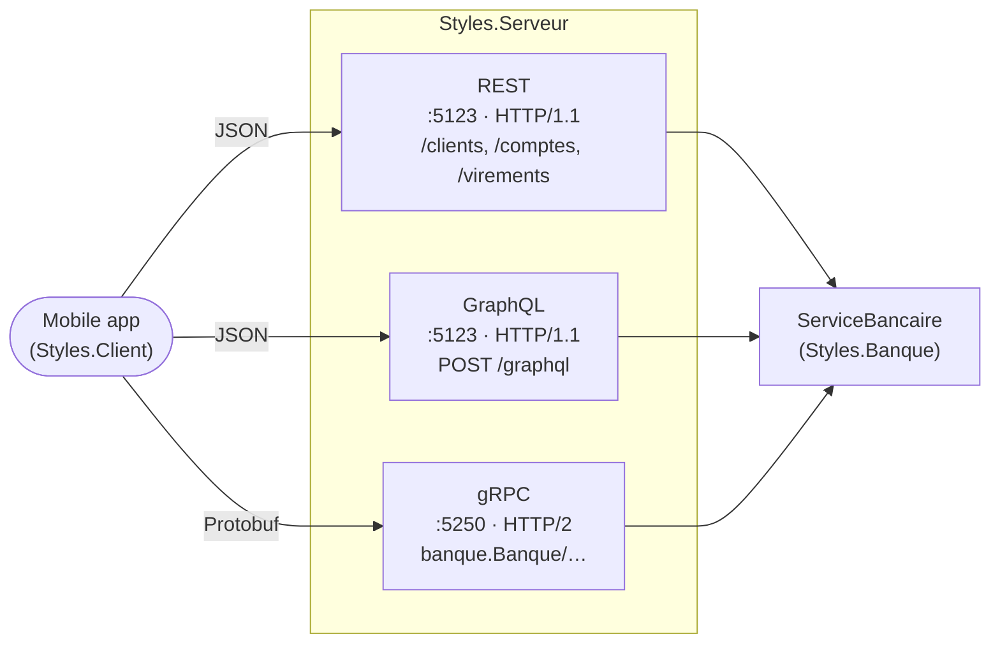
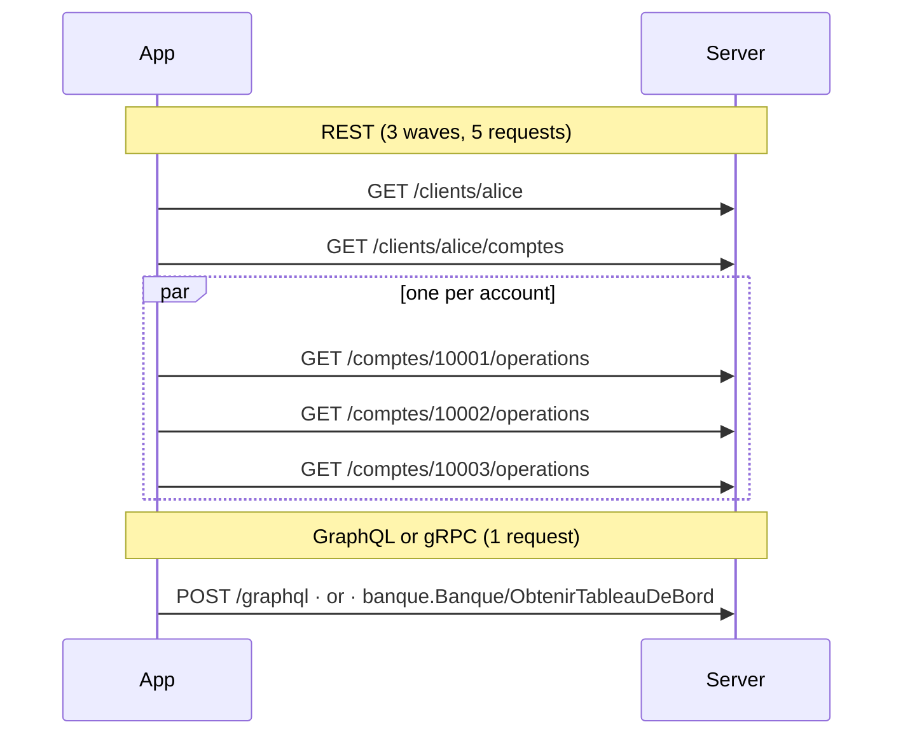

# 23. REST, gRPC, GraphQL (API styles)

> **In one sentence**: the same bank exposed in three ways, as **resources** (REST), as **procedures** (gRPC) and as a
> **graph the client queries** (GraphQL); the business doesn't move, what changes is who decides the shape of the
> responses, what travels over the network, and what HTTP still does for you.

📁 Code: [`23-RestGrpcGraphQL`](../../23-RestGrpcGraphQL) · ⬅️ [Strangler Fig](22-strangler-fig.md) · ➡️ [MVC and MVVM](24-mvc-mvvm.md) ·
🌐 [Français](../23-rest-grpc-graphql.md)

---

## The idea: three presentations of the same business

The other demos change the system's **inside**. This one keeps a simple, single inside, the
[ServiceBancaire](../../23-RestGrpcGraphQL/Styles.Banque/ServiceBancaire.cs), and changes its **surface**: three APIs
in the same process, each a thin translation layer. An architecture test checks that the business knows nothing about
any of the three (`Le_metier_ignore_tout_des_styles_d_API`).



| | **REST** | **gRPC** | **GraphQL** |
|---|---|---|---|
| You manipulate… | **resources** (nouns), with the HTTP verbs | a service's **procedures** (verbs) | a **graph** of types, which you traverse |
| The contract | implicit, or described separately (OpenAPI) | **banque.proto**, from which client and server are generated | the **schema** (SDL), checked on every request |
| Who chooses the response shape | the server, one representation per resource | the server, one message per method | **the client**, field by field |
| Format | JSON (text, field names) | Protobuf (binary, field numbers) | JSON, exactly the requested shape |
| Transport | HTTP, any version | **HTTP/2 required** (trailers) | HTTP, almost always `POST /graphql` |
| Errors | HTTP status + `problem+json` | 17 gRPC statuses, in the trailers | `200` + `errors`, next to the data obtained |
| HTTP cache | **yes** (GET, ETag, 304) | no | no (in practice) |
| The server pushes | no (you poll, or SSE) | native **streams** | subscriptions (WebSocket; not done here) |
| From a browser | yes | no (needs gRPC-Web and a proxy) | yes |
| Evolving | add fields, otherwise `/v2` | field numbers, unknown fields ignored | `@deprecated`, and you know who reads what |

---

## The components

- **The business** ([Styles.Banque](../../23-RestGrpcGraphQL/Styles.Banque)): customers, accounts, operations,
  transfers, and what the three APIs need without being specific to any of them: **single and batched** reads, a
  subscription to new operations, a counter of "database" reads.
- **The tooling** ([Styles.Outillage](../../23-RestGrpcGraphQL/Styles.Outillage)): since the packages aren't in the local
  NuGet cache, what Google.Protobuf, Grpc.AspNetCore and HotChocolate would provide, written by hand and reduced to the
  essentials, but faithful to the wire formats: [Protobuf.cs](../../23-RestGrpcGraphQL/Styles.Outillage/Protobuf/Protobuf.cs)
  (encoding), [Grpc.cs](../../23-RestGrpcGraphQL/Styles.Outillage/Grpc/Grpc.cs) (frames, statuses, deadlines),
  [HoteGrpc.cs](../../23-RestGrpcGraphQL/Styles.Outillage/Grpc/HoteGrpc.cs) and
  [ClientGrpc.cs](../../23-RestGrpcGraphQL/Styles.Outillage/Grpc/ClientGrpc.cs), and a mini GraphQL engine
  ([Analyseur.cs](../../23-RestGrpcGraphQL/Styles.Outillage/GraphQL/Analyseur.cs),
  [Schema.cs](../../23-RestGrpcGraphQL/Styles.Outillage/GraphQL/Schema.cs),
  [Moteur.cs](../../23-RestGrpcGraphQL/Styles.Outillage/GraphQL/Moteur.cs)). Writing these pieces shows what these
  protocols really are: a few hundred lines each.
- **The gRPC contracts** ([banque.proto](../../23-RestGrpcGraphQL/Styles.Contrats/banque.proto) and
  [Messages.cs](../../23-RestGrpcGraphQL/Styles.Contrats/Messages.cs)): without `protoc`, the classes are hand-written
  and a test checks that they match the `.proto` field by field.
- **The server** ([ApiRest.cs](../../23-RestGrpcGraphQL/Styles.Serveur/ApiRest.cs),
  [ApiGrpc.cs](../../23-RestGrpcGraphQL/Styles.Serveur/ApiGrpc.cs),
  [ApiGraphQL.cs](../../23-RestGrpcGraphQL/Styles.Serveur/ApiGraphQL.cs)) and the error table in
  [Traductions.cs](../../23-RestGrpcGraphQL/Styles.Serveur/Traductions.cs).
- **The comparison client** ([ClientsBanque.cs](../../23-RestGrpcGraphQL/Styles.Client/ClientsBanque.cs)): the same
  application written three times, behind an `IClientBanque` interface, with a request and byte counter
  ([Mesure.cs](../../23-RestGrpcGraphQL/Styles.Client/Mesure.cs)). The tests use it too.

Data: **Alice** (`alice`) has three accounts, current account `10001`, Livret A (savings) `10002` and joint account
`10003`; **Bob** (`bob`) a current account `20001`.

---

## 1. The home screen: five requests, one, one

The mobile app shows, for each account, its label, its balance and its three latest operations. **Real run**
(`dotnet run --project Styles.Client`, with 50 ms of simulated latency per request, like a mobile network; output in
French: requests, bytes sent, bytes received):

```text
  REST     5 requête(s), 0 o envoyés, 2014 o reçus, 178 ms
  GraphQL  1 requête(s), 210 o envoyés, 881 o reçus, 60 ms
  gRPC     1 requête(s), 14 o envoyés, 378 o reçus, 62 ms
```

**REST** follows the resources: the customer, their accounts, then the operations of **each** account ("1 + N"). The
last N leave in parallel, but that is three waves of round trips, and one request per account (the code is quoted
exactly as it is):

```csharp
var customer = await http.GetFromJsonAsync<JsonObject>($"/customers/{customerId}");
var accounts = await http.GetFromJsonAsync<JsonArray>($"/customers/{customerId}/accounts");
// 1 + 1 + N: one request per account for its operations (in parallel, but one request each).
```

**GraphQL** sends the description of the screen; the response has exactly its shape:

```graphql
query HomeScreen($id: ID!, $n: Int) {
  customer(id: $id) {
    name
    accounts { number label balance operations(latest: $n) { date label amount } }
  }
}
```

**gRPC** has a procedure tailored to this screen, declared in the contract:

```protobuf
rpc GetDashboard (DashboardRequest) returns (Dashboard);
```



The three resulting screens are **identical** (test `Les_trois_API_donnent_exactement_le_meme_ecran`). REST could have
done better, with a dedicated resource (`/clients/alice/tableau-de-bord`) or an `?expand=operations` parameter: that is
exactly what a [BFF](16-bff.md) does. But then you need one resource per screen, which GraphQL avoids.

---

## 2. What travels

For the same screen, REST receives **2.3 times** more than GraphQL and **5 times** more than gRPC (bodies only; test
`gRPC_transfere_le_moins_d_octets_et_REST_le_plus`).

**REST** returns the full representation of each account, the same for every client. The screen wanted two fields; it
receives ten (over-fetching, test `La_representation_d_un_compte_est_complete_et_la_meme_pour_tous_les_clients`):

```json
{"number":"10001","label":"Current account","type":"current","iban":"FR76 3000 4000 0110 0010 0010 001","balance":1626.05,
 "currency":"EUR","openingDate":"2015-03-02","overdraftLimit":500,"owner":{"id":"alice","name":"Alice Martin"},
 "_links":{"self":"/accounts/10001","operations":"/accounts/10001/operations","owner":"/customers/alice"}}
```

**GraphQL** only returns the requested fields, but in JSON: each field name is repeated in every object. And it is the
one that **sends** the most (210 bytes): the query text leaves with every call. (In production, "persisted queries"
replace that text with an identifier.)

**gRPC** transmits neither names nor text: field numbers and binary integers. The example from the Protobuf
documentation (test `Un_entier_s_encode_en_varint_comme_dans_la_documentation_Protobuf`; field number 1, wire type 0
varint; 150 on 7 bits per byte, least significant first):

```text
champ 1 = 150   →   08 96 01
                    08    = numéro de champ 1, type filaire 0 (varint)
                    96 01 = 150, sur 7 bits par octet, poids faibles d'abord
```

Two consequences visible in the contract: a default value (0, empty string) **doesn't travel at all**; and there is
**no decimal type**, hence amounts in cents:

```protobuf
// No decimal type in Protobuf: amounts travel in cents, on integers.
message Account {
  string number = 1;
  string label = 2;
  AccountType type = 3;
  int64 balance_cents = 4;
  repeated Operation latest_operations = 5;
}
```

GraphQL has no decimal either: `Float` is a double (`"Float" => JsonValue.Create(Convert.ToDouble(valeur))`). For money,
you usually define a custom scalar. And each format has its own precision for dates: the real run showed a GraphQL
screen different from the other two, because the schema dated to the second while REST kept the fractions. The business
therefore now dates its operations to the second:

```csharp
now = now.AddTicks(-(now.Ticks % TimeSpan.TicksPerSecond));
```

---

## 3. N+1: moved, not removed

A single GraphQL query can hide **N** database reads: if the `operations` field is resolved account by account,
`client { comptes { operations } }` reads the database once per account, and
`client { comptes { titulaire { comptes { operations } } } }` nine times. The client sees only one round trip; the
database sees everything.

The engine therefore executes the query **level by level**: a field is resolved for all the objects of a level at once.
A **batched** resolver (the "DataLoader" of GraphQL engines) receives all the accounts and makes a single read:

```csharp
.BatchedField("operations", "[Operation!]!", (accounts, a) =>
{
    var byAccount = bank.LatestOperations(accounts.Select(c => c.Number).ToList(), a.GetOrDefault<int?>("latest") ?? 10);
    return accounts.Select(c => (object?)byAccount[c.Number]).ToList();
}, new Arg("latest", "Int", 10))
```

| For Alice's screen | REST | GraphQL | gRPC |
|---|---|---|---|
| HTTP requests | 5 | 1 | 1 |
| Database reads of the operations | **3** | **1** | **1** |

REST makes as many reads as requests: the N+1 is **visible** (in the access logs, in the latency). In GraphQL it is
**invisible** and depends on each resolver. gRPC, with its method built for the screen, settles it once and for all on
the server side. Tests `Derriere_la_requete_unique_de_GraphQL_la_base_n_est_lue_qu_une_fois` and
`Les_operations_de_tous_les_comptes_d_un_niveau_sont_lues_en_une_seule_fois` (9 accounts, one read).

---

## 4. One error, three languages

A transfer refused for insufficient balance, **real run** (the message, in French: "insufficient balance: €1,160.01
available (authorized overdraft: €300.00)"):

```text
  REST     422 SOLDE_INSUFFISANT  « Solde insuffisant : 1160,01 € disponibles (découvert autorisé : 300,00 €). »
  GraphQL  SOLDE_INSUFFISANT      « Solde insuffisant : 1160,01 € disponibles (découvert autorisé : 300,00 €). »
  gRPC     FailedPrecondition     « Solde insuffisant : 1160,01 € disponibles (découvert autorisé : 300,00 €). »
```

The translation is written once, in [Traductions.cs](../../23-RestGrpcGraphQL/Styles.Serveur/Traductions.cs):

| Business error | REST | gRPC | GraphQL (`extensions.code`) |
|---|---|---|---|
| Unknown customer, account or transfer | `404 Not Found` | `NotFound` (5) | `COMPTE_INCONNU`… |
| Invalid amount, same account, invalid parameter | `400 Bad Request` | `InvalidArgument` (3) | `MONTANT_INVALIDE`… |
| Insufficient balance | `422 Unprocessable Entity` | `FailedPrecondition` (9) | `SOLDE_INSUFFISANT` |

- **REST**: the status gives the category, understood by every tool (caches, logs, alerts on 5xx); the
  `application/problem+json` body (RFC 9457) carries the details.
- **gRPC**: the HTTP response is **always 200**. The real status arrives at the end, in the HTTP/2 **trailers**
  (`grpc-status`, `grpc-message`), after the last message: that is why gRPC requires HTTP/2. The server refuses a call
  without trailers (`426`). The 17 statuses are categories, not business codes: to tell two `FailedPrecondition` apart,
  you need rich details (`google.rpc.Status`, not done here).
- **GraphQL**: `200` too, and the error in `errors`, with the **path** of the faulty field. The other fields are served
  (test `Une_erreur_sur_un_champ_n_empeche_pas_d_obtenir_les_autres`):

```json
{"data":{"a":{"label":"Current account"},"b":null},
 "errors":[{"message":"Unknown account \"99999\".","locations":[{"line":1,"column":41}],"path":["b"],"extensions":{"code":"UNKNOWN_ACCOUNT"}}]}
```

When the field in error is **non-null** (`!`), it cannot be `null`: its parent becomes `null`, and so on up to the first
field that accepts it. With `operations(derniers: 51)` (refused), the account, the list of accounts and finally `client`
are `null`, with one error per account (test `Un_champ_non_nul_en_erreur_rend_nul_le_premier_parent_nullable`).
Designing a schema also means choosing where these errors stop. Finally, an unexpected exception must disclose nothing:
`"Erreur interne."` (internal error), with no details (test `Une_erreur_inattendue_ne_divulgue_rien_au_client`).

---

## 5. Push rather than poll

**gRPC** can make the server answer several times: `SuivreOperations` keeps the HTTP/2 response open and writes each new
operation into it, one frame at a time.

```csharp
await foreach (var operation in operations.ReadAllAsync(cancellation))
    await write(Message(operation));
```

The client sets a **deadline** (`grpc-timeout` header); the server enforces it too, and stops the work: the stream ends
with `DeadlineExceeded` and the subscription is released (test `L_echeance_du_client_arrete_aussi_le_travail_cote_serveur`).
A client that leaves also frees the server (test `Un_client_qui_abandonne_libere_le_serveur`). **Real run** (server
stream, 1 request open for 2 s; three savings deposits arrive, made through each API; end of stream):

```text
  gRPC (flux serveur, 1 requête ouverte 2 s) :
      Épargne via REST de 10002 (10,00 €)
      Épargne via GraphQL de 10002 (10,00 €)
      Épargne via gRPC de 10002 (10,00 €)
      fin du flux : DeadlineExceeded
```

**REST** has no streams: you poll. But HTTP makes polling cheap: each account has an **ETag** that changes with every
operation; the client sends back the one it has (`If-None-Match`) and receives `304 Not Modified`, without a body, as
long as nothing has moved (test `L_ETag_evite_de_retransferer_un_compte_qui_n_a_pas_change`):

```text
  REST (interrogation avec ETag, 5 fois) : 1 × 200, 4 × 304 Not Modified — 5 requête(s), 0 o envoyés, 341 o reçus
```

That is REST's great asset, missing from the other two: GET is **safe and idempotent**, so everything between the client
and the server (browser, proxy, CDN) can cache. GraphQL sends everything through `POST /graphql` and loses that cache;
gRPC too. (To push, REST has *Server-Sent Events* or WebSockets; GraphQL, subscriptions over WebSocket: neither is done
here.)

---

## 6. Evolving the contract

All three styles let you add a field without breaking clients, each in its own way.

- **gRPC**: only the field **number** travels. You can rename a field; never change or reuse its number. An old client
  **skips** the fields it doesn't know, a new client reads default values in an old message (tests
  `Un_ancien_client_ignore_les_champs_ajoutes_depuis`,
  `Un_nouveau_client_lit_un_ancien_message_avec_les_valeurs_par_defaut`). Hence the value 0 of each enum, reserved for
  "unknown" (`TYPE_COMPTE_INCONNU = 0`).
- **GraphQL**: the client only receives what it asks for, so adding is always safe. Removing is prepared: the
  `soldeTexte` field (the pre-formatted balance, from the first version) is **deprecated** in the published schema, and
  the server **counts who still asks for it** (`GET /graphql/utilisation`); it is removed the day the counter stops
  moving. No other style knows so precisely what its clients read.

```graphql
balanceText: String! @deprecated(reason: "Use 'balance' (a number) and format it for display.")
```

- **REST**: adding a JSON field is safe if clients ignore those they don't know (System.Text.Json's default behavior);
  for an incompatible change, you publish a new version (`/v2/comptes`, or a header), and keep both alive.

Without `protoc`, a trap lies in wait: classes that drift from the `.proto`. The test
`Chaque_message_du_proto_correspond_a_sa_classe_champ_par_champ` compares the name, number and type of each field, and
`Le_serveur_sert_chaque_methode_du_service_et_rien_d_autre` the methods.

---

## 7. Protecting yourself from an overly curious client

In REST and gRPC, the server knows what each call costs: it wrote them. In GraphQL, **the client writes the query**:
`client { comptes { titulaire { comptes { titulaire { … } } } } }` can make the server work endlessly. The engine
therefore **validates** the whole query against the schema **before** executing anything (unknown fields and
arguments, required arguments, variable types, with their line and column), and refuses beyond 6 levels (tests
`Une_requete_trop_profonde_est_refusee_avant_d_etre_executee`,
`Un_champ_ou_un_argument_inconnu_est_refuse_par_la_validation_avec_sa_position`). In production you add a **maximum
cost** per query, limits on list sizes (here `derniers` ≤ 50), and often an allowlist of known queries.

---

## The tests

49 tests ([Styles.Tests](../../23-RestGrpcGraphQL/Styles.Tests)): the three clients and the server in memory (the test
server handles HTTP/2 and trailers: gRPC works too), the GraphQL engine called directly, the Protobuf encoder alone.

| Test | What is checked |
|---|---|
| `Les_trois_API_donnent_exactement_le_meme_ecran`, `Un_virement_reussit_de_la_meme_facon_par_les_trois_API` | same business, same results |
| `REST_fait_une_requete_par_compte_GraphQL_et_gRPC_une_seule_en_tout`, `gRPC_transfere_le_moins_d_octets_et_REST_le_plus` | network costs |
| `Derriere_la_requete_unique_de_GraphQL_la_base_n_est_lue_qu_une_fois` | N+1 in the database |
| `La_meme_erreur_metier_dans_la_langue_de_chaque_API` (3 cases) | error translations |
| `Un_entier_s_encode_en_varint_comme_dans_la_documentation_Protobuf`, `Une_chaine_est_precedee_de_sa_longueur`, `Les_valeurs_par_defaut_ne_circulent_pas`, `Le_zigzag_garde_les_petits_negatifs_courts`… | Protobuf encoding, byte by byte |
| `Un_ancien_client_ignore_les_champs_ajoutes_depuis`, `Un_nouveau_client_lit_un_ancien_message_avec_les_valeurs_par_defaut` | gRPC contract evolution |
| `Chaque_message_du_proto_correspond_a_sa_classe_champ_par_champ`, `L_enumeration_du_proto_correspond_a_celle_du_code`, `Le_serveur_sert_chaque_methode_du_service_et_rien_d_autre` | the `.proto` stays the source of truth |
| `Un_appel_unaire_est_un_POST_dont_le_corps_est_un_message_encadre_et_le_statut_dans_les_trailers`, `Une_erreur_metier_repond_quand_meme_200_avec_le_statut_gRPC_dans_les_trailers` | the gRPC wire format, seen "by hand" |
| `Le_flux_pousse_chaque_operation_des_qu_elle_a_lieu`, `L_echeance_du_client_arrete_aussi_le_travail_cote_serveur`, `Un_client_qui_abandonne_libere_le_serveur` | streams, deadlines, cancellation |
| `Le_client_obtient_exactement_les_champs_demandes_et_rien_d_autre`, `Des_alias_permettent_de_demander_deux_fois_le_meme_champ`, `Les_variables_sont_verifiees_selon_leur_type`, `Une_mutation_s_execute_et_rend_ce_que_le_client_demande` | GraphQL |
| `Une_erreur_sur_un_champ_n_empeche_pas_d_obtenir_les_autres`, `Un_champ_non_nul_en_erreur_rend_nul_le_premier_parent_nullable`, `Une_erreur_inattendue_ne_divulgue_rien_au_client` | partial responses, `null` propagation |
| `Le_schema_publie_signale_les_champs_deprecies_et_le_serveur_sait_qui_les_utilise` | deprecation and usage statistics |
| `Les_erreurs_sont_des_statuts_HTTP_avec_un_corps_problem_json` (4 cases), `Un_virement_cree_une_ressource_201_dont_l_adresse_est_dans_Location`, `L_ETag_evite_de_retransferer_un_compte_qui_n_a_pas_change` | REST |
| `Le_metier_ignore_tout_des_styles_d_API`, `L_outillage_ignore_la_banque_et_les_contrats_ignorent_le_metier` | **architecture tests** |

Checked by mutation (25 attempts, all detected): default values transmitted, unknown field refused, missing zigzag, a
field skip that reads the old position; a gRPC error returned as a success, deadline ignored, content type not checked,
trailers ignored by the client, a gRPC method reading account by account; a subscription never released, dates not
rounded; an unbatched GraphQL resolver, no depth limit, unknown field accepted, an error not absorbed by a nullable
field, null not propagated, internal error disclosed, an unused or wrongly typed variable accepted, missing usage
statistics; ETag ignored, 200 instead of 201; falsified error translations; a field number changed in a class without
touching the `.proto`.

Two of these guarantees come from real failures while writing the demo: skipping unknown fields
(`position += LireVarint(octets, ref position)` reads the old value of `position` **before** the call, and skips to the
wrong place: found by `Un_ancien_client_ignore_les_champs_ajoutes_depuis`) and rounding dates (found in the real run,
section 2).

---

## Summary

| | 👍 Strengths | 👎 Limits |
|---|---|---|
| **REST** | Simple, universal, readable with `curl`; **the HTTP cache**; statuses understood by every tool | One shape per resource: too much data, or too many round trips; no streams; contract often implicit |
| **gRPC** | **Compact and fast**; strict, generated contract; streams both ways; propagated deadlines | HTTP/2 required, no browser without a proxy; binary unreadable without tooling; no HTTP cache |
| **GraphQL** | **The client chooses**: one round trip per screen, nothing superfluous; typed, introspectable schema; you know who reads what | Hidden N+1, costly queries to bound, HTTP cache lost, `200` for everything; an engine to operate |

**When to choose what**: **REST** for a public or partner API, simple resources, when caching matters; **gRPC** between
internal services (microservices, [demo 8](08-microservices.md)), for throughput, latency, streams and strict contracts
between teams; **GraphQL** in front of many varied clients with rich screens (mobile, web), often as an aggregation layer
on top of REST or gRPC services, where you would otherwise write one [BFF](16-bff.md) per application. The three often
coexist: gRPC between services, GraphQL or REST to the outside. In production: **ASP.NET Core** (Minimal API) and
**OpenAPI** for REST; **Grpc.AspNetCore**, **Grpc.Net.Client** and **Grpc.Tools** (`protoc`) for gRPC, with **gRPC-Web**
or JSON transcoding for browsers; **HotChocolate** or **GraphQL.NET** for GraphQL, with their DataLoaders, cost analysis
and persisted queries.
