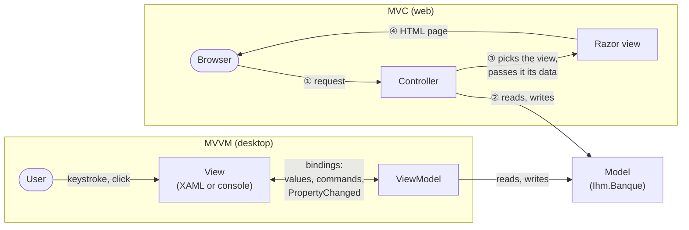
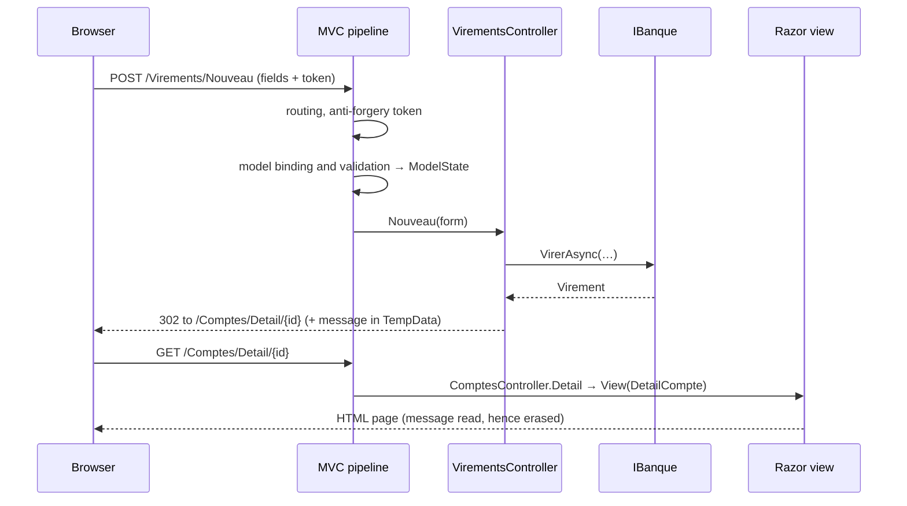
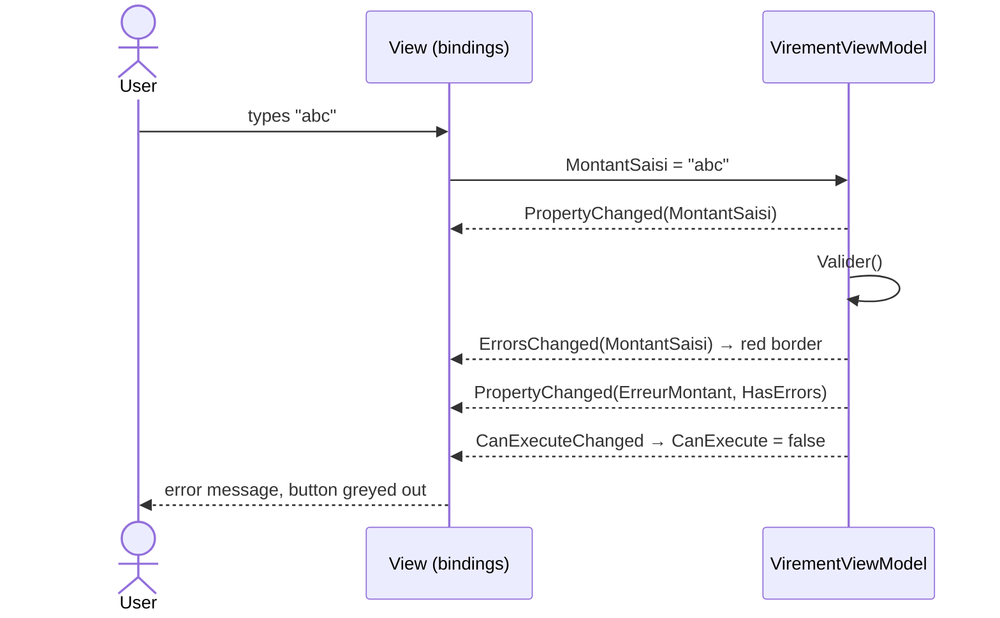

# 24. MVC and MVVM (presentation patterns)

> **In one sentence**: the same banking screen built twice, in **MVC** on the web (a controller receives each request,
> picks a view, which produces a page and then disappears) and in **MVVM** on the desktop (a ViewModel keeps the
> screen's state and commands, the view binds to it and follows each of its changes); the model doesn't move, what
> changes is **who receives the user's action, and how long the screen lives**.

📁 Code: [`24-MvcMvvm`](../../24-MvcMvvm) · ⬅️ [REST, gRPC, GraphQL](23-rest-grpc-graphql.md) · ➡️ [Cross-cutting concepts](concepts-transverses.md) ·
🌐 [Français](../24-mvc-mvvm.md)

---

## The idea: organizing what lies between the model and the user

The other demos organize the system, or its API. This one looks at the last mile: **the interface**. MVC and MVVM say
nothing about the model's inside (which can be hexagonal, layered, microservices…). They answer another question: how to
separate what you **display** from what you **decide**, so that one can be tested without the other. (In the code:
*Ihm* = UI, *Vue* = view, *Contrôleur* = controller.)

The model is shared ([Ihm.Banque](../../24-MvcMvvm/Ihm.Banque)): accounts, operations, transfers and their rules, behind
an asynchronous `IBanque` interface, like a real remote service. A test checks that it knows nothing about screens
(`Le_modele_ignore_les_ecrans`).



| | **MVC** (here: ASP.NET Core MVC) | **MVVM** (here: WPF, and a console) |
|---|---|---|
| Who receives the user's action | the **controller** (a route, an action) | the **view**, which passes it on through a binding or a command |
| Who knows whom | the controller picks the view (by name) | the view knows the ViewModel; the ViewModel **ignores** the view |
| Screen lifetime | **one request**: built, rendered, discarded | **as long as the window is open**: the state stays in memory |
| How the view is updated | you make another request, you get a new page | **automatically**, on every PropertyChanged |
| Validation | after the form is submitted (ModelState) | **while typing**, on every keystroke |
| What you test without a screen | the controller's decision (which view, which data) | **all of the screen's behavior** |
| Indispensable mechanism | routing, model binding, view engine | data binding engine |

---

## The projects

```
Ihm.Banque        the MODEL, shared: IBanque (asynchronous), BanqueEnMemoire (adjustable latency), transfer rules
Ihm.Mvc           :5124  web MVC: Controllers/ (one action per page), Views/ (Razor), Models/ (view data)
Ihm.Presentation  MVVM: the ViewModels, in pure .NET (no WPF, checked by a test) + ObservableObject, commands
Ihm.Wpf           the WPF view: MainWindow.xaml, only bindings; code-behind reduced to InitializeComponent
Ihm.Console       a second view on the same ViewModels, and Liaison.cs: a {Binding} taken apart in 20 lines
Ihm.Tests         51 tests: model, controllers, full site, ViewModels, console view, XAML bindings
```

```powershell
dotnet run --project 24-MvcMvvm\Ihm.Mvc        # puis http://localhost:5124
dotnet run --project 24-MvcMvvm\Ihm.Wpf        # la fenêtre (Windows) ; 400 ms par appel à la banque
dotnet run --project 24-MvcMvvm\Ihm.Console    # la même chose au clavier (« aide »)
```

(Then `http://localhost:5124`; the window (Windows), with 400 ms per call to the bank; the same thing from the keyboard,
type `aide` for help.)

Data: **Alice** has a current account `11111111-…` (€1,000) and a Livret A `44444444-…` (€8,000), **Bob** a current
account `22222222-…` (€500). Above €1,000, both interfaces ask for a confirmation.

The vocabulary trap: ASP.NET Core often calls "view models" the classes the controller passes to the view
([Models/Modeles.cs](../../24-MvcMvvm/Ihm.Mvc/Models/Modeles.cs)). They are **not** ViewModels in the MVVM sense: just
data bags, prepared for one rendering then discarded, with no state and no commands.

---

## 1. MVC: the path of a request

Each click is an HTTP request, which goes along the same path:



The controller doesn't produce HTML and the view doesn't read the bank: one **decides**, the other **formats**
([ComptesController.cs](../../24-MvcMvvm/Ihm.Mvc/Controllers/ComptesController.cs),
[Index.cshtml](../../24-MvcMvvm/Ihm.Mvc/Views/Comptes/Index.cshtml)). The view is designated by convention
(`Views/{controller}/{action}.cshtml`) or by name. That is what you test by calling the controller as a plain method
(`La_liste_choisit_sa_vue_et_lui_passe_des_donnees_pretes_a_afficher`): the result is a **decision** (`ViewResult`,
`RedirectToActionResult`, `NotFoundResult`), not HTML.

Between two requests, the server keeps **nothing** of the screen. Everything needed for the next one travels in the
request: the identifier in the URL, the form fields, the token, and a cookie for TempData.

---

## 2. The form in MVC: redisplay or redirect

[VirementsController.cs](../../24-MvcMvvm/Ihm.Mvc/Controllers/VirementsController.cs) follows the classic web pattern.
When the action runs, model binding has already filled the form and recorded in `ModelState` everything that's wrong:
missing field (`[Required]`), "abc" instead of a number, cross-field rules (`IValidatableObject`, the same as the
bank's). If there is an error, **the same view is shown again** (200), with the messages and what the user had typed
(the code is quoted exactly as it is, French comments and messages included):

```csharp
        if (!ModelState.IsValid)
            return await Reafficher(formulaire, annulation);
```

If there is none, the transfer is made, then the controller **redirects** ("Post/Redirect/Get"): the landing page is
reached with a GET, which can be refreshed without redoing the transfer. The success message survives the redirect in
**TempData** (a cookie), which is erased as soon as it is read — it shows only once:

```csharp
            var virement = await banque.VirerAsync(source, cible, montant, annulation);
            // TempData survit à UNE redirection (cookie), puis disparaît : le message s'affiche une seule fois.
            TempData["Message"] = $"Virement de {Format.Euros(virement.Montant)} effectué. Nouveau solde : {Format.Euros(virement.SoldeSource)}.";
            return RedirectToAction(nameof(ComptesController.Detail), "Comptes", new { id = source });
```

A refusal from the bank (insufficient balance) becomes a form error, without a field, shown at the top
(`ModelState.AddModelError(string.Empty, …)`). And every POST must carry the **anti-forgery token** that the `<form>`
tag helper adds by itself: without it, `400` (global `AutoValidateAntiforgeryTokenAttribute` filter).

**The confirmation for large amounts** is **another view** for the same action. Since the server kept nothing, the
[Confirmer.cshtml](../../24-MvcMvvm/Ihm.Mvc/Views/Virements/Confirmer.cshtml) page sends back every field, hidden, plus
`Confirme=true`:

```csharp
        if (montant >= ReglesVirement.SeuilConfirmation && !formulaire.Confirme)
        {
            await ChargerComptes(formulaire, annulation);
            return View("Confirmer", formulaire);
        }
```

**Real run**: €1,200 from Alice's account (€1,000). The site first shows the confirmation page, then, once confirmed,
the bank's refusal. The controller doesn't know the balance before calling the bank; checking it earlier would take one
more read. The ViewModel, on the other hand, has the balances in memory and refuses as you type (section 4). Then
€250.50: redirect, message, new balance €749.50; F5: no second transfer, no message.

---

## 3. MVVM: the view observes the ViewModel

In MVVM, the screen is **an object that lives**: the ViewModel ([Ihm.Presentation](../../24-MvcMvvm/Ihm.Presentation)).
It contains the state (displayed accounts, selected account, typed text, errors, message, "busy") and the commands
(Transfer, Swap). It doesn't know the view: it **notifies** when a property changes, through `INotifyPropertyChanged`
([Outillage.cs](../../24-MvcMvvm/Ihm.Presentation/Outillage.cs)):

```csharp
    protected bool Definir<T>(ref T champ, T valeur, [CallerMemberName] string? propriete = null)
    {
        if (EqualityComparer<T>.Default.Equals(champ, valeur))
            return false;
        champ = valeur;
        Signaler(propriete!);
        return true;
    }
```

The WPF view ([MainWindow.xaml](../../24-MvcMvvm/Ihm.Wpf/MainWindow.xaml)) contains **only bindings**. Each one reads a
property and subscribes to its changes; in the other direction, a keystroke or a selection writes into the ViewModel;
`Command` connects a button to a command, whose `CanExecute` greys out or enables the button:

```xml
                <TextBox Text="{Binding MontantSaisi, UpdateSourceTrigger=PropertyChanged}" Margin="0,4,0,2" Padding="2" />
                <TextBlock Text="{Binding ErreurMontant}" Foreground="#B42318" TextWrapping="Wrap" />

                <Button Content="Virer" Command="{Binding VirerCommande}" Padding="16,6" Margin="0,12,0,8" HorizontalAlignment="Left" />
```



The window's code-behind is reduced to `InitializeComponent`, and the XAML contains no event handler
(`La_vue_WPF_ne_contient_pas_de_code`). The wiring (bank, ViewModel, window) is done once, in
[App.xaml.cs](../../24-MvcMvvm/Ihm.Wpf/App.xaml.cs). The ViewModels have no reference to WPF
(`Les_ViewModels_ignorent_WPF_et_le_web`): `INotifyPropertyChanged`, `INotifyDataErrorInfo`, `ICommand` and
`ObservableCollection` are part of .NET itself. `ObservableObject`, `Commande` and `CommandeAsync` are what
CommunityToolkit.Mvvm or Prism would bring, written by hand: a hundred lines or so, no magic.

---

## 4. Validating while typing

[VirementViewModel.cs](../../24-MvcMvvm/Ihm.Presentation/VirementViewModel.cs) rechecks everything on every change:
readable amount ("250", "250,5", "250.50", "1 000 €"), positive, to the cent, below the source balance, different
accounts. The rules are the bank's (`ReglesVirement`, public for that purpose); the bank applies them again, and it is
the authority. Errors are exposed twice: as text (`ErreurMontant`, `ErreurCible`, which a console can display) and
through `INotifyDataErrorInfo` (WPF's red border).

A few details that make the difference, each covered by a test:
- what was typed stays displayed, even "abc": the bound property is the **text**, the amount is derived from it;
- an identical error isn't re-notified, and neither is an identical value (`Chaque_frappe_est_verifiee_et_la_vue_en_est_prevenue`):
  WPF often rewrites the displayed value, and each useless notification redraws the screen;
- the **source balance is tracked**: if it changes elsewhere (another window, another device, then a refresh), the
  "insufficient balance" error appears or disappears on its own; when the source changes, the old one is no longer
  tracked, otherwise leaks and ghost errors (`Le_solde_de_la_source_est_suivi_meme_quand_il_change_ailleurs`);
- after a transfer, the balances are updated **in place** (the same `CompteViewModel` object): the selection in the
  list and in the drop-down lists doesn't jump.

---

## 5. Asynchrony: waiting, ignoring the double click, discarding stale responses

An MVC page only exists once the response is ready. An MVVM screen, on the other hand, is **displayed during** the
calls: you have to show that you're waiting, prevent redoing, and beware of responses arriving out of order. With the
real window (400 ms per call), you can see the button grey out and the activity bar scroll.

**The double click**: `CommandeAsync` disables itself while running; a second click on the greyed-out button does
nothing (`Pendant_le_virement_l_ecran_attend_et_un_double_clic_ne_vire_pas_deux_fois`, which holds the call to the
bank back long enough to click again).

**Stale responses**: click Bob, then immediately the Livret; if the response for Bob arrives after the Livret's, the
screen would show Bob's operations under the Livret's title. Each load has a number, only the last one's response is
kept ([ComptesViewModel.cs](../../24-MvcMvvm/Ihm.Presentation/ComptesViewModel.cs)):

```csharp
        var demande = ++_derniereDemande;
```
```csharp
            var operations = await banque.OperationsAsync(compte.Id);
            if (demande != _derniereDemande)
                return;
```

The test makes the responses arrive in the wrong order, without `Thread.Sleep`: the test bank "holds" a call until it
is released (`Une_reponse_qui_arrive_trop_tard_n_ecrase_pas_la_selection_suivante`). It also checks that the stale
response doesn't turn off the indicator of the load still in progress.

---

## 6. Asking a question without knowing the screen

Above €1,000, a confirmation is needed. A ViewModel that called `MessageBox.Show` would no longer be testable (a modal
window would block the test) or reusable (no dialog box in a console). It therefore asks an interface, `IConfirmation`,
which each view implements its own way: a dialog box in WPF, a line read from the keyboard in the console, a scripted
answer in the tests.

```csharp
        if (montant >= ReglesVirement.SeuilConfirmation
            && !await _confirmation.DemanderAsync($"Virer {Format.Euros(montant)} de {source.Affichage} vers {cible.Affichage} ?"))
        {
            Informer("Virement annulé.", erreur: false);
            return;
        }
```

This is the fundamental difference with MVC: there, the confirmation is **one more request and one more view**, and the
state makes the round trip in hidden fields; here, it is **an awaited call in the middle of a method**, and the state
hasn't moved.

---

## 7. A second view on the same ViewModels

[Ihm.Console](../../24-MvcMvvm/Ihm.Console) plugs a console into the **same** ViewModels, without changing a line of
them. Its bindings are done by hand by [Liaison.cs](../../24-MvcMvvm/Ihm.Console/Liaison.cs), which does what a WPF
`{Binding}` does without the machinery: read the property, subscribe to `PropertyChanged`, copy on every change (an
empty name means "everything may have changed").

```csharp
    private void Changement(object? emetteur, PropertyChangedEventArgs e)
    {
        // Un nom vide signifie « tout a pu changer ».
        if (string.IsNullOrEmpty(e.PropertyName) || e.PropertyName == _propriete.Name)
            Pousser();
    }
```

The `⚠`, `»` and `[Virer]` lines appear on their own, pushed by the ViewModel when it changes (the session is in French:
choose two different accounts, enter an amount, insufficient balance, the Transfer button greyed out then enabled,
transfer in progress, done):

```text
> de 1
> vers 1
  ⚠ comptes Choisissez deux comptes différents.
> vers 3
> montant abc
  ⚠ montant Saisissez un montant, par exemple 250,50.
> montant 2000
  ⚠ montant Solde insuffisant : 1 000,00 € disponibles.
> virer
  (le bouton Virer est grisé)
…
> montant 250,5
  [Virer] actif
> virer
  [Virer] grisé
  » Virement en cours…
  » Virement de 250,50 € effectué. Nouveau solde : 749,50 €.
```

(Real run, `dotnet run --project 24-MvcMvvm\Ihm.Console`.) The test
`La_console_pilote_les_memes_ViewModels_que_la_fenetre_WPF` plays a keyboard session, refused confirmation included.

---

## 8. Bindings are not checked by the compiler

`{Binding MontantSaisie}` (with a typo) compiles, and the window opens: the field stays empty, and the error goes to the
debugger's output window. It is MVVM's classic weakness in WPF (MAUI, Avalonia and UWP have **compiled** bindings,
`x:DataType` / `x:Bind`, which fix it).

The demo makes up for it with a test that reads the XAML: the design-time hints (`d:DataContext`, and `DataType` on item
templates) say which ViewModel is bound where, and the checker
([ArchitectureTests.cs](../../24-MvcMvvm/Ihm.Tests/ArchitectureTests.cs)) follows every binding path. It also checks
that these hints tell the truth: a `DataContext="{Binding Virement}"` announced as `ComptesViewModel`, a list of accounts
displayed with a template meant for operations, a misspelled `DisplayMemberPath`
(`Le_verificateur_trouve_les_fautes_de_frappe_que_WPF_laisserait_passer`). On the real window, 30 bindings are checked.

---

## MVC, MVP, MVVM… and the others

All of them separate the **model** from its **presentation**; they differ in the object in the middle and the
direction of the arrows.

- **MVC** (Smalltalk, 1979): originally, the view observed the model and the controller handled the keyboard and
  mouse. On the web (Rails, ASP.NET MVC, Spring MVC), it became this demo's request → controller → view cycle.
- **MVP** (Model-View-Presenter): the presenter drives a **passive** view through an interface
  (`IVueVirement.AfficherErreur(…)`). Testable too, but the presenter pushes every change by hand, for lack of a binding
  engine. Common in Windows Forms and on Android before its binding tools.
- **MVVM** (WPF, 2005): the presenter becomes a model of the view, and the binding engine does the synchronization
  work. WPF, MAUI, Avalonia, WinUI; on the web, Knockout, and Vue or Angular components take up the idea.
- **MVU / unidirectional flow** (Elm, Redux, and React or Blazor components): the state is immutable, each action
  produces a new state, and the view is recomputed. A separate path, which replaces two-way bindings with a single
  direction.

---

## The tests

51 tests, without a screen or `Thread.Sleep` ([Ihm.Tests](../../24-MvcMvvm/Ihm.Tests)):
- **the model** (6): the transfer rules, which both interfaces display but only the bank enforces;
- **the MVC controllers** called like methods (6): the decision (view picked, data, redirect, error added to
  `ModelState`); binding and validation don't happen here;
- **the full site**, in memory (`WebApplicationFactory`, 9): you play the browser, read the HTML, send the form back
  with its token; Post/Redirect/Get, message read only once, input kept after an error, confirmation page that sends
  everything back;
- **the ViewModels** (21): every expected notification, the button following the input, validation, the tracked
  balance, waiting, the double click, stale responses, confirmation, with a "remote-controlled" bank that holds a call
  until it is released;
- **the console view and the binding** (3), **architecture and XAML bindings** (6).

**Mutation testing**: 25 guarantees broken one by one (stale response displayed, indicator turned off by it, old source
still tracked, new source not tracked, double click, notifications without a change, accounts replaced instead of
updated, amount not cleared, no confirmation, errors re-notified, balance not checked while typing, button not
re-evaluated, the bank's refusal not handled, no refresh after a transfer; on the MVC side: token, redirect,
confirmation page, `ModelState` ignored, cross-field rule, refusal not translated, message not shown; balance not checked
by the bank; a console binding that doesn't filter; a typo in the XAML; a `Click` handler in the view): each makes at
least one test fail. Three initially made nothing fail and strengthened the tests: the old source still being tracked
changes no property, only the button (the test now also counts `CanExecuteChanged`); no test reassigned the same value;
and the controller test sent an empty form, rejected anyway: it now sends a complete form, with an error recorded by the
pipeline.

---

## Summary

| | 👍 Strengths | 👎 Limits |
|---|---|---|
| **MVC** (web) | Simple and stateless on the server: each request is independent, easy to cache and distribute; works everywhere, even without JavaScript; the controller is tested in one line | The screen only reacts on submit: no validation while typing without JavaScript; each step (confirmation) is one more page, the state travels in hidden fields; a view can only be tested by reading HTML |
| **MVVM** | **The whole screen is tested without a screen**; immediate reaction (validation, button, indicator); several views on the same ViewModels; the view can be handed to a designer | A binding engine is indispensable; bindings not checked by the compiler in WPF; ceremony (notifications, commands); the state lives long: subscription leaks, out-of-order responses, the UI thread |

**When to choose what**: the platform often decides. **MVC** for a server-rendered site (ASP.NET Core MVC or Razor
Pages, its "one page, one model" variant), when simplicity, SEO and holding up under load matter more than reactivity.
**MVVM** as soon as an interface lives long and reacts continuously: desktop (WPF, WinUI, Avalonia) and mobile (MAUI)
applications, with CommunityToolkit.Mvvm or Prism in production. On the web, rich applications took a third path,
**components** (Blazor, React, Angular, Vue), which borrow MVVM's view-bound state, or the **unidirectional flow**'s
immutable state. And in every case, the model stays behind, organized according to any of the other demos: MVC and MVVM
are only the **presentation layer** of [demo 0](00-couches.md), finally split in turn.
