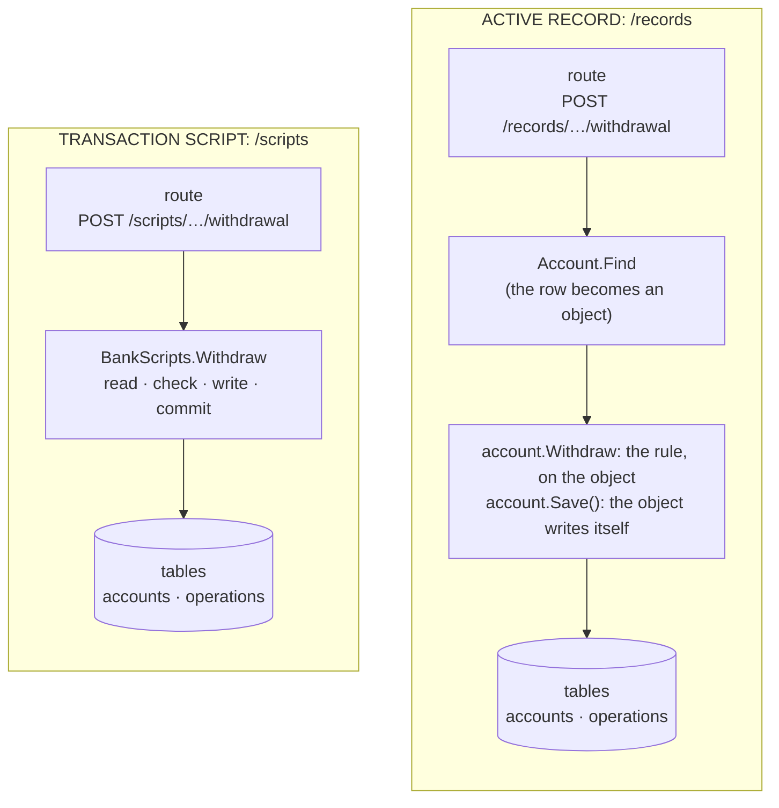
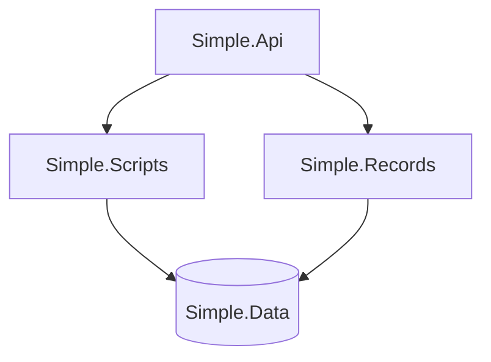

# 25. Transaction Script and Active Record (the starting point)

> **In one sentence**: the two most direct ways to write the business, without any architecture: **one procedure per
> use case**, which reads and writes the database rows itself (**Transaction Script**), or **one object per table
> row**, which carries its rules and saves itself (**Active Record**). Almost every application starts there, and the
> other demos were built against their limits.

📁 Code: [`25-TransactionScriptActiveRecord`](../../25-TransactionScriptActiveRecord) · ⬅️ [MVC and MVVM](24-mvc-mvvm.md) · ➡️ [Cross-cutting concepts](concepts-transverses.md) · 🌐 [Français](../25-transaction-script-active-record.md)

---

## The idea: writing the business with nothing between it and the database

Both names come from **Martin Fowler**'s book, *Patterns of Enterprise Application Architecture* (2002). Fowler sorts
business logic into three forms: the **Transaction Script** (one procedure per request), the **Domain Model** (objects
that carry the rules, what [demo 11](11-ddd.md) does) and the **Table Module** (one class per table, the era of .NET 1
`DataSet`s). **Active Record** sits on the border: it is a domain object that *is* also its table row. Ruby on Rails
made it famous in 2004; Laravel (Eloquent) and Django follow it.



Both styles live in the **same API**, on the **same database**: what one writes, the other reads. What changes is
**where the rules live** (in every script, or once on the object) and **who coordinates** (the script, or the route
that calls the objects).

Neither is a beginner's mistake: for a thin business, it is often **the right choice**. Demo 0 already uses it without
saying so (the service of its business layer is a transaction script), and so does demo 5 (`OpenAccount`). This demo
isolates them, to see when they stop being enough.

---

## The projects

```
Simple.Data      the database, written by hand: tables of rows (AccountRow, OperationRow), transactions (Commit, rollback)
Simple.Scripts   TRANSACTION SCRIPT: BankScripts, one method per use case; the rows are only data
Simple.Records   ACTIVE RECORD: Account and Operation, which load (Find), check (Withdraw…) and save (Save) themselves
Simple.Api       :5125  /scripts/… and /records/…, the same routes, on the same database
Simple.Tests     54 tests: database, scripts, objects, API, architecture
```



**There is no layer between the code and the database**: the scripts and the objects both depend directly on
`Simple.Data`, which depends on nothing. It is the opposite of [Onion](02-onion.md), where the database depends on the
business.

> **Why a hand-written database?** The repository only uses the packages of the local cache, without SQLite.
> `Simple.Data` plays the part of a SQL database reduced to four statements (read by key, filter, insert, update) and,
> above all, to **real transactions**: the changes are made on a copy of the tables, `Commit` publishes it, abandoning
> it throws it away.

---

## 1. Transaction Script: a use case, read from top to bottom

The whole withdrawal fits in one method: open the transaction, read the row, check, write, commit.
([BankScripts.cs](../../25-TransactionScriptActiveRecord/Simple.Scripts/BankScripts.cs))

```csharp
public WithdrawalResult Withdraw(Guid id, decimal amount)
{
    using var tx = database.Begin();
    var account = tx.Accounts.Find(id) ?? throw new AccountNotFoundException(id);

    // The same two checks are copied in Transfer: each script carries its own copy of the rules.
    if (amount <= 0)
        throw new ScriptRefusedException("The amount must be strictly positive.");
    if (amount > account.Balance)
        throw new ScriptRefusedException("Insufficient balance.");

    var newBalance = account.Balance - amount;
    tx.Accounts.Update(account with { Balance = newBalance });
    tx.Operations.Insert(new OperationRow(Guid.NewGuid(), id, "Withdrawal", -amount, tx.Now));
    tx.Commit();
    return new WithdrawalResult(id, newBalance);
}
```

No business object: `AccountRow` is a `record` without behaviour, a copy of the table's columns. To know what
"withdraw" does, you read **one** method, without jumping from class to class. That is the style's great strength.

The route has nothing left to do but call the script and translate its exceptions into HTTP.
([ScriptEndpoints.cs](../../25-TransactionScriptActiveRecord/Simple.Api/ScriptEndpoints.cs))

```csharp
routes.MapPost("/accounts/{id:guid}/withdrawal", (Guid id, WithdrawalRequest request, BankScripts scripts) =>
    Run(() => Results.Ok(scripts.Withdraw(id, request.Amount))));
```

---

## 2. The transaction makes the script safe

A script writes as it goes: in the transfer, the source's debit is **already written** when the target account is
read. If it doesn't exist, the exception leaves the script without `Commit`.
([BankScripts.cs](../../25-TransactionScriptActiveRecord/Simple.Scripts/BankScripts.cs))

```csharp
var newSource = source with { Balance = source.Balance - amount };
tx.Accounts.Update(newSource);

// The target is read after the debit. If it does not exist, the exception leaves the script
// without Commit: the transaction throws the debit away.
var target = tx.Accounts.Find(targetId) ?? throw new AccountNotFoundException(targetId);
```

The `using` does the rest: `Dispose` without `Commit` throws away the copy of the tables, and the debit with it.
([Database.cs](../../25-TransactionScriptActiveRecord/Simple.Data/Database.cs))

```csharp
public void Commit()
{
    ObjectDisposedException.ThrowIf(_finished, this);
    _database.Publish(Accounts.Rows, Operations.Rows);
    Finish();
}

public void Dispose()
{
    if (!_finished)
        Finish();
}
```

The transaction also gives **isolation**: one at a time (a `SemaphoreSlim`), the crude equivalent of the
`SERIALIZABLE` level. Two withdrawals can never read the same balance and each write it. In a real database, the SQL
engine provides both guarantees; the transaction script relies on them entirely. **One transaction boundary = one
script**: that is the whole model.

Real run (the requests of `Bank.http`, in order): after a withdrawal through `/scripts` and a transfer through
`/records`, Alice has €650. A €50 transfer to an account that doesn't exist answers `404` and she still has €650, with
no new operation.

---

## 3. The price: each script keeps its own copy of the rules

The transfer must check what the withdrawal checks. With Transaction Script, it **copies** it.
([BankScripts.cs](../../25-TransactionScriptActiveRecord/Simple.Scripts/BankScripts.cs))

```csharp
using var tx = database.Begin();
var source = tx.Accounts.Find(sourceId) ?? throw new AccountNotFoundException(sourceId);
if (amount <= 0)
    throw new ScriptRefusedException("The amount must be strictly positive.");
if (amount > source.Balance)
    throw new ScriptRefusedException("Insufficient balance.");
```

With two scripts, it doesn't matter. With forty (counter withdrawal, direct debit, scheduled transfer, fees…), the
"sufficient balance" rule exists in forty copies, and the day it changes (an authorized overdraft), you have to find
them all. Fowler says it himself: you start by extracting common subroutines, and one thing leading to another you end
up with a **Domain Model**. The tests show it: the rule has to be tested **in every script**
(`A_refused_withdrawal_writes_nothing` and `A_transfer_breaking_a_rule_is_refused` check the same amounts).

---

## 4. Active Record: the row becomes an object

`Account` wraps one row of the `accounts` table. It **loads** itself (static method `Find`), carries **its rules** and
**writes** itself (`Save`).
([Account.cs](../../25-TransactionScriptActiveRecord/Simple.Records/Account.cs))

```csharp
public static Account? Find(Transaction tx, Guid id) =>
    tx.Accounts.Find(id) is { } row ? new Account(tx, row, isNew: false) : null;
```

```csharp
public void Withdraw(decimal amount) => Debit(amount, "Withdrawal");

public void TransferTo(Account target, decimal amount)
{
    if (target.Id == Id)
        throw new RuleViolationException("Cannot transfer to the same account.");
    if (amount > TransferLimit)
        throw new RuleViolationException($"A transfer cannot exceed {TransferLimit:0} €.");

    Debit(amount, $"Transfer to {target.Owner}");
    target.Balance += amount;
    target.Record($"Transfer from {Owner}", amount);
}

private void Debit(decimal amount, string label)
{
    if (amount <= 0)
        throw new RuleViolationException("The amount must be strictly positive.");
    if (amount > Balance)
        throw new RuleViolationException("Insufficient balance.");
    Balance -= amount;
    Record(label, -amount);
}
```

The "sufficient balance" rule is written **once**, in `Debit`, and both the withdrawal and the transfer go through it.
`Balance` has no public setter, and the constructor is private: an `Account` can only be made by `Find` or `Open` (two
architecture tests check it).

```csharp
/// <summary>INSERT or UPDATE of the row, then INSERT of the operations recorded since the last Save.</summary>
public void Save()
{
    var row = new AccountRow(Id, Owner, Balance);
    if (_isNew)
        _tx.Accounts.Insert(row);
    else
        _tx.Accounts.Update(row);
    _isNew = false;

    foreach (var operation in _pendingOperations)
        _tx.Operations.Insert(operation);
    _pendingOperations.Clear();
}
```

The object knows whether it is new (`INSERT`) or loaded (`UPDATE`), and keeps the operations recorded since the last
`Save`: that is what `save()` does in Rails or Laravel.

---

## 5. Who coordinates? The route

The objects know how to check and save themselves, but someone has to open the transaction, load them, save **both**
and commit. With no layer between the route and the objects, the route does it.
([RecordEndpoints.cs](../../25-TransactionScriptActiveRecord/Simple.Api/RecordEndpoints.cs))

```csharp
routes.MapPost("/transfers", (TransferRequest request, Database database) => Run(() =>
{
    using var tx = database.Begin();
    if (Account.Find(tx, request.Source) is not { } source)
        return NotFound(request.Source);
    if (Account.Find(tx, request.Target) is not { } target)
        return NotFound(request.Target);

    source.TransferTo(target, request.Amount);
    source.Save();
    target.Save();
    tx.Commit();
    return Results.Ok(new { SourceBalance = source.Balance, TargetBalance = target.Balance });
}));
```

It is the "fat controller" of growing Rails applications: coordination (and soon notifications, access checks, calls
to other services) piles up in the controllers. The usual answer is to add **application services**, which leads to
[layers](00-couches.md), or explicit **use cases**, which leads to [Clean](03-clean.md).

---

## 6. Active Record's trap: forgetting `Save`

Changing the object doesn't change the row. A test shows it: the withdrawal is done, the transaction committed, and
yet nothing is written.
([AccountRecordTests.cs](../../25-TransactionScriptActiveRecord/Simple.Tests/AccountRecordTests.cs))

```csharp
[Fact]
public void A_change_that_is_not_saved_is_lost()
{
    using (var tx = _database.Begin())
    {
        Account.Find(tx, Database.Alice)!.Withdraw(100m);
        tx.Commit();   // Save() was forgotten: the object changed, not the row
    }

    Assert.Equal(1000m, BalanceOf(Database.Alice));
}
```

In the transfer, **both** accounts must be saved; forgetting one means crediting Bob in memory only (which is why the
API transfer test reads both balances back from the database: without that read, the mutation that removes
`target.Save()` went unnoticed, since the response is computed from the objects in memory). An ORM with change tracking
like EF Core (the *Data Mapper* style of demo 0) removes this trap: `SaveChanges` writes everything that changed.

---

## 7. The model depends on the database

Active Record's rules are on the object, but the object cannot exist without a transaction: even testing "insufficient
balance" needs a database.
([AccountRecordTests.cs](../../25-TransactionScriptActiveRecord/Simple.Tests/AccountRecordTests.cs))

```csharp
[Theory]
[InlineData(0)]
[InlineData(-5)]
[InlineData(1001)]
public void A_refused_withdrawal_leaves_the_object_unchanged(int amount)
{
    using var tx = _database.Begin();
    var alice = Account.Find(tx, Database.Alice)!;

    Assert.Throws<RuleViolationException>(() => alice.Withdraw(amount));

    alice.Save();
    Assert.Equal(1000m, alice.Balance);
    Assert.Empty(alice.LatestOperations());
}
```

Here the database is in memory and the test takes a millisecond. With a real SQL Server, every rule test becomes an
integration test. That is exactly what [Hexagonal](01-hexagonale.md) and [Onion](02-onion.md) fix: the business no
longer knows the database and is tested on its own.

---

## When to move on

These two styles are not a stage to get past as fast as possible: you leave them when a **symptom** appears, and the
symptom tells you where to go.

| Symptom | What is missing | Towards |
|---|---|---|
| The same rule copied in several scripts | a single place for each rule | Active Record, then a [domain model](11-ddd.md) |
| The routes thicken with coordination | a place for the use cases | [layers](00-couches.md), [Clean](03-clean.md) |
| Every rule test needs a database | a business unaware of the database | [Hexagonal](01-hexagonale.md), [Onion](02-onion.md), [functional core](04-coeur-fonctionnel.md) |
| The objects no longer look like the tables (inheritance, values, aggregates) | separating the model from the schema | *Data Mapper* (EF Core), [DDD](11-ddd.md) |
| The scripts multiply without getting in each other's way | nothing: store each script with its route | [Vertical Slice](05-vertical-slice.md) |

The last row matters: a well-stored transaction script is a **vertical slice**. Demo 5 is nothing but one transaction
script per file, which moves only the shared rules up into the domain.

---

## The tests

54 tests, sorted by subject:

- **The database** (`DatabaseTests`): what is committed is seen by the next transaction, abandoning is a rollback, a
  second transaction **waits** for the first (the test checks it without `Thread.Sleep`, with a guard delay).
- **The scripts** (`BankScriptsTests`): call the script, then read the database back. The rollback of the transfer to
  an unknown account is checked on the balance **and** on the operations.
- **The objects** (`AccountRecordTests`): `Find`, rules, `Save` (insert, update, operations written only once),
  forgotten `Save`.
- **The API** (`ApiTests`): each test runs twice, on `/scripts` and on `/records`, and must give the same answer; what
  one style writes, the other reads.
- **The architecture** (`ArchitectureTests`): scripts and objects only know the database; an `Account` only changes its
  balance through its rules.

The mutation runs (36 guarantees broken one by one: lock, rollback, table copies, every rule of both styles, `Save`,
HTTP codes, shared database) all make at least one test fail. The first pass had left six without effect, including
the €5,000 limit: the test checked it with €5,001 from Alice's account, which only has €1,000, and the refusal came from
the balance, not from the limit. The test now goes through an account that can afford it.

---

## Summary

| | 👍 Strengths | 👎 Limits |
|---|---|---|
| **Transaction Script** | One use case = one method, read from top to bottom; no abstraction; the transaction is visible | Rules copied from one script to the next; the business depends on the database; hard to grow |
| **Active Record** | Each rule written once, on the object; very productive with a framework (Rails, Laravel) | `Save` not to be forgotten; coordination slides into the routes; objects glued to the table schema; tests that need a database |

**When to use it**: a thin business (CRUD, back office, internal tools, import scripts), a prototype, an application
that will stay small. Transaction Script when each use case is independent; Active Record when the same rules come back
on the same data, and the objects look like the tables.

**When to avoid it**: a rich business, with rules that cross each other; a database schema that doesn't look like the
model; a team that wants to test the rules without a database. The twenty-five other demos are as many ways out.
