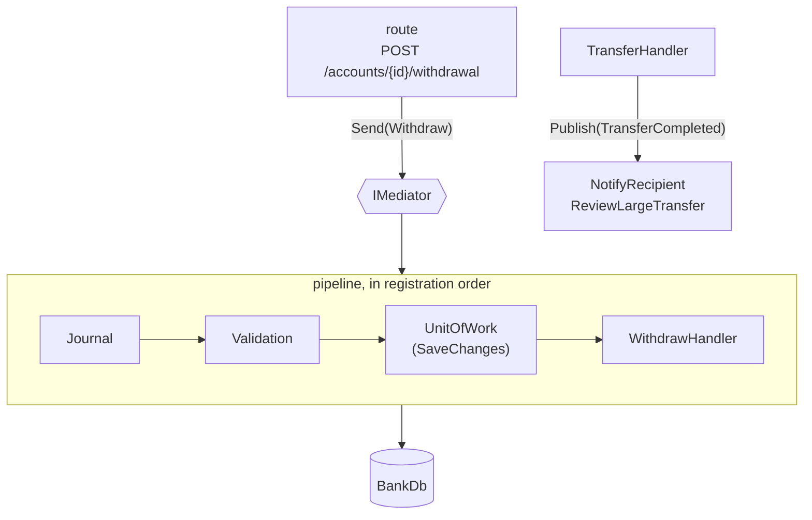
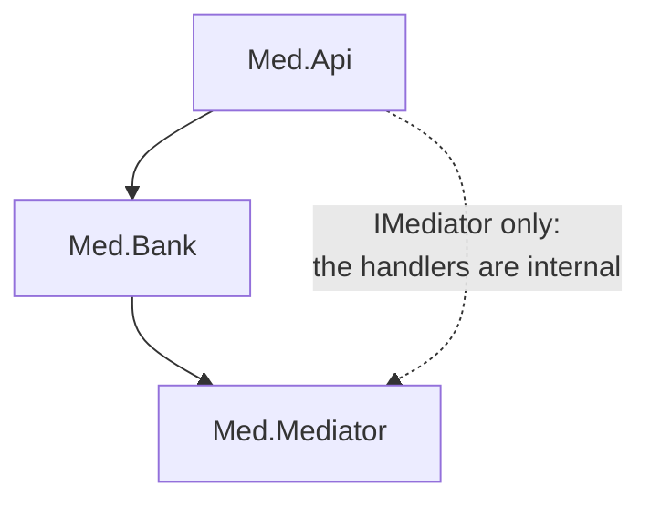

# 26. Mediator (in-process messaging)

> **In one sentence**: callers no longer call the code that serves them, they **send a message** to a **mediator**.
> The mediator finds the one handler of that message, runs it through a **pipeline** of common behaviors (journal,
> validation, unit of work), and broadcasts the **notifications** to everyone interested. That is what MediatR does,
> written here by hand; and it is **not** CQRS.

📁 Code: [`26-Mediator`](../../26-Mediator) · ⬅️ [Transaction Script and Active Record](25-transaction-script-active-record.md) · ➡️ [Cross-cutting concepts](concepts-transverses.md) · 🌐 [Français](../26-mediator.md)

---

## The idea: a go-between for those who ask and those who do

The **Mediator** is one of the *Gang of Four* patterns (1994): rather than objects that all know each other, a mediator
through which they communicate. In .NET, the word mostly means what **MediatR** (Jimmy Bogard, 2014) made popular,
**in-process messaging**:

- a **request** (`Withdraw`, `GetAccount`) has **exactly one** handler, and an answer;
- a **notification** (`TransferCompleted`) has **zero, one or several** handlers, and no answer;
- **behaviors** (*pipeline behaviors*) wrap every request: written once, they apply to all of them.

MediatR became paid for companies in 2025. The demo writes it by hand, in about a hundred lines, to show there is no
magic in it, and at what price the convenience comes.



---

## The projects

```
Med.Mediator   the mediator, written by hand: IRequest, IRequestHandler, INotification, IPipelineBehavior, Mediator
               (≈ 100 lines, only knows the dependency injection container)
Med.Bank       the bank: one file per request (request + validator + handler, those two internal),
               the notifications and their handlers, the three pipeline behaviors, BankDb (in-memory EF Core)
Med.Api        :5126  routes that only know IMediator; GET /journal shows what the pipeline saw
Med.Tests      35 tests: the mediator alone, the bank through the mediator, the API, the architecture
```



---

## 1. The mediator, without magic

The caller only knows the type of the answer. The request's real type is only known at run time: the mediator then
builds, once per request type, a typed "dispatcher", and reuses it.
([Mediator.cs](../../26-Mediator/Med.Mediator/Mediator.cs))

```csharp
public Task<TResponse> Send<TResponse>(IRequest<TResponse> request, CancellationToken ct = default)
{
    ArgumentNullException.ThrowIfNull(request);

    // The caller only knows TResponse; the request's real type is only known now.
    // The dispatcher closes the generic types once: IRequestHandler<Withdraw, decimal>, and so on.
    var dispatcher = (Dispatcher<TResponse>)Dispatchers.GetOrAdd(request.GetType(), type =>
        Activator.CreateInstance(typeof(Dispatcher<,>).MakeGenericType(type, typeof(TResponse)))!);
    return dispatcher.Send(request, services, ct);
}
```

The dispatcher asks the container for the handler, then wraps it in the behaviors, like the layers of an onion:

```csharp
var typed = (TRequest)request;
var handler = services.GetService<IRequestHandler<TRequest, TResponse>>()
    ?? throw new InvalidOperationException($"No handler is registered for {typeof(TRequest).Name}.");

// The behaviors wrap the handler like the layers of an onion:
// the first one registered is the outermost, the handler is at the center.
RequestHandlerDelegate<TResponse> next = () => handler.Handle(typed, ct);
foreach (var behavior in services.GetServices<IPipelineBehavior<TRequest, TResponse>>().Reverse())
{
    var inner = next;
    next = () => behavior.Handle(typed, inner, ct);
}
return next();
```

That's all: MediatR adds optimizations, streams (`IStreamRequest`), publishing strategies, but the core is there.

---

## 2. One route = one message

Every route has the same shape: build a message, send it, translate the result into HTTP. They know neither the
handler nor what runs around it.
([BankEndpoints.cs](../../26-Mediator/Med.Api/BankEndpoints.cs))

```csharp
app.MapPost("/accounts/{id:guid}/withdrawal", (Guid id, WithdrawalRequest request, IMediator mediator, CancellationToken ct) =>
    Run(async () => Results.Ok(new { NewBalance = await mediator.Send(new Withdraw(id, request.Amount), ct) })));

app.MapPost("/transfers", (Transfer command, IMediator mediator, CancellationToken ct) =>
    Run(async () => Results.Ok(await mediator.Send(command, ct))));
```

The handlers are `internal`: the API **cannot** call them directly, the compiler prevents it. The only way in is the
mediator.

---

## 3. A handler that only does the business

No validation, no journal, no `SaveChanges`: the pipeline takes care of them.
([Withdraw.cs](../../26-Mediator/Med.Bank/Features/Accounts/Withdraw.cs))

```csharp
public record Withdraw(Guid AccountId, decimal Amount) : ICommand<decimal>;

internal class WithdrawValidator : IValidator<Withdraw>
{
    public IEnumerable<ValidationError> Validate(Withdraw request)
    {
        if (request.Amount <= 0)
            yield return new(nameof(request.Amount), "The amount must be strictly positive.");
    }
}

/// <summary>Only the business: no validation, no logging, no SaveChanges. The behaviors take care of them.</summary>
internal class WithdrawHandler(BankDb db) : IRequestHandler<Withdraw, decimal>
{
    public async Task<decimal> Handle(Withdraw request, CancellationToken ct)
    {
        var account = await db.Accounts.FindAsync([request.AccountId], ct)
            ?? throw new NotFoundException($"Account {request.AccountId} not found.");

        account.Withdraw(request.Amount);
        db.Operations.Add(new Operation { AccountId = account.Id, Label = "Withdrawal", Amount = -request.Amount });
        return account.Balance;
    }
}
```

The request, its validator and its handler are **in the same file**: that is the usual layout, and it is a
[vertical slice](05-vertical-slice.md). The two are combined so often that they get mixed up; the slice says **where
to store**, the mediator says **how to call**.

---

## 4. The pipeline: written once, applied to every request

Three behaviors, registered in the order in which they nest.
([BankRegistration.cs](../../26-Mediator/Med.Bank/BankRegistration.cs))

```csharp
// Handlers and notification handlers are found by scanning; the behaviors are listed, in pipeline order.
services.AddMediator(typeof(BankRegistration).Assembly)
    .AddBehavior(typeof(JournalBehavior<,>))
    .AddBehavior(typeof(ValidationBehavior<,>))
    .AddBehavior(typeof(UnitOfWorkBehavior<,>));
```

**Validation** stops the request before its handler; the **unit of work** saves after a command, never after a read.
([Behaviors.cs](../../26-Mediator/Med.Bank/Pipeline/Behaviors.cs))

```csharp
public Task<TResponse> Handle(TRequest request, RequestHandlerDelegate<TResponse> next, CancellationToken ct)
{
    var errors = validators.SelectMany(v => v.Validate(request)).ToList();
    if (errors.Count > 0)
        throw new RequestValidationException(errors);
    return next();
}
```

```csharp
public async Task<TResponse> Handle(TRequest request, RequestHandlerDelegate<TResponse> next, CancellationToken ct)
{
    if (request is not ICommand<TResponse>)
        return await next();

    var response = await next();
    await db.SaveChangesAsync(ct);
    return response;
}
```

**Order matters.** The journal is on the outside: it also sees the requests refused by validation. Placed after it,
it would no longer see them (the mutation runs confirm it: swapping the two lines makes the journal test fail). Real
run, `GET /journal` after the `Bank.http` scenario (the first call includes EF Core's start-up):

```text
{"request":"Transfer","outcome":"ok","elapsedMs":86.46}
{"request":"GetAccount","outcome":"ok","elapsedMs":36.14}
{"request":"ListComplianceAlerts","outcome":"ok","elapsedMs":2.85}
{"request":"Withdraw","outcome":"ok","elapsedMs":2.12}
{"request":"Withdraw","outcome":"RequestValidationException","elapsedMs":0.32}
{"request":"Withdraw","outcome":"BusinessRuleException","elapsedMs":0.38}
```

The €0 withdrawal stops in validation (0.32 ms, the handler is never called); the €99,999 one goes all the way to the
handler, where the entity refuses: two refusals, two different stages of the pipeline.

---

## 5. Notifications: the sender doesn't know its subscribers

The transfer moves the money, then **announces** it did. It doesn't know that Bob will be notified, nor that a
compliance check watches large amounts.
([Transfer.cs](../../26-Mediator/Med.Bank/Features/Transfers/Transfer.cs))

```csharp
source.Withdraw(request.Amount);
target.Deposit(request.Amount);
// …
await mediator.Publish(new TransferCompleted(source.Id, source.Owner, target.Id, request.Amount), ct);
return new TransferResult(source.Balance, target.Balance);
```

([TransferCompleted.cs](../../26-Mediator/Med.Bank/Features/Transfers/TransferCompleted.cs))

```csharp
internal class NotifyRecipient(BankDb db) : INotificationHandler<TransferCompleted>
{
    public Task Handle(TransferCompleted notification, CancellationToken ct)
    {
        db.Notifications.Add(new Notification
        {
            AccountId = notification.TargetId,
            Message = $"You received {notification.Amount:0.##} € from {notification.SourceOwner}."
        });
        return Task.CompletedTask;
    }
}
```

Adding a reaction (an email, loyalty points) = adding a handler, without touching the transfer.

**But this is not a message bus.** The handlers run **in the same process, one after the other, in the transfer's
flow**, before its `SaveChanges`. Their writes are saved with it, or not at all, and the first exception cancels
everything. A test shows it: a broken audit handler makes the transfer fail, and neither the balances nor Bob's
notification move (`A_failing_notification_handler_cancels_the_whole_transfer`). It is the opposite of
[choreography](21-choregraphie.md), where the events cross a broker, between services, afterwards: a broken subscriber
doesn't prevent the transfer there, but then retries and ordering have to be handled.

---

## 6. The price: the compiler no longer sees the path

With a direct call, "go to definition" leads to the code that runs, and a call without a destination doesn't compile.
With a mediator:

- `mediator.Send(new Withdraw(...))` **always compiles**, even if no handler exists; the error only comes at run time
  (`No handler is registered for Withdraw.`, a test checks it);
- "go to definition" leads to `IMediator`, not to the handler; you have to search for the class that implements
  `IRequestHandler<Withdraw, decimal>`;
- a handler can send other requests: cascading calls become invisible;
- what runs around a handler (the pipeline) is written nowhere near it.

The architecture tests put back part of what the compiler used to do.
([ArchitectureTests.cs](../../26-Mediator/Med.Tests/ArchitectureTests.cs))

```csharp
[Fact]
public void Every_request_of_the_bank_has_exactly_one_handler()
{
    using var bank = new TestBank();
    using var scope = bank.Services.CreateScope();

    var requests = Bank.GetTypes().Where(t => !t.IsAbstract && !t.IsInterface && Implements(t, typeof(IRequest<>)));
    foreach (var request in requests)
    {
        var response = request.GetInterfaces().Single(i => i.IsGenericType && i.GetGenericTypeDefinition() == typeof(IRequest<>))
            .GetGenericArguments()[0];
        var handlers = scope.ServiceProvider.GetServices(typeof(IRequestHandler<,>).MakeGenericType(request, response));
        Assert.True(handlers.Count() == 1, $"{request.Name}: {handlers.Count()} handler(s)");
    }
}
```

Two others check that the handlers are `internal` and that none depends on another handler.

---

## 7. A mediator doesn't make CQRS

`ICommand` and `IQuery` are **our** labels (the mediator only knows "request"): the unit of work uses them to know
when to save. But the read queries **the same tables, with the same `DbContext`**, as the commands.
([GetAccount.cs](../../26-Mediator/Med.Bank/Features/Accounts/GetAccount.cs))

```csharp
/// <summary>A query reads the same tables as the commands: the mediator does not separate the models.</summary>
internal class GetAccountHandler(BankDb db) : IRequestHandler<GetAccount, AccountView>
```

CQRS separates **the models** (one to write, another to read, often two databases linked by events); the mediator
separates **the caller from the called code**. You can do CQRS without a mediator, and a mediator without CQRS: that is
the case here. The detailed comparison: [Mediator or CQRS?](differences/18-mediator-vs-cqrs.md)

---

## The tests

35 tests:

- **The mediator alone** (`MediatorTests`), with toy messages: the request reaches its handler; a request without a
  handler fails naming it; the behaviors nest in registration order; a behavior can answer without calling the
  handler; publishing calls every handler, in order, and stops at the first one that fails.
- **The bank through the mediator** (`BankTests`), without HTTP, one scope per send like a web request: a withdrawal is
  saved although its handler never calls `SaveChanges`; a read **never** saves what is pending in the unit of work; an
  invalid request stops before its handler; a broken notification handler cancels the whole transfer; the journal
  records each request and its outcome.
- **The API** (`ApiTests`): validation errors (400, fields in error), business rule (400), unknown account (404).
- **The architecture** (`ArchitectureTests`): the mediator ignores the bank; each request has one handler and only one;
  `internal` handlers; no handler depends on another.

The mutation runs (27 guarantees broken one by one: pipeline order, publishing, handler lookup, validation, unit of
work, every rule, HTTP codes) all make at least one test fail.

---

## Summary

| 👍 Strengths | 👎 Limits |
|---|---|
| Common concerns (journal, validation, transaction, permissions, cache) written once | The execution path is no longer visible: "go to definition" leads to `IMediator` |
| Thin routes and controllers, all of the same shape | A request without a handler compiles; the error comes at run time |
| A sender doesn't know its subscribers (notifications) | Synchronous notifications, in the same transaction: a slow or broken subscriber slows down or cancels everything |
| Combines naturally with vertical slices | Useless indirection if each request has only one caller anyway; often mistaken for CQRS |

**When to use it**: many use cases sharing the same concerns (validation, transaction, audit, permissions), especially
with [vertical slices](05-vertical-slice.md). **When to do without**: a small application, where a direct call to a
service reads better; and when the real need is to separate reads and writes, which is the job of [CQRS](09-cqrs.md),
not of the mediator. A decorator on a service interface also gives a pipeline, without losing "go to definition".
