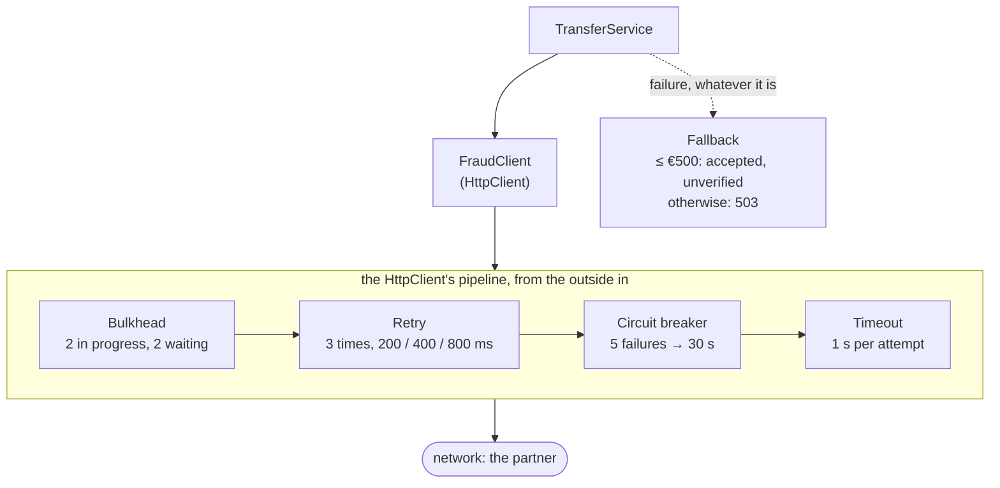
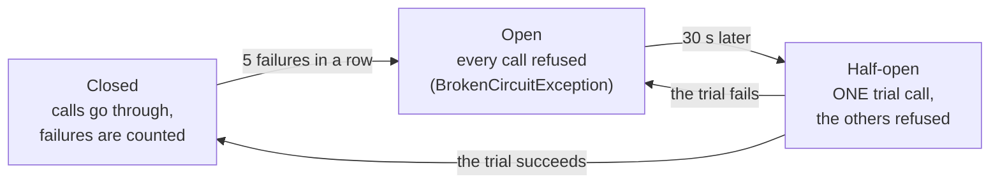

# 27. Resilience (timeout, retry, circuit breaker, bulkhead)

**French name**: *Résilience*

> **In one sentence**: when an application depends on a service it doesn't control, it can't stop it from being slow
> or down, but it can **avoid going down with it**: cut calls that take too long (**timeout**), retry passing failures
> (**retry**), stop calling a service that is down (**circuit breaker**), bound what it can tie up (**bulkhead**), and
> decide what to do without it (**fallback**).

📁 Code: [`27-Resilience`](../../27-Resilience) · ⬅️ [Mediator](26-mediator.md) · ➡️ [MVU](28-mvu.md) · 🌐 [Français](../27-resilience.md)

---

## The idea: a failure must not spread

Before each transfer, the bank asks a **partner** (a fraud-detection service) whether the operation is suspicious. The
partner is behind the network. Without precautions, its failure becomes ours:

- a **slow** partner keeps every request waiting; threads and connections run out, and the whole bank stops answering,
  even to show a balance;
- a partner that is **down** still receives all our calls, plus our retries: we keep it from getting back up;
- and the customer waits, only to end with an error.

Michael Nygard named these protections in *Release It!* (2007); in .NET, the **Polly** library made them popular, and
`Microsoft.Extensions.Http.Resilience` assembles them in one call, `AddStandardResilienceHandler`, which
[demo 8](08-microservices.md) uses. This demo writes them **by hand**, without any package, to see what each one does,
and why their **order** matters.



---

## The projects

```
Res.Resilience      the four strategies, written by hand as DelegatingHandlers (≈ 250 lines);
                    doesn't know the bank
Res.FraudSimulator  the simulated partner, in place of the network: healthy, flaky, slow or down, on demand
Res.Bank            accounts, transfers, FraudClient (an HttpClient without any resilience code) and the fallback
Res.Api             :5127  POST /transfers; GET /resilience (circuit state, events, calls received by the
                    partner); POST /partner/mode (the failure switch)
Res.Tests           35 tests, on a fake clock: each strategy alone, then the API in front of each failure
```

---

## 1. The order of the pipeline is the design

The strategies are **handlers** (`DelegatingHandler`) stacked around the partner's `HttpClient`. The calling code
(`FraudClient`) knows nothing about them: it does a `PostAsJsonAsync`.
([Program.cs](../../27-Resilience/Res.Api/Program.cs))

```csharp
// The pipeline of the fraud client, from the outside in: the order IS the design.
builder.Services.AddHttpClient<IFraudCheck, FraudClient>(client => client.BaseAddress = new Uri("http://fraud.partner.example/"))
    .AddHttpMessageHandler(sp => new BulkheadHandler(sp.GetRequiredService<Bulkhead>()))
    .AddHttpMessageHandler(sp => new RetryHandler(sp.GetRequiredService<ResilienceOptions>().Retry,
        sp.GetRequiredService<TimeProvider>(), sp.GetRequiredService<ResilienceEvents>(), sp.GetRequiredService<Random>()))
    .AddHttpMessageHandler(sp => new CircuitBreakerHandler(sp.GetRequiredService<CircuitBreaker>()))
    .AddHttpMessageHandler(sp => new TimeoutHandler(sp.GetRequiredService<ResilienceOptions>().AttemptTimeout,
        sp.GetRequiredService<TimeProvider>(), sp.GetRequiredService<ResilienceEvents>()))
    .ConfigurePrimaryHttpMessageHandler(sp => new SimulatedFraudHandler(sp.GetRequiredService<FraudPartner>()));
```

Why this order (the same as `AddStandardResilienceHandler`'s):

| Position | Strategy | If it were elsewhere… |
|---|---|---|
| 1, outermost | **Bulkhead** | inside the retry, a retrying request would release then take its place back at each attempt |
| 2 | **Retry** | inside the breaker, it wouldn't see the open circuit and its attempts wouldn't be counted |
| 3 | **Circuit breaker** | outside the retry, it would count a request of 4 attempts as **one** failure |
| 4, innermost | **Timeout** (per attempt) | outside the retry, it would cut all the attempts together, not each one |

---

## 2. Timeout: don't wait forever

Beyond one second, the call is cancelled and becomes a `TimeoutRejectedException`, a failure like any other for the
breaker and the retry around it.
([TimeoutHandler.cs](../../27-Resilience/Res.Resilience/TimeoutHandler.cs))

```csharp
using var timeoutSource = new CancellationTokenSource(timeout, clock);
using var linked = CancellationTokenSource.CreateLinkedTokenSource(ct, timeoutSource.Token);
try
{
    return await base.SendAsync(request, linked.Token);
}
catch (OperationCanceledException) when (timeoutSource.IsCancellationRequested && !ct.IsCancellationRequested)
{
    // Our delay ran out, not the caller's patience: the caller's own cancellation goes up unchanged.
    events.Add("timeout", $"no answer within {timeout.TotalMilliseconds:0} ms");
    throw new TimeoutRejectedException(timeout);
}
```

The filter tells **our** delay apart from the caller giving up (the HTTP client disconnecting): the latter is not a
failure of the partner, and must neither be retried nor open the circuit.

---

## 3. Retry: try again, but not any old way

([RetryHandler.cs](../../27-Resilience/Res.Resilience/RetryHandler.cs))

```csharp
for (var attempt = 0; ; attempt++)
{
    string failure;
    try
    {
        var response = await base.SendAsync(request, ct);
        if (!Transient.IsFailure(response) || attempt == options.MaxRetries)
            return response;
        failure = $"HTTP {(int)response.StatusCode}";
        response.Dispose();
    }
    catch (Exception e) when (Transient.IsRetryable(e) && attempt < options.MaxRetries)
    {
        failure = e.GetType().Name;
    }

    var delay = DelayBefore(attempt + 1);
    events.Add("retry", $"attempt {attempt + 2} in {delay.TotalMilliseconds:0} ms, after {failure}");
    await Task.Delay(delay, clock, ct);
}
```

Four rules, each checked by a test:

- **Only passing failures**: 5xx, 408, 429, network error, timeout. A `400` won't heal by retrying.
- **A wait that doubles** (*exponential backoff*): 200, 400, 800 ms, to give the service time to recover.
- **A random part** (*jitter*, up to +20%): a thousand clients that failed together must not come back at the same
  millisecond.
- **Never an open circuit nor a full bulkhead**: retrying what these two refuse would cancel their effect.

And a business rule: **only retry what can be repeated without harm**. Asking for a fraud opinion, yes; debiting an
account, no (except with an [idempotency](concepts-transverses.md#idempotency) key, like demo 8).

> **A trap met while writing the demo**: the retry sends **the same** `HttpRequestMessage` again. Its content must be
> readable again. The simulator first read the body with `ReadFromJsonAsync`, which closes the buffered stream: the
> second attempt failed with an `ObjectDisposedException` (500). It now reads it as text.

---

## 4. Circuit breaker: let a service that is down catch its breath

After **5 failures in a row**, the circuit **opens**: for 30 s, every call fails **at once**, without the network.
Then it goes **half-open**: **a single** trial call decides what comes next.



([CircuitBreaker.cs](../../27-Resilience/Res.Resilience/CircuitBreaker.cs))

```csharp
public void BeforeCall()
{
    lock (_gate)
    {
        if (State == CircuitState.HalfOpen)
            throw new BrokenCircuitException(TimeSpan.Zero);   // the trial call is in progress: no other

        if (State == CircuitState.Open)
        {
            var remaining = _openedAt + options.BreakDuration - clock.GetUtcNow();
            if (remaining > TimeSpan.Zero)
                throw new BrokenCircuitException(remaining);
            State = CircuitState.HalfOpen;
            events.Add("circuit", "half-open: one trial call");
        }
    }
}
```

**The state is shared**: one breaker per partner, for every request (a singleton), otherwise each request would have
its own counter and the circuit would never open. It lives **outside** the handler: `IHttpClientFactory` recreates its
handlers every two minutes, and the state would be lost with them.

---

## 5. Bulkhead: bound what a service can tie up

The name comes from a ship's **watertight bulkheads**. At most 2 calls in progress to the partner, 2 waiting, the
next ones refused **at once**. A very slow partner only ties up these four requests.
([Bulkhead.cs](../../27-Resilience/Res.Resilience/Bulkhead.cs))

```csharp
public async Task<IDisposable> Enter(CancellationToken ct)
{
    if (!_slots.Wait(0))
    {
        lock (_gate)
        {
            if (_queued >= options.MaxQueue)
            {
                events.Add("bulkhead", $"rejected: {options.MaxConcurrency} in progress, {_queued} waiting");
                throw new BulkheadRejectedException();
            }
            _queued++;
        }
        try
        {
            await _slots.WaitAsync(ct);
        }
        finally
        {
            lock (_gate)
                _queued--;
        }
    }
    return new Slot(_slots);
}
```

---

## 6. The fallback: a business decision

The four strategies limit the damage; they don't answer the question "and now?". Whatever the reason for the failure
(network, timeout, open circuit, full bulkhead), the bank decides.
([TransferService.cs](../../27-Resilience/Res.Bank/TransferService.cs))

```csharp
bool approved;
try
{
    approved = await fraud.IsApproved(source, amount, ct);
}
catch (Exception e) when (e is HttpRequestException or TimeoutRejectedException
                              or BrokenCircuitException or BulkheadRejectedException)
{
    if (amount > UnverifiedLimit)
        throw new FraudCheckUnavailableException(e.GetType().Name,
            e is BrokenCircuitException broken ? broken.RetryAfter : TimeSpan.FromSeconds(5));

    var (from, to) = ledger.Move(source, target, amount, " (unverified)");
    return new TransferOutcome("accepted-unverified", from, to);
}
```

Up to €500, the transfer goes through, marked "unverified", for a check afterwards; above, `503` with a `Retry-After`
header (the time left before the circuit tries again, if it is open). This threshold is not a technical setting: it is
the **risk** the bank agrees to take.

And a detail that matters: the rules that can be checked alone (amount, accounts, balance) are checked **before**
calling the partner. An invalid transfer costs it no call (a test checks it).

---

## Real run: the `Bank.http` scenario

The API started for real (real clock), the requests of `Bank.http` in order:

| Partner | Transfer | Answer | Duration | Calls received (total) |
|---|---|---|---|---|
| healthy | €100 | `accepted` | 0.15 s | 1 |
| flaky (2 × 503) | €100 | `accepted`: 2 retries, after 203 then 423 ms | 0.74 s | 4 |
| slow (3 s) | €50 | `accepted-unverified`: 4 timeouts | 5.5 s | 8 |
| down | €600 | `503`, `Retry-After: 30`: the 5th failure in a row opens the circuit | 0.26 s | 9 |
| down | €10 | `accepted-unverified`, circuit open | **0.001 s** | 9: no call |
| back, 31 s later | €10 | `accepted`: the trial call closes the circuit | 0.03 s | 10 |

Two readings. The slow partner cost the customer 5.5 s: that is the price of 4 one-second attempts, and the reason for
a **total timeout** in production. And the 4 timeouts counted in the breaker: the first failure while down was enough
to open it. Once open, the partner receives nothing more and the customer gets an answer in a millisecond. The waits
shown (203, 423, 238, 435, 814 ms) show the jitter at work.

---

## 7. In production: don't rewrite Polly

This demo writes the strategies to understand them. In production, `AddStandardResilienceHandler` (demo 8) assembles
the same ones, in the same order, with what the demo leaves out:

- a **total timeout**, on top of the per-attempt timeout;
- a breaker **by failure ratio** over a time window, rather than a number of failures in a row;
- a **rate limiter** instead of the bulkhead;
- **hedging** (starting a second request if the first one is slow);
- the telemetry (metrics, traces) of each strategy.

The package is already in the cache, and the configuration fits in ten lines. The point of this demo is elsewhere:
knowing **what you are setting** when you choose `MaxRetryAttempts = 3`.

---

## The tests

35 tests, all on a **fake clock** (`FakeTimeProvider`): the retry's waits, the timeouts, the breaker's break and the
partner's slowness follow this clock, which a helper moves forward in 50 ms steps as long as the call isn't finished.
A 30 s break lasts a few milliseconds; no `Thread.Sleep`.

- **Each strategy alone** (`StrategyTests`), in front of a scripted service that counts its calls: retry (passing
  failures, giving up after 3 retries, no retry on a 400, doubling waits, jitter), timeout (slowness, cancellation by
  the caller), breaker (opening at 5 failures, reset by a success, trial succeeded or failed, one trial at a time,
  cancelled trial), bulkhead (2 + 2, the 5th refused), and the retry that doesn't retry an open circuit.
- **The API in front of each failure** (`ApiTests`): healthy partner (1 call), flaky (3 calls, accepted), slow (4
  timeouts, accepted unverified), down (503 and `Retry-After`), circuit that protects then closes, full bulkhead.
- **The architecture**: the strategies ignore the bank; the bank ignores the simulator; `FraudClient` has no other
  field than its `HttpClient`.

The mutation runs (28 guarantees broken one by one) all make at least one test fail. The first pass had left five
without effect, each fixed by a stricter test or by the code:

- **removing the wait** between two attempts: the tests checked the journal, not the elapsed time; a test now measures
  the gap between calls on the clock;
- **retrying an open circuit**: the partner received no more calls, but the retries are now counted;
- **taking the caller giving up for a timeout** when both happen together: a dedicated test;
- **ignoring the failed trial call**: no effect, since the failure counter wasn't reset on opening; it now is, and it
  is indeed the half-open state that reopens the circuit;
- **the €5,000 limit**: €5,001 also exceeds Alice's balance, the refusal came from the balance; the test now checks
  the message.

---

## Summary

| 👍 Strengths | 👎 Limits |
|---|---|
| A failure of the partner stays with it: no domino effect | Settings to choose and test (thresholds, delays, number of attempts) |
| Quick answer to the customer, even on failure | Retries multiply the load: without breaker or jitter, they make the failure worse |
| The partner in trouble is no longer bombarded | Retrying is only safe for an idempotent operation |
| The business code knows nothing: resilience is in the pipeline | The fallback is a business decision, to be made explicitly |

**When to use it**: for **every** network call to a service you don't control (partner, other service, remote
database). It is the necessary complement of [microservices](08-microservices.md), the [BFF](16-bff.md) and any
distributed architecture. **In practice**: `AddStandardResilienceHandler` or Polly; write your own only to learn, as
here.
