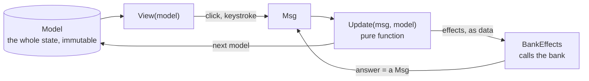

# 28. MVU (Model-View-Update)

> **In one sentence**: the whole state of the screen fits in **one immutable model**; everything that happens (click,
> keystroke, answer from the bank) is a **message**, handled **one at a time** by a **pure** function, `Update`, which
> returns the next model and the effects to run **as data**; the **view** is recomputed from the model, and only the
> differences reach the screen. The same screen as [demo 24](24-mvc-mvvm.md), as a one-way flow.

📁 Code: [`28-Mvu`](../../28-Mvu) · ⬅️ [Resilience](27-resilience.md) · ➡️ [Cross-cutting concepts](concepts-transverses.md) · 🌐 [Français](../28-mvu.md)

---

## The idea: one direction of travel

Demo 24 built the same bank screen in MVC and in MVVM. In MVVM, the view and the ViewModel talk **both ways**
(bindings); the state is spread over properties, and each setter must remember to revalidate, to notify the view, to
re-evaluate the commands. MVU, which came from the **Elm** language (2012) and was made popular by **Redux** and React,
makes information flow in **one direction only**:



The same bank model (`Ui.Bank`, demo 24's, referenced as it is), the same rules, the same behaviours: validation while
typing, greyed-out button, confirmation above €1,000, answers arriving out of order discarded. Only the organization
changes.

---

## The projects

```
Mvu.Runtime   the engine, written by hand: the view's nodes (Column, Text, Button, TextBox, Choice), the diff
              between two views, and the loop (mailbox, Update, rendering, effects); doesn't know the bank
Mvu.Bank      the screen: Model (the whole state), Msg (everything that happens), Effect (what Update asks for),
              BankScreen.Update (pure), BankView.View (pure), BankEffects (the only code that calls the bank)
Mvu.Console   a generic renderer (any MVU program): the view first, then only the differences;
              "click ID", "type ID text", "pick ID N" send the message attached to the element
Ui.Bank       (demo 24) the bank's model, shared
Mvu.Tests     33 tests
```

```powershell
dotnet run --project 28-Mvu\Mvu.Console     # then: pick from 1, pick to 3, type amount 250, click transfer…
```

---

## 1. The model: the whole state, in one value

What is selected, typed, loading, waiting for confirmation: everything is in **one** immutable `record`. Each message
produces a modified copy (`with`), never a change in place. And what can be **derived** from the state is recomputed
at each read.
([Model.cs](../../28-Mvu/Mvu.Bank/Model.cs))

```csharp
public string? AmountError =>
    AmountText.Trim().Length == 0 ? null
    : Amount is not { } amount ? "Enter an amount, for example 250.50."
    : TransferRules.CheckAmount(amount) ?? (SourceAccount is { } source ? TransferRules.CheckBalance(source.Balance, amount) : null);

public string? AccountsError =>
    Source is { } source && Target is { } target ? TransferRules.CheckAccounts(source, target) : null;

public bool CanTransfer =>
    Source is not null && Target is not null && Amount is not null && AmountError is null && AccountsError is null
    && !Busy && PendingConfirmation is null;
```

Compare with `TransferViewModel` (demo 24), which calls `Validate()` in each setter, subscribes to the source
account's balance to revalidate if it changes, and notifies the view error by error. Here, nothing to call, nothing to
forget: changing the source account changes the balance read, hence the error.

---

## 2. The messages: the list of everything that can happen

([Messages.cs](../../28-Mvu/Mvu.Bank/Messages.cs))

```csharp
// What the user does
public sealed record AccountSelected(int Index) : Msg;
public sealed record SourceChosen(int Index) : Msg;
public sealed record TargetChosen(int Index) : Msg;
public sealed record AmountTyped(string Text) : Msg;
public sealed record SwapClicked : Msg;
public sealed record TransferClicked : Msg;
public sealed record ConfirmationAnswered(bool Yes) : Msg;

// What the bank answers (the results of the effects)
public sealed record AccountsLoaded(IReadOnlyList<Account> Accounts) : Msg;
public sealed record OperationsLoaded(int Request, IReadOnlyList<Operation> Operations) : Msg;
public sealed record OperationsFailed(int Request, string Error) : Msg;
public sealed record TransferDone(Transfer Transfer) : Msg;
public sealed record TransferFailed(string Error) : Msg;
```

The bank's answers are messages **like the clicks**: they queue up with them, and are handled by the same function.

---

## 3. `Update`: a pure function

A message and the current model come in; the new model and the effects to run come out. No `await`, no event, no call
to the bank.
([BankScreen.cs](../../28-Mvu/Mvu.Bank/BankScreen.cs))

```csharp
// A response to an older request (A clicked, then B, and A's answer arrives last): ignored.
OperationsLoaded loaded when loaded.Request != model.OperationsRequest => (model, None),
OperationsLoaded loaded => (model with { Operations = [.. loaded.Operations], LoadingOperations = false }, None),
```

```csharp
// The button is greyed out when this is false; a click that arrives anyway (double click) changes nothing.
TransferClicked when !model.CanTransfer => (model, None),
TransferClicked when model.Amount >= TransferRules.ConfirmationThreshold =>
    (model with { PendingConfirmation = Question(model) }, None),
TransferClicked => Send(model),

ConfirmationAnswered { Yes: true } when model.PendingConfirmation is not null =>
    Send(model with { PendingConfirmation = null }),
ConfirmationAnswered when model.PendingConfirmation is not null =>
    (model with { PendingConfirmation = null, Notice = new Notice("Transfer cancelled.", IsError: false) }, None),
```

The **confirmation** shows the deep difference with demo 24. In MVVM, the command stopped in the middle to **wait** for
an answer (`await _confirmation.AskAsync(…)`, a dialog box in WPF, a question at the keyboard in the console). In MVU,
there is nothing to wait for: the pending question is **a state** (`PendingConfirmation`), the view shows it with two
buttons, and the answer is one more message.

---

## 4. Effects are data

`Update` loads nothing: it **asks** (`new LoadOperations(id, request)`). An interpreter, the only one to know `IBank`,
runs the request and turns the answer, success or business refusal, into a message.
([BankEffects.cs](../../28-Mvu/Mvu.Bank/BankEffects.cs))

```csharp
case LoadOperations load:
    try
    {
        return new OperationsLoaded(load.Request, await bank.OperationsAsync(load.Account, ct));
    }
    catch (BusinessError error)
    {
        return new OperationsFailed(load.Request, error.Message);
    }
```

That is what makes `Update` testable by simply comparing values: "after this click, the model is this one, and the
effect asked for is `SendTransfer(Alice, Bob, 250)`". No fake bank.
([UpdateTests.cs](../../28-Mvu/Mvu.Tests/UpdateTests.cs))

```csharp
[Fact]
public void A_click_sends_the_transfer_and_a_second_click_sends_nothing()
{
    var (sending, effects) = BankScreen.Update(new TransferClicked(), ReadyToTransfer("250"));
    var (_, secondClick) = BankScreen.Update(new TransferClicked(), sending);

    Assert.Equal([new SendTransfer(InMemoryBank.Alice, InMemoryBank.Bob, 250m)], effects);
    Assert.True(sending.Busy);
    Assert.Empty(secondClick);
}
```

---

## 5. The view: a function of the model

The view reads the model and **describes** the screen; each element carries the message it will send. Greying out a
button means giving it no message.
([BankView.cs](../../28-Mvu/Mvu.Bank/BankView.cs))

```csharp
H.TextBox("amount", "Amount", model.AmountText, text => new AmountTyped(text)),
model.AmountError is { } amountError ? H.Text(amountError, Tone.Error) : null,
H.Button("swap", "Swap", model.Source is not null || model.Target is not null ? new SwapClicked() : null),
H.Button("transfer", model.Busy ? "Transfer…" : "Transfer", model.CanTransfer ? new TransferClicked() : null),
```

The console knows nothing about the bank: "click transfer" looks in the current view for the `transfer` element and
sends its message; a button without a message does nothing.

---

## 6. The engine: a mailbox, one message at a time

The loop reads the messages one by one, calls `Update`, recomputes the view, passes the differences on, starts the
effects. It is the only place with asynchrony and concurrency.
([Runtime.cs](../../28-Mvu/Mvu.Runtime/Runtime.cs))

```csharp
await foreach (var message in _mailbox.Reader.ReadAllAsync())
{
    try
    {
        var (model, effects) = _program.Update(message, Model);
        var view = _program.View(model);
        var patches = Diff.Compute(View, view);
        (Model, View) = (model, view);
        if (patches.Count > 0)
            _render(view, patches);
        foreach (var effect in effects)
            Run(effect);
    }
    // …
}
```

Like [actors](18-modele-acteurs.md): a mailbox read by a single consumer. A test sends 1,000 messages from several
threads: none is lost, and `Update` is never called twice at the same time.

---

## 7. The diff, and its limit

The view is recomputed entirely; the diff compares it with the previous one, **position by position**, and only the
differences are displayed. The real run (the console, demo 24's bank at 300 ms per call) shows it, and also shows the
limit of a positional diff:

```text
> type amount abc
  ~ [amount] Amount: abc
  ~ ⚠ Enter an amount, for example 250.50.
  ~ [swap] Swap
  + (transfer) Transfer, greyed out
```

The error line is inserted in the middle: the following lines change position, and the diff sees them as "changed".
The error takes `[swap]`'s place, `[swap]` takes `(transfer)`'s, and `(transfer)`, which didn't change, is "inserted"
at the end. React, Elm and Blazor avoid this with **keys**: each element is identified, and an insertion doesn't shift
the others. The demo's diff has none, on purpose.

The rest of the session, as displayed: €2,000 from Alice gives `⚠ Insufficient balance: 1,000.00 € available.` as soon
as it is typed; the €250 transfer goes through ("Transfer…" greyed out during the call), the amount is emptied, the
balances and the history reload; a second click does nothing ("greyed out"); €1,200 from the savings account brings up
the question, "no" cancels it, "yes" sends the transfer.

---

## MVVM or MVU: the same screen

| Behaviour | MVVM (demo 24) | MVU (this demo) |
|---|---|---|
| The screen's state | spread over the properties of several ViewModels | **one** immutable model |
| Validating while typing | `Validate()` in each setter, subscription to the source account's balance | errors **derived** from the model, recomputed |
| Notifying the view | `PropertyChanged`, `ErrorsChanged`, `CanExecuteChanged` | nothing: the view is recomputed |
| Confirmation above €1,000 | an `await` in the middle of the command (`IConfirmation`) | a **state**: `PendingConfirmation`, two buttons |
| Stale answer (A then B) | a counter in the ViewModel, checked after the `await` | a counter in the model, checked in `Update` |
| Double click | button greyed out by `CanExecute` | `TransferClicked` ignored when `!CanTransfer` |
| Testing | ViewModel + fake bank that holds back the calls | `Update` with values, without a bank |
| Writing a small form | one binding and done | a message, a case in `Update`, a view element |

---

## The tests

33 tests:

- **`Update` alone** (`UpdateTests`, 15): no bank, no engine, no `await`: initial loading, stale answer ignored,
  errors while typing, balance error that follows the source account, identical accounts, double click, confirmation
  (question, no, yes), transfer done (amount emptied, reload keeping the selection), refusal by the bank.
- **The view** (`ViewTests`): button greyed out or carrying `TransferClicked`, errors shown, yes and no during a
  question.
- **The engine** (`RuntimeTests`), with a toy counter: 1,000 concurrent messages handled one by one, an effect's result
  coming back as a message, rendering of the differences only, failed effect recorded, diff (insertion, removal,
  replacement, line turned into a group).
- **Everything together** (`ScreenTests`): a complete console session on the real bank; the "savings then Bob" race
  with a bank that holds back the savings account's answer; the bank's refusals turned into messages.
- **The architecture**: the engine ignores the bank; only the effects call `IBank`, never `Update` nor the view; the
  model only has `init` properties and immutable lists.

The mutation runs (26 guarantees broken one by one) all make at least one test fail. The first pass had left two: the
**selection lost** when the accounts reload (the test had already selected the first account, the one you get by
default) and the broken **swap** of the accounts (the test only looked at the error, not at the target account).

Writing the demo also brought out a real defect of the diff: a line replaced by a group ("loading…" replaced by the
history) was displayed as "column (1)". It now removes the old line and inserts the group's lines.

---

## Summary

| 👍 Strengths | 👎 Limits |
|---|---|
| The whole behaviour in a pure function, tested with values | A message and a case of `Update` for the slightest input: verbose |
| A single state: nothing out of sync, nothing to revalidate by hand | The view recomputed entirely: a diff (and keys) is needed |
| One message at a time: no race between two changes | A single model that grows: it must be split (composition of programs) |
| Effects are data: no fake bank to test | Less tooling than MVVM in .NET (Fabulous, Elmish); it is the approach of React and Redux on the web |

**When to use it**: a rich screen, where the order of events matters and where you want to test everything without a
screen; component-based web applications (React + Redux, Elm, and Blazor's components take part of it). **When to
prefer MVVM**: a XAML desktop application, where bindings do the work in one line and the tooling exists.
