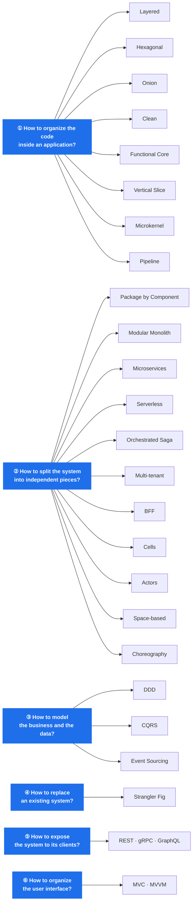
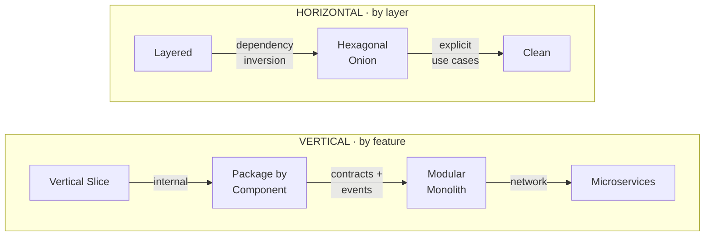
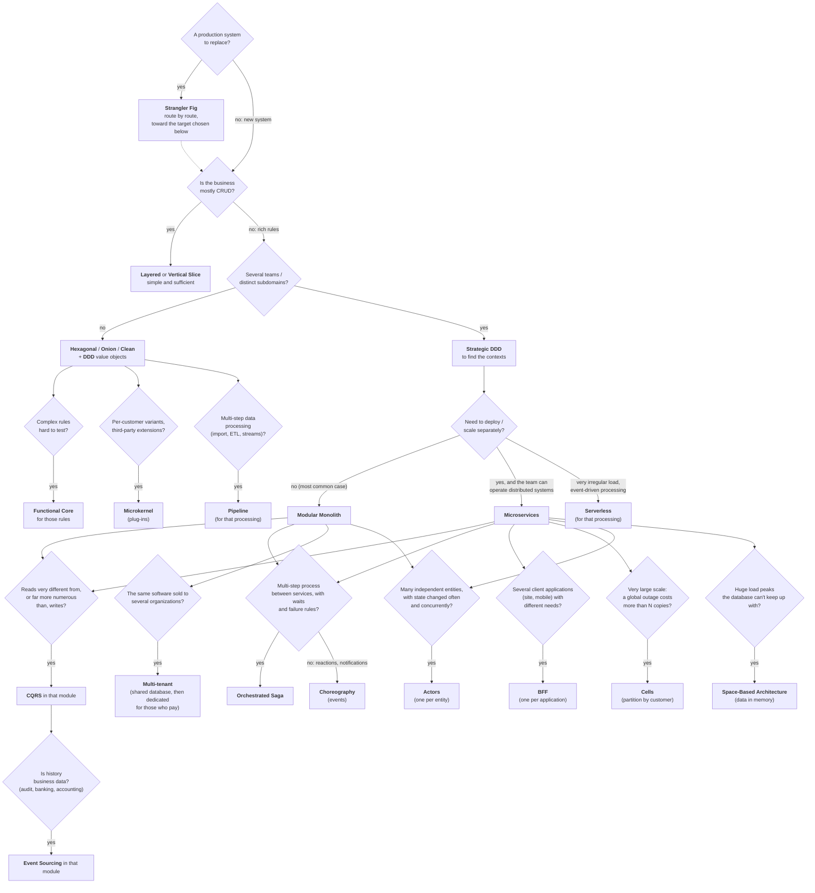
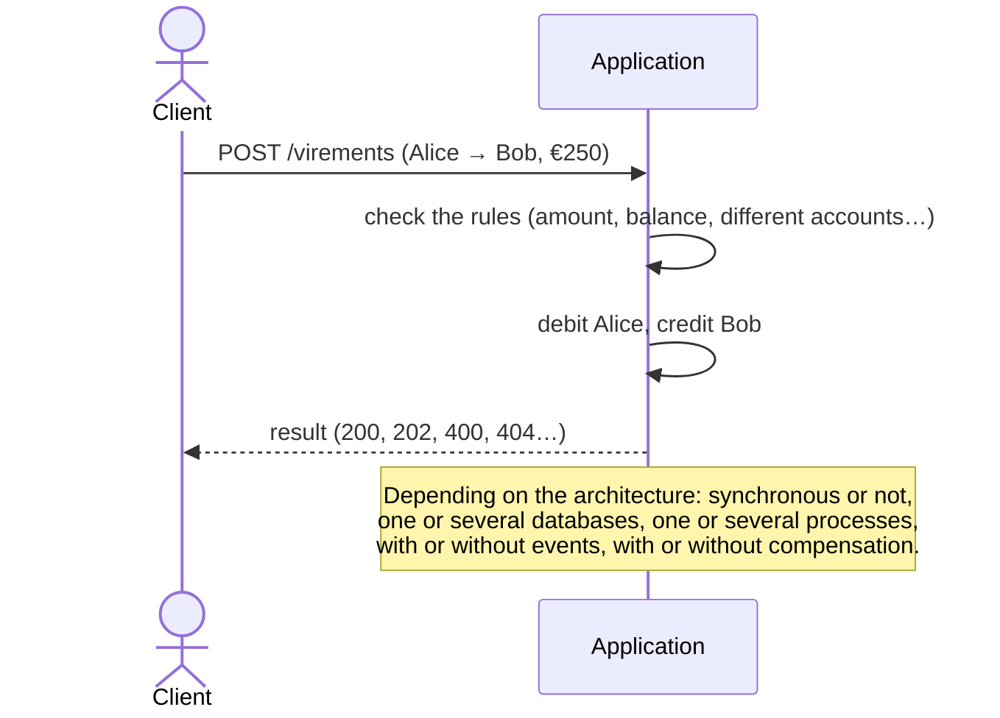

# Software architectures in C# — documentation

🌐 [Français](../README.md) · 🚧 English translation in progress: see [TRANSLATION.md](TRANSLATION.md). Until a page
is translated, its link leads to the French version (marked *FR*).

This documentation explains **twenty-two ways to organize an application**, **one way to get there** from an existing
system, **three ways to expose it** to its clients and **two ways to organize its user interface**, each illustrated by
a complete, tested and runnable .NET 10 solution in this repository. They all implement **the same business** — a small
bank: open an account, look it up, withdraw, transfer — so that the *shape* of the code can be compared with equal
features.

> The demos' code (folders, projects, classes, routes, comments) is written in French. Identifiers such as
> `ComptesService` (accounts service) or `IRetirerArgent` (withdraw money) are quoted as they are.

> 📗 **Not a developer?** A no-code version, with simple words and everyday images:
> [architectures explained to everyone](../pour-tous/README.md) (*FR*).

> 🗂️ **Need a summary?** A one-page cheat sheet per architecture (idea, diagram, rules, when to use it,
> pitfalls): [the cheat sheets](fiches/README.md).

> ⚖️ **Hexagonal or Onion? CQRS or Event Sourcing?** The architectures people confuse, compared two by two on their
> differences only, with code from the demos: [the differences between architectures](../differences/README.md) (*FR*).

> 🌐 **French and English names**: an architecture known by an English name keeps it; those with a French name show
> it under the title of each page. Summary in [the names table](../noms-architectures.md) (*FR*).

> **Reading the diagrams.** The diagrams are written in [Mermaid](https://mermaid.js.org/). They render directly on
> GitHub / GitLab / Azure DevOps, in Rider and Visual Studio 2022 (Markdown preview), and in VS Code with the
> *Markdown Preview Mermaid Support* extension.

---

## Contents

| # | Architecture | French name | In one sentence | Cheat sheet | Full page | Code |
|---|---|---|---|---|---|---|
| 0 | **Layered (N-tier)** | Couches | Presentation → Business → Data: dependencies flow down to the database | [0](fiches/00-couches.md) | [EN](00-couches.md) | [`00-Couches`](../../00-Couches) |
| 1 | **Hexagonal** (ports & adapters) | Hexagonale | The business at the center, plugged into the world through ports and interchangeable adapters | [1](fiches/01-hexagonale.md) | [EN](01-hexagonale.md) | [`01-Hexagonale`](../../01-Hexagonale) |
| 2 | **Onion** | — | Concentric layers, every dependency points toward the domain | [2](fiches/02-onion.md) | [EN](02-onion.md) | [`02-Onion`](../../02-Onion) |
| 3 | **Clean Architecture** | — | One interactor per use case; the result goes out through a *presenter* | [3](fiches/03-clean.md) | [EN](03-clean.md) | [`03-Clean`](../../03-Clean) |
| 4 | **Functional Core, Imperative Shell** | — | 100% pure rules that decide; a shell that does the input/output | [4](fiches/04-coeur-fonctionnel.md) | [EN](04-coeur-fonctionnel.md) | [`04-CoeurFonctionnel`](../../04-CoeurFonctionnel) |
| 5 | **Vertical Slice** | — | One file per feature, from the route down to the database | [5](fiches/05-vertical-slice.md) | [EN](05-vertical-slice.md) | [`05-VerticalSlice`](../../05-VerticalSlice) |
| 6 | **Package by Component** | — | One public interface per component, everything else `internal` | [6](fiches/06-composants.md) | [EN](06-composants.md) | [`06-Composants`](../../06-Composants) |
| 7 | **Modular Monolith** | Monolithe modulaire | Autonomous modules, connected by contracts and events, in a single deployment | [7](fiches/07-monolithe-modulaire.md) | [EN](07-monolithe-modulaire.md) | [`07-MonolitheModulaire`](../../07-MonolitheModulaire) |
| 8 | **Microservices** | — | One process per service, HTTP + messages, no shared code | [8](fiches/08-microservices.md) | [EN](08-microservices.md) | [`08-Microservices`](../../08-Microservices) |
| 9 | **CQRS** | — | One model to write, another to read, connected by events | [9](fiches/09-cqrs.md) | [*FR*](../09-cqrs.md) | [`09-CQRS`](../../09-CQRS) |
| 10 | **Event Sourcing** | — | Store the events, recompute the state by replaying them | [10](fiches/10-event-sourcing.md) | [*FR*](../10-event-sourcing.md) | [`10-EventSourcing`](../../10-EventSourcing) |
| 11 | **Domain-Driven Design** | — | Model the business in its own language; split it into bounded contexts | [11](fiches/11-ddd.md) | [*FR*](../11-ddd.md) | [`11-DDD`](../../11-DDD) |
| 12 | **Serverless** | — | Stateless functions triggered by events, billed per use | [12](fiches/12-serverless.md) | [*FR*](../12-serverless.md) | [`12-Serverless`](../../12-Serverless) |
| 13 | **Microkernel** (plug-ins) | — | A minimal core and plug-ins loaded, unloaded and updated at runtime | [13](fiches/13-microkernel.md) | [*FR*](../13-microkernel.md) | [`13-Microkernel`](../../13-Microkernel) |
| 14 | **Orchestrated Saga** | Saga orchestrée | An orchestrator drives a multi-service process: persistent state, retries, waits, compensation | [14](fiches/14-saga-orchestree.md) | [*FR*](../14-saga-orchestree.md) | [`14-SagaOrchestree`](../../14-SagaOrchestree) |
| 15 | **Multi-tenant** (SaaS) | — | A single application for several customers: isolated data, rules and quotas per customer | [15](fiches/15-multi-tenant.md) | [*FR*](../15-multi-tenant.md) | [`15-MultiTenant`](../../15-MultiTenant) |
| 16 | **Backend for Frontend** (BFF) | — | One backend per client application: aggregation, screen-tailored responses, token kept on the server | [16](fiches/16-bff.md) | [*FR*](../16-bff.md) | [`16-BFF`](../../16-BFF) |
| 17 | **Cell-Based Architecture** | Architecture cellulaire | Several complete copies of the system, each for part of the customers: bounded blast radius | [17](fiches/17-cell-based.md) | [*FR*](../17-cell-based.md) | [`17-CellBased`](../../17-CellBased) |
| 18 | **Actor Model** | Modèle d'acteurs | Thousands of actors with private state, talking only through messages handled one at a time; crashed ones are replaced | [18](fiches/18-modele-acteurs.md) | [*FR*](../18-modele-acteurs.md) | [`18-ModeleActeurs`](../../18-ModeleActeurs) |
| 19 | **Space-Based Architecture** | Architecture spatiale | Data in memory, replicated between units added at will; the database updated in the background | [19](fiches/19-space-based.md) | [*FR*](../19-space-based.md) | [`19-SpaceBased`](../../19-SpaceBased) |
| 20 | **Pipeline** (pipes & filters) | — | Independent filters connected by bounded pipes, all working at the same time on a stream of data | [20](fiches/20-pipeline.md) | [*FR*](../20-pipeline.md) | [`20-Pipeline`](../../20-Pipeline) |
| 21 | **Event-Driven Choreography** | Chorégraphie | The same transfer as demo 14, without an orchestrator: each service reacts to the others' events | [21](fiches/21-choregraphie.md) | [*FR*](../21-choregraphie.md) | [`21-Choregraphie`](../../21-Choregraphie) |
| 22 | **Strangler Fig** (progressive migration) | — | A façade in front of the legacy system takes its features away one route at a time in favor of the new one | [22](fiches/22-strangler-fig.md) | [*FR*](../22-strangler-fig.md) | [`22-StranglerFig`](../../22-StranglerFig) |
| 23 | **REST, gRPC, GraphQL** (API styles) | — | The same business exposed as resources, as procedures and as a graph queried by the client | [23](fiches/23-rest-grpc-graphql.md) | [*FR*](../23-rest-grpc-graphql.md) | [`23-RestGrpcGraphQL`](../../23-RestGrpcGraphQL) |
| 24 | **MVC and MVVM** (presentation patterns) | — | The same screen in web MVC (one request, a discarded view) and in MVVM (a living ViewModel the view observes) | [24](fiches/24-mvc-mvvm.md) | [*FR*](../24-mvc-mvvm.md) | [`24-MvcMvvm`](../../24-MvcMvvm) |
| ★ | **Cross-cutting concepts** | Concepts transverses | Idempotency, outbox, optimistic concurrency, compensation, eventual consistency | | [*FR*](../concepts-transverses.md) | (demos 6 to 22) |

---

## Three different questions (and three more)

These "architectures" don't all answer the same question. Mixing them in a single ranking is the main source of
confusion. They fall into three families, **and they combine** across families. A fourth question arises as soon as a
system already exists: how to move from it to one of these architectures. A fifth concerns its surface, whatever its
organization: how to expose it to its clients. The sixth, its last mile: how to organize the interface the user sees.



| Family | Question | Granularity | Example combinations |
|---|---|---|---|
| **Code organization** | What goes where, who depends on whom, where can it be extended? | an application, a module, a service | Vertical Slice *inside* a module; Hexagonal *inside* a microservice; plug-ins around a core |
| **System decomposition** | Which boundaries, which deployment, which coordination? | the whole system | A modular monolith one of whose modules becomes a microservice; an orchestrated saga between services; one application shared by several customers; one BFF per application in front of microservices; cells each containing a modular monolith; actors inside a service |
| **Modeling** | How to represent the business and the state? | a context, a module | DDD to find the modules; CQRS + Event Sourcing in *one* module |
| **Migration** | How to replace a production system without stopping everything? | the whole system, for the duration of the migration | Strangler Fig toward a modular monolith or microservices; its façade then becomes their gateway |
| **Exposure** | In what form do clients call the system? | each boundary (public, partners, between services) | gRPC between microservices, REST for the public API; GraphQL in front of the applications, instead of one BFF per application |
| **Presentation** | Who receives the user's action, who decides, who displays? | a screen, a client application | MVC for the server-rendered site, MVVM for the desktop or mobile application, in front of the same model; one BFF per application behind each |

### The two main axes of code organization



- **Horizontal**: you separate *the technology* (UI, business, data). The progress from *Layered* to
  *Hexagonal / Onion / Clean* is **dependency inversion**: the business stops depending on the database.
- **Vertical**: you separate *features or subdomains*. The progress from *Package by Component* to *Microservices* is
  **ever stronger isolation**: `internal` visibility, then contracts, then a network boundary.

---

## Choosing guide

No choice is "the right one" in absolute terms. This tree gives a **reasonable starting point**; each page details the
signals that should make the choice evolve.



The **API style** is chosen separately, boundary by boundary, whatever the architecture: **REST** for a public or
partner API (simple, universal, HTTP caching); **gRPC** between internal services (compact, strict contract,
streaming); **GraphQL** in front of applications with rich and varied screens (the client picks its fields, one round
trip per screen). Details and measurements: [demo 23](../23-rest-grpc-graphql.md) (*FR*).

The **organization of the interface** depends mostly on the platform: **MVC** for a server-rendered site, where each
click is a request; **MVVM** for a desktop or mobile application, whose screen lives long and reacts to every
keystroke. Details: [demo 24](../24-mvc-mvvm.md) (*FR*).

---

## Comparison

| | Business depends on | What is stored | Deployments | Safeguard | Main cost |
|---|---|---|---|---|---|
| [Layered](fiches/00-couches.md) | the data layer | the state | 1 | non-transitive references | business coupled to persistence |
| [Hexagonal](fiches/01-hexagonale.md) | nothing | the state | 1 | discipline + architecture test | interfaces to maintain |
| [Onion](fiches/02-onion.md) | nothing | the state | 1 | project references | number of projects |
| [Clean](fiches/03-clean.md) | nothing | the state | 1 | project references | ceremony (boundaries, presenters) |
| [Functional Core](fiches/04-coeur-fonctionnel.md) | nothing (pure) | the state | 1 | separate projects | load everything *before* deciding |
| [Vertical Slice](fiches/05-vertical-slice.md) | the `DbContext` | the state | 1 | discipline | duplication if you don't refactor |
| [Package by Component](fiches/06-composants.md) | nothing outside the component | the state | 1 | **compiler** (`internal`) | interfaces to design |
| [Modular Monolith](fiches/07-monolithe-modulaire.md) | other modules' contracts | the state (1 database / module) | 1 | `internal` + Contracts + architecture test | no transactions across modules |
| [Microservices](fiches/08-microservices.md) | other services' JSON | the state (1 database / service) | **N** | **the network** | failures, idempotency, operations |
| [CQRS](fiches/09-cqrs.md) | nothing (write side) | the state + views | 1 | project references | eventual consistency, duplicated data |
| [Event Sourcing](fiches/10-event-sourcing.md) | nothing | **the events** | 1 | append-only store | versioning, GDPR, learning curve |
| [DDD](fiches/11-ddd.md) | nothing | the state | 1 | language + contexts | requires available domain experts |
| [Serverless](fiches/12-serverless.md) | the provider's managed services | the state (managed services) | **1 per function** | **the platform** | cold starts, provider lock-in |
| [Microkernel](fiches/13-microkernel.md) | nothing (plug-ins depend on the SDK) | the state | 1 (+ plug-ins dropped in at runtime) | one load context per plug-in | SDK to version, plug-ins in-process |
| [Orchestrated Saga](fiches/14-saga-orchestree.md) | the participants, via the orchestrator | the state + each saga's state | 1 orchestrator + N participants | engine: retries, deadlines, compensation | idempotent participants, an orchestrator to operate |
| [Multi-tenant](fiches/15-multi-tenant.md) | nothing (the tenant is ambient) | the state, tagged by tenant | **1 for all customers** | global filter + stamping + composite key | leaks between customers at the slightest slip, noisy neighbor |
| [BFF](fiches/16-bff.md) | downstream services (HTTP) | nothing, except sessions | 1 per client application | no references between BFFs; permissions checked by the services | one component per application, duplication, business logic creeping in |
| [Cells](fiches/17-cell-based.md) | nothing (each cell is autonomous) | the state, spread across cells | 1 router + **N cells**, in waves | **the cell**: bounded blast radius | cross-cell exchanges, N times the infrastructure, migrations |
| [Actors](fiches/18-modele-acteurs.md) | nothing (an actor only knows addresses) | the state, one row per actor | 1 (or a server cluster: Orleans, Akka) | **the mailbox**: one message at a time; the supervisor | no transactions between actors, cross-cutting reads, request cycles |
| [Space-based](fiches/19-space-based.md) | nothing (only its unit's replica) | the state, **in memory** in each unit; the database deferred | **N units**, added and removed with the load | versions + affinity routing | collisions (lost writes), everything in memory, database lagging |
| [Pipeline](fiches/20-pipeline.md) | nothing (a filter only knows its input and output) | the state; the data only passes through | 1 | bounded pipes (back-pressure); types checked at assembly | streaming processing only; single stateful filters; idempotent recovery |
| [Choreography](fiches/21-choregraphie.md) | event contracts, never other services | each service's state + the event log | 1 per service + the broker | architecture test: no service references another | process written nowhere; scattered compensations and timeouts; silent failures |
| [Strangler Fig](fiches/22-strangler-fig.md) | nothing (the legacy is only seen through the anti-corruption layer) | the state, **twice** (legacy and new), synchronized both ways | façade + legacy + new, then façade + new | the façade: anything undeclared stays on the legacy; rollback in one request | two systems to run together; synchronization; legacy contract to reproduce |
| [REST, gRPC, GraphQL](fiches/23-rest-grpc-graphql.md) | nothing (unaware of HTTP, JSON, Protobuf and GraphQL) | the state | 1 (REST and GraphQL over HTTP/1.1, gRPC over HTTP/2) | the `.proto` (matching test); the GraphQL schema, validated before execution | REST: round trips, over-fetching; gRPC: no browser; GraphQL: hidden N+1, queries to bound, HTTP cache lost |
| [MVC and MVVM](fiches/24-mvc-mvvm.md) | nothing (unaware of screens) | the state; MVVM also keeps the screen's state in memory | 1 site (MVC); 1 application per machine (MVVM) | MVC: anti-forgery token, ModelState; MVVM: ViewModels without WPF (architecture test), XAML bindings checked by a test | MVC: validation after submission, one page per step; MVVM: binding engine, uncompiled bindings, long-lived state (subscriptions, stale responses) |

---

## The common thread: a transfer

To compare, keep this scenario in mind, present in every demo: *Alice transfers €250 to Bob*.
Each page shows its path through the architecture at hand.



Shared demo data: **Alice** `11111111-1111-1111-1111-111111111111` (€1,000) and
**Bob** `22222222-2222-2222-2222-222222222222` (€500).

---

## Running the demos

```powershell
dotnet test ArchitecturesDemo.slnx                          # les 489 tests
dotnet run --project 01-Hexagonale\Hexa.Adapters.Web        # une API (ports 5100 à 5124)
dotnet run --project 08-Microservices\Micro.Lanceur         # les 5 microservices
```

Each API contains a **`Banque.http`** file with the scenario's requests, to run from Visual Studio, Rider or VS Code
(REST Client extension). The [main README](../../README.en.md) details what to look at in each demo.
