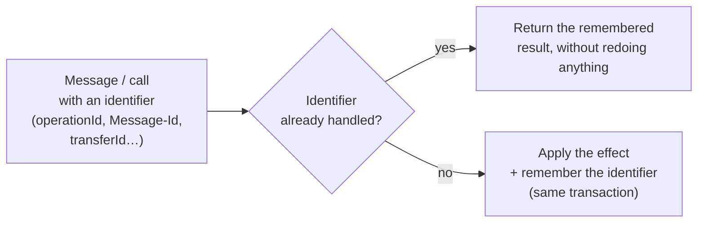
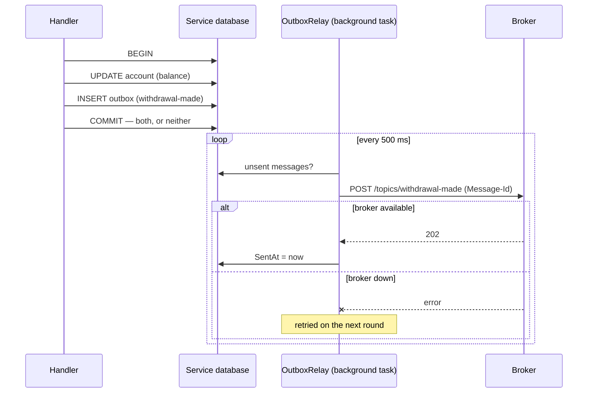
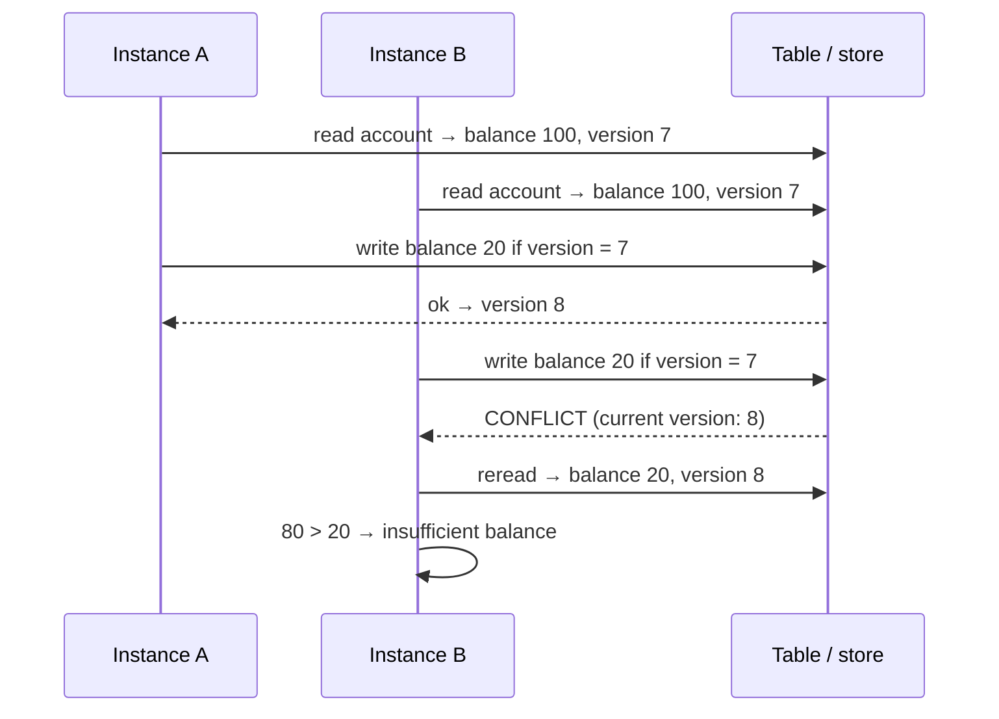
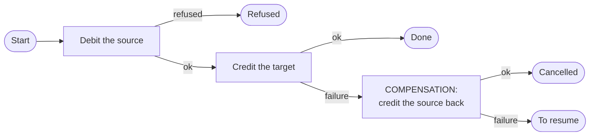
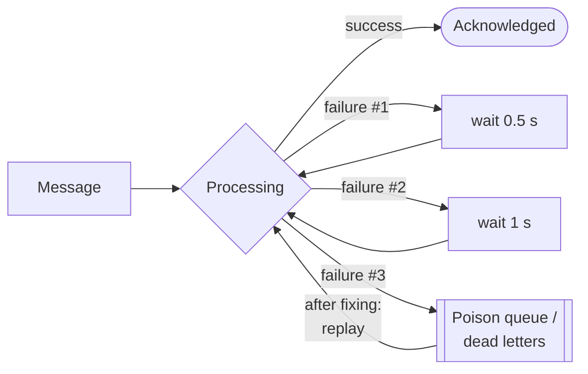
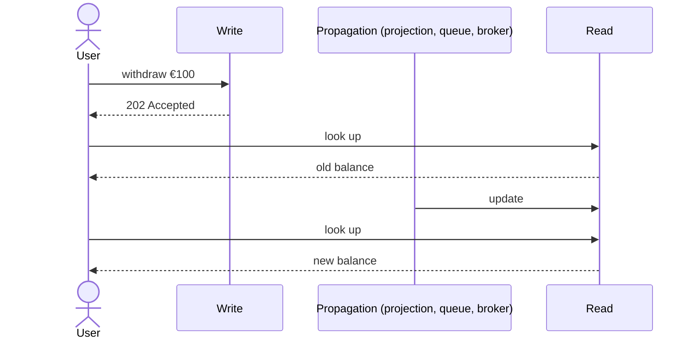
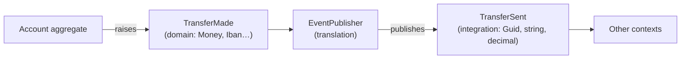

# ★ Cross-cutting concepts

As soon as a system has **several databases** (demos 6 to 12) or **several processes** (demos 8 and 12), two guarantees
we took for granted are lost: *the single transaction* and *the call that clearly succeeds or fails*. The same
mechanisms then come back in several demos. This page gathers them.

⬅️ [Contents](README.md) · 🌐 [Français](../concepts-transverses.md)

| Concept | Problem solved | Demos |
|---|---|---|
| [Idempotency](#idempotency) | The same call or message handled twice | 8, 10, 12, 14, 15, 17, 18, 20, 21, 22 |
| [Outbox](#outbox) | Saving data **and** publishing an event, without losing either | 8 (and 9, 22) |
| [Optimistic concurrency](#optimistic-concurrency) | Two simultaneous changes to the same data | 10, 12 (and the alternative: 18; the counter-example: 19) |
| [Compensation / saga](#compensation-and-saga) | No transaction across several databases | 6, 7, 8, 14, 17, 18, 21 |
| [Retries and dead letters](#retries-and-dead-letters) | Transient vs lasting failures | 8, 12, 14, 18, 21 |
| [Eventual consistency](#eventual-consistency) | Reads don't see writes right away | 8, 9, 10, 12, 19, 22 |
| [Domain vs integration events](#domain-vs-integration-events) | What you publish to others | 7, 9, 11 |

---

## Idempotency

**An operation is idempotent if executing it twice has the same effect as executing it once.**
Over a network, you never know whether a call that got no response was processed: you replay it. And a message broker
delivers "at least once". Without idempotency: a double debit.

| Technique | Example in the demos |
|---|---|
| Table of handled operations | [Micro.Accounts/Endpoints.cs](../../08-Microservices/Micro.Accounts/Endpoints.cs): `ProcessedOperations` by `operationId` |
| Table of handled messages | [Micro.Notifications/Program.cs](../../08-Microservices/Micro.Notifications/Program.cs): `ProcessedMessages` by `Message-Id` |
| Recent operations inside the entity | [Sls.Functions/Model.cs](../../12-Serverless/Sls.Functions/Model.cs): `Account.Operations` |
| Deterministic key (overwrite without duplicates) | [Sls.Functions/Functions.cs](../../12-Serverless/Sls.Functions/Functions.cs): notification `{account}/{transfer}` |
| Identifier derived from the input | `DeterministicId($"{file}#{line}")`: a reprocessed import creates no duplicates |
| Checkpoint | [Projector.cs](../../09-CQRS/Cqrs.Read/Projections/Projector.cs): `if (sequence <= LastSequence) return;` |
| Handled operations, migrated with the customer | [Store.cs](../../17-CellBased/Cell.App/Store.cs): `ProcessedOperations` follows the customer from one cell to another |
| Period key on the operation | [BankingService.cs](../../15-MultiTenant/Mt.Bank/BankingService.cs): `var key = $"fee-{month}";` (monthly fees charged once) |
| The actor's identity | [TransferActor.cs](../../18-ActorModel/Actors.Bank/TransferActor.cs): replaying `transfer/invoice-42` wakes up the same actor, which already knows the answer |
| One inbox per service | [Others.cs](../../21-Choreography/Choreo.Services/Others.cs): `Reactive.Once`, tested with a broker that delivers every event twice |
| Line reference, at two levels | [Filters.cs](../../20-Pipeline/Pipeline.Bank/Filters.cs): `Deduplicate` drops already executed references early; the ledger refuses as a last resort. An interrupted import is replayed as is |
| Operation identifier, in both directions of a synchronization | [BankingSystem.cs](../../22-StranglerFig/Fig.Legacy/BankingSystem.cs): the legacy ignores a batch resent after a lost response; [Domain.cs](../../22-StranglerFig/Fig.Modern/Domain.cs): the new system ignores the echo of its own writes (no loop) |

---

## Outbox

**Problem**: save a withdrawal then publish `WithdrawalMade`. If the process stops between the two, or if the broker is
down, the event is lost — or worse, published for a cancelled withdrawal.

**Solution**: write the message into an *outbox* table **in the same transaction** as the data, then publish it in the
background, retrying until it succeeds.

The relay may send a message twice (crash between the send and the update of `SentAt`): hence **idempotency** on the
subscribers' side. Code: [OutboxRelay.cs](../../08-Microservices/Micro.Accounts/OutboxRelay.cs). In CQRS, the event
log of [WriteDb](../../09-CQRS/Cqrs.Write/Persistence/WriteDb.cs) plays the same role. In demo 22, the operations
written by the new service wait in an outbox (`Store.ToForward`, filled under the same lock as the transfer) to be
carried over to the legacy system; they only leave it once the import is confirmed.

---

## Optimistic concurrency

**Problem**: two processes read an account at €100, each withdraws €80, and writes: the account shows €20 instead of a
refusal. **Solution**: each write states the **version** (or ETag) it read; if it has changed, the write is refused.

| | Event Sourcing | Serverless |
|---|---|---|
| Where | [EventStore.Add](../../10-EventSourcing/Es.Storage/EventStore.cs) | [ManagedTable.Write](../../12-Serverless/Sls.Platform/ManagedServices.cs) |
| Version | number of events in the stream | the entity's ETag |
| On conflict | 409 to the client (`If-Match`) | reread and retry ([`Concurrency.Modify`](../../12-Serverless/Sls.Functions/Model.cs)) |

"Optimistic": nothing is locked, you bet there will be no conflict, and detect it if there is one.

**The alternative: a single writer.** Rather than detecting conflicts, the [actor model](18-modele-acteurs.md) makes them
impossible: each account has a single owner, which handles its messages one at a time. The two €80 withdrawals arrive
in its mailbox and are handled one after the other; the second sees €20 and is refused, with no version and no retry.

**The counter-example: last write wins.** In the [space-based architecture](19-space-based.md), each unit writes to its
own replica without checking anything elsewhere; replication keeps the highest version and **throws the other away**.
Both €80 withdrawals are accepted, only one is debited. Only routing that gives each account to a single unit
(affinity) avoids these collisions.

---

## Compensation and saga

**Problem**: a transfer touches two accounts stored in **two databases** (or two services). No shared transaction.
**Solution**: a sequence of local steps; if a step fails, **compensating actions** are executed to cancel the previous
ones. A **saga** is that sequence of steps, with a state that says where it stands.

| Demo | Where | Specifics |
|---|---|---|
| 6 | [TransfersComponent.cs](../../06-Components/Components.Transfers/Internal/TransfersComponent.cs) | simple compensation, in the same process |
| 7 | [TransfersEndpoints.cs](../../07-ModularMonolith/Modular.Transfers/Internal/TransfersEndpoints.cs) | between two modules, via `IAccountsApi` |
| 8 | [Micro.Transfers/Endpoints.cs](../../08-Microservices/Micro.Transfers/Endpoints.cs) | saga with a status (`InProgress` → `Done` / `Refused` / `Cancelled` / `ToResume`), idempotent calls |
| 14 | [SagaEngine.cs](../../14-OrchestratedSaga/Saga.Orchestrator/SagaEngine.cs) | **orchestrated** saga: process described in one place, persistent state, waiting for an external event, point of no return |
| 18 | [TransferActor.cs](../../18-ActorModel/Actors.Bank/TransferActor.cs) | one **actor per transfer**, talking to two account actors; its stored state (`DebitDone`…) allows recovery after a failure |
| 21 | [Accounts.cs](../../21-Choreography/Choreo.Services/Accounts.cs) | **choreographed** saga: no coordinator; Accounts compensates by listening to the others' failures, and an expiring reservation unblocks a process left hanging |

Two ways to coordinate a saga: **choreography** (each service reacts to the others' events, demos 7, 8 and
[21](21-choregraphie.md)) and **orchestration** (an explicit conductor drives the steps, [demo 14](14-saga-orchestree.md)).
The steps after the **point of no return** (for example the final debit) are no longer compensated: they can only be retried.

A compensation doesn't erase the past: the customer sees a debit **then** a credit. It is a reverse entry, as in accounting.

---

## Retries and dead letters

A **transient** failure (network, restart) is fixed by retrying; a **lasting** failure (bug, invalid data) is not.
So you retry a limited number of times, with an **increasing wait** (*exponential backoff*), then set the message aside
(*dead letter*, *poison queue*) for a human to handle, without blocking the others.

| | Microservices | Serverless |
|---|---|---|
| HTTP calls | [`AddStandardResilienceHandler`](../../08-Microservices/Micro.Transfers/Program.cs): 3 retries + timeout + circuit breaker | — |
| Messages | [Broker](../../08-Microservices/Micro.Broker/Broker.cs): 8 attempts then dead letters | [QueueService](../../12-Serverless/Sls.Platform/ManagedServices.cs): 3 attempts then `-poison`, replayable |

The [actor model](18-modele-acteurs.md) applies the same idea to the actors themselves: a crashing actor is restarted
(up to 3 times per minute), then stopped and quarantined; the messages sent to it meanwhile are "dead letters", counted
by the runtime.

To be distinguished: a **business refusal** (insufficient balance) is **not** a failure. It must not trigger a retry
(see `TransfersFunctions.Execute`, which marks the transfer "Refusé" without throwing an exception).

---

## Eventual consistency

When writes and reads take different paths (events, projections, queues), **the read sees the write with a slight
delay**. The system is *eventually* consistent: once the messages have been processed.

Made visible in the CQRS demo (`Projections:DelayMs`, `GET /admin/projections`), in the microservices (Notifications
stopped then restarted), in serverless (`202` then `GET /transfers/{id}`) and during a migration (demo 22: a transfer
served by the legacy system only shows up in the lookup, served by the new one, at the next synchronization cycle). On
the interface side: show "in progress", return the known state right after a command, or poll until it is updated.

---

## Domain vs integration events

| | **Domain** event | **Integration** event |
|---|---|---|
| Scope | inside a context / module | between contexts, modules or services |
| Types | rich (`Money`, `Iban`, `AccountId`) | simple (`Guid`, `string`, `decimal`) |
| Stability | evolves freely with the model | public contract, to evolve carefully |
| Example | [`TransferMade`](../../11-DDD/Ddd.AccountKeeping.Domain/Foundations.cs) (DDD) | [`TransferSent`](../../11-DDD/Ddd.AccountKeeping.Contracts/Contracts.cs) (DDD), [`TransferMade`](../../07-ModularMonolith/Modular.Transfers.Contracts/TransferMade.cs) (demo 7) |

A good integration event carries **what the subscribers need** (for example the holders' names), so that they don't
have to call the publisher back: that is *event-carried state transfer*.
