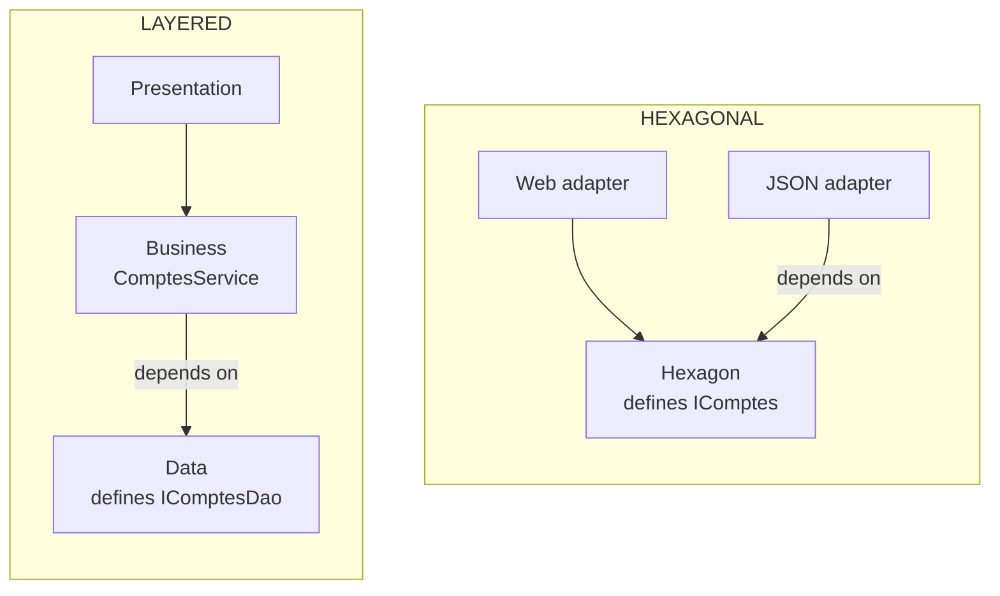

# Layered or Hexagonal?

> **The difference in one sentence**: in layers, the business **depends on the database**; in hexagonal, it is the
> other way around, the database **plugs into the business**. Everything else follows from that.

📁 Demos: [`00-Couches`](../../../00-Couches) · [`01-Hexagonale`](../../../01-Hexagonale) ·
📖 Pages: [Layered](../00-couches.md) · [Hexagonal](../01-hexagonale.md) · 🗂️ Cheat sheets: [0](../fiches/00-couches.md) · [1](../fiches/01-hexagonale.md)

⬅️ [Contents](README.md) · ➡️ [Hexagonal or Onion?](02-hexagonale-vs-onion.md) · 🌐 [Français](../../differences/01-couches-vs-hexagonale.md)

---

## What they share

Both separate the technology (HTTP, database) from the business, and both fit in **a single deployment**. The business
has the same rules (positive amount, sufficient balance), the scenario is the same.

## The differences point by point

| | Layered | Hexagonal |
|---|---|---|
| Picture | a stack: top → bottom | a center and a perimeter: inside / outside |
| The business references… | `Couches.Donnees` | **no project** |
| The data-access interface is defined by… | the data layer (`IComptesDao`) | the business (outbound port `IComptes`) |
| …in the vocabulary of… | persistence (`CompteEntite`, `Enregistrer`) | the business (`Compte`, `Charger`, `Sauvegarder`) |
| The entity | **anemic** (public setters); the rule is in the service | **rich**: `Compte.Retirer` protects its balance |
| Input channels | one: the presentation | several, on an equal footing: API, CLI, tests |
| Replacing the storage | touches the business (it handles the persistence entities) | write an adapter; the **contract tests** prove equivalence |
| Testing the business | with a fake DAO… which returns `CompteEntite` objects | with a test adapter, no database |
| Safeguard | non-transitive references | hexagon with no references + architecture test |

## Side by side



The arrow between the business and the data **changes direction**: that is dependency inversion.

## In the demos' code

The code is quoted exactly as it is, French comments included.

**Who defines the data-access contract.** In layers, it is the data layer, with its own types (the comment: the
interface is defined BY the data layer, in ITS vocabulary)
([ComptesDao.cs](../../../00-Couches/Couches.Donnees/ComptesDao.cs)):

```csharp
// The interface is defined BY the data layer, in ITS vocabulary (AccountEntity).
public interface IAccountsDao
{
    Task<AccountEntity?> ById(Guid id);
    Task Add(AccountEntity account);
    Task<bool> IsEmpty();
    Task Save();
}
```

In hexagonal, it is the business, which says what it needs
([PortsSortants.cs](../../../01-Hexagonale/Hexa.Hexagone/Ports/Sortants/PortsSortants.cs)):

```csharp
public interface IAccounts
{
    Task<Account?> Load(Guid id);
    Task Save(Account account);
}
```

**Where the rule lives.** Layered: in the service, on an entity anyone can modify — the entity being anemic, nothing
stops another class from doing `compte.Solde -= x` without this check
([ComptesService.cs](../../../00-Couches/Couches.Metier/ComptesService.cs)):

```csharp
// Since the entity is anemic, nothing stops another class from doing "account.Balance -= x"
// without going through this check: the rule is protected by discipline alone.
private static void CheckWithdrawalAllowed(AccountEntity account, decimal amount)
```

Hexagonal: in the entity itself, whose balance has no public setter
([Compte.cs](../../../01-Hexagonale/Hexa.Hexagone/Domaine/Compte.cs)):

```csharp
public decimal Balance { get; private set; }

public void Withdraw(decimal amount)
{
    CheckAmount(amount);
    if (amount > Balance)
        throw new BusinessRuleException("Insufficient balance.");
    Balance -= amount;
}
```

## The same withdrawal

| Step | Layered | Hexagonal |
|---|---|---|
| Input | `ComptesController` (the only possible entry) | Web adapter **or** CLI adapter, same use case |
| Load | `dao.ParId` → `CompteEntite` | `comptes.Charger` → domain `Compte` |
| Decide | `ComptesService.VerifierRetraitPossible` | `Compte.Retirer` |
| Modify | `compte.Solde -= montant` in the service | in `Compte.Retirer` |
| Save | `dao.Enregistrer()` (EF's `SaveChanges`) | `comptes.Sauvegarder(compte)`: memory or JSON file depending on configuration |

## How to choose

- **Layered** if the application is mostly CRUD, the rules fit in a few `if`s and the database won't change: it is simple
  and known by everyone.
- **Hexagonal** as soon as one of these signals appears: rules that multiply, the wish to test them without a database, a
  second input channel (CLI, messages), a storage likely to change.

## Moving from layers to hexagonal

1. Make the entity rich: move the rules from the service into the entity's methods, remove the public setters.
2. Move the data-access interface **into the business project**, rename it in the business's vocabulary.
3. Have the old data layer implement this interface (it now references the business).
4. Remove the business's reference to the data; an architecture test keeps it from coming back.

These steps can be done **one feature at a time**: nothing forces you to migrate everything at once.

## Misconceptions

- *"Hexagonal has six sides for six ports"*: no, the shape only leaves room to draw. You can have two ports or twenty.
- *"Layers are necessarily bad"*: for CRUD, dependency inversion brings nothing and costs interfaces. Layers remain a
  very good starting point.
