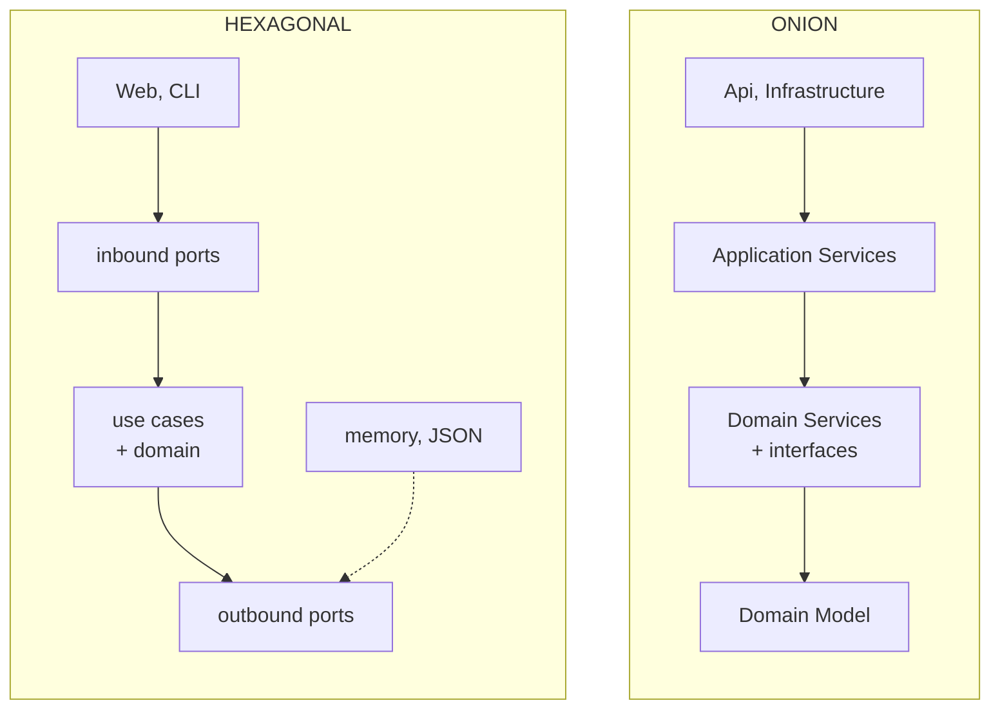

# Hexagonal or Onion?

> **The difference in one sentence**: **the same dependency rule** (everything points to the business), but hexagonal
> structures **the perimeter** (ports and adapters) while Onion structures **the center** (model, domain services,
> application services).

📁 Demos: [`01-Hexagonal`](../../../01-Hexagonal) · [`02-Onion`](../../../02-Onion) ·
📖 Pages: [Hexagonal](../01-hexagonale.md) · [Onion](../02-onion.md) · 🗂️ Cheat sheets: [1](../fiches/01-hexagonale.md) · [2](../fiches/02-onion.md)

⬅️ [Layered or Hexagonal?](01-couches-vs-hexagonale.md) · ➡️ [Onion or Clean?](03-onion-vs-clean.md) · 🌐 [Français](../../differences/02-hexagonale-vs-onion.md)

---

## What they share

The essentials: the business depends on nothing, the infrastructure implements interfaces declared at the center, a
*composition root* wires everything. A project built according to one is almost always readable with the other's
vocabulary. That is why they get confused, and why many ".NET Clean" templates are actually Onion.

## The differences point by point

| | Hexagonal (Cockburn, 2005) | Onion (Palermo, 2008) |
|---|---|---|
| What it draws | the **outside**: who calls, who is called | the **inside**: concentric layers |
| The center | one block: domain + use cases + ports | Domain Model → Domain Services → Application Services |
| Demo projects | `Hexa.Hexagon` (just one) + one project per adapter | `Onion.Domain`, `Onion.Application`, `Onion.Infrastructure`, `Onion.Api` |
| Vocabulary | inbound / outbound port, adapter, *driving* / *driven* | repository, unit of work, domain service, application service |
| A rule touching **two** accounts | in the use case | in a **domain service** (`TransferService`) |
| Saving a transfer | two `Save` calls, one per account | **one** unit of work: all or nothing |
| Inputs | highlighted: Web **and** CLI on the same use case | a single API; the point is elsewhere |
| What the tests check | **contract tests**: each adapter of a port passes the same suite | each layer only depends on the inner layers |

## Side by side



## In the demos' code: the same transfer

The code is quoted exactly as it is, French comments and messages included.

**Hexagonal**: the use case carries the "same account" rule and saves each account separately
([UseCases.cs](../../../01-Hexagonal/Hexa.Hexagon/Application/UseCases.cs)):

```csharp
public class MakeTransfer(IAccounts accounts, INotifications notifications) : IMakeTransfer
{
    public async Task Execute(Guid sourceId, Guid targetId, decimal amount)
    {
        if (sourceId == targetId)
            throw new BusinessRuleException("Cannot transfer to the same account.");

        var source = await accounts.Load(sourceId) ?? throw new AccountNotFoundException(sourceId);
        var target = await accounts.Load(targetId) ?? throw new AccountNotFoundException(targetId);

        source.Withdraw(amount);
        target.Deposit(amount);

        await accounts.Save(source);
        await accounts.Save(target);
        await notifications.TransferMade(sourceId, targetId, amount);
    }
}
```

**Onion**: the rule concerning two accounts is a **domain service**
([TransferService.cs](../../../02-Onion/Onion.Domain/Services/TransferService.cs)); the application service only
orchestrates, and saves **once** — all or nothing
([TransfersAppService.cs](../../../02-Onion/Onion.Application/TransfersAppService.cs)):

```csharp
public async Task<TransferResult> Transfer(Guid sourceId, Guid targetId, decimal amount)
{
    var source = await accounts.GetOrThrow(sourceId);
    var target = await accounts.GetOrThrow(targetId);

    // The rule (limit, same account, balance…) lives in the domain service.
    transferService.Transfer(source, target, amount);

    // A single commit for both accounts: all or nothing.
    await unitOfWork.Save();
    return new TransferResult(AccountDto.From(source), AccountDto.From(target));
}
```

What this changes:

- **Atomicity**: in the hexagonal demo, if the second save failed, the first would already be done. The `IAccounts` port
  offers no transaction. Onion makes it explicit with `IUnitOfWork`, which the `DbContext` implements.
- **Where rules go**: hexagonal doesn't say where to put a rule involving two entities; Onion gives it a layer.
- **Entry points**: hexagonal shows two inbound adapters on the same use case; that is its subject.

> Nothing prevents adding a unit of work to a hexagonal design (one more port), or a CLI to an Onion: each demo
> highlights what its author wanted to emphasize.

## How to choose

It isn't really an exclusive choice:

- if the challenge is **outside** (several channels, infrastructure to replace, adapters to prove equivalent), think in
  ports and adapters;
- if the challenge is **inside** (many rules, some across several entities, transactions), structure the center in
  Onion-style layers.

## Combining them

The most common combination in .NET: **an onion center** (`Domain`, `Application`) **surrounded by adapters**
(`Infrastructure.Persistence`, `Infrastructure.Messagerie`, `Api`, `Cli`), with contract tests on the adapters. Then
[DDD](06-ddd-vs-hexagonale-onion.md)'s value objects and aggregates are added at the center.

## Misconceptions

- *"Onion is an evolution of hexagonal"*: it is mostly another angle on the same rule.
- *"You need as many projects as layers"*: no. Folders and an architecture test are often enough; separate projects add
  the compiler's guarantee.
