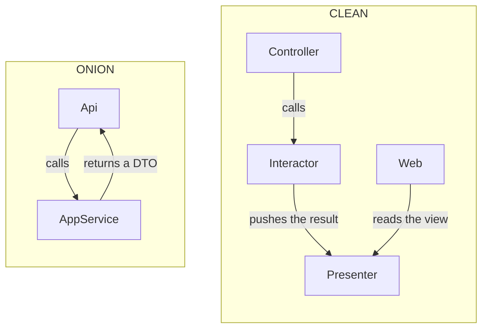

# Onion or Clean?

> **The difference in one sentence**: Clean keeps Onion's circles but **formalizes each use case** (one class, one
> input, one output) and **also inverts the output**: the interactor returns nothing, it pushes its result to a
> *presenter*.

📁 Demos: [`02-Onion`](../../../02-Onion) · [`03-Clean`](../../../03-Clean) ·
📖 Pages: [Onion](../02-onion.md) · [Clean](../03-clean.md) · 🗂️ Cheat sheets: [2](../fiches/02-onion.md) · [3](../fiches/03-clean.md)

⬅️ [Hexagonal or Onion?](02-hexagonale-vs-onion.md) · ➡️ [Clean or Vertical Slice?](04-clean-vs-vertical-slice.md) · 🌐 [Français](../../differences/03-onion-vs-clean.md)

---

## What they share

Concentric circles, the **dependency rule** (a circle only knows the inner circles), entities at the center, data access
behind an interface declared inside.

| Clean circle | Onion equivalent |
|---|---|
| ① Entities | Domain Model |
| ② Use Cases | Application Services (+ Domain Services) |
| ③ Interface Adapters | Infrastructure, controllers |
| ④ Frameworks & Drivers | Api (ASP.NET Core) |

## The differences point by point

| | Onion | Clean |
|---|---|---|
| A use case is… | a **method** of an application service | a **class**: `WithdrawalInteractor` |
| Input | parameters | a *request model* (`WithdrawalRequest`) via an *input boundary* (`IWithdrawalInput`) |
| Output | a **returned value** (`TransferResult`) or an exception | **nothing is returned**: a call to an *output boundary* (`IWithdrawalOutput`) |
| Business errors | exceptions, translated by a middleware | output methods: `Refused`, `AccountNotFound` |
| Formatting the response | the API, from the DTO | one **presenter** per format (HTTP, text) |
| Types for one withdrawal | 1 or 2 | ≈ 6 |
| Data access | repository + unit of work | *gateway* (`IAccountsGateway`) |
| Main cost | number of projects | **ceremony** |

## Side by side: the flow of the response



## In the demos' code

The code is quoted exactly as it is.

**Onion**: the application service returns its result; errors bubble up as exceptions
([TransfersAppService.cs](../../../02-Onion/Onion.Application/TransfersAppService.cs)):

```csharp
transferService.Transfer(source, target, amount);
await unitOfWork.Save();
return new TransferResult(AccountDto.From(source), AccountDto.From(target));
```

**Clean**: the interactor returns nothing; each outcome is a method of the output boundary
([Withdrawal.cs](../../../03-Clean/Clean.UseCases/Withdrawal/Withdrawal.cs)):

```csharp
public interface IWithdrawalOutput
{
    void Success(WithdrawalResponse response);
    void AccountNotFound(Guid accountId);
    void Refused(string reason);
}
```

```csharp
try
{
    account.Withdraw(request.Amount);
}
catch (BusinessRuleException e)
{
    output.Refused(e.Message);
    return;
}

await accounts.Save(account);
output.Success(new WithdrawalResponse(account.Id, oldBalance, account.Balance));
```

The outer circle creates the presenter, calls the controller, then reads the produced view
([Program.cs](../../../03-Clean/Clean.Web/Program.cs)):

```csharp
var presenter = new WithdrawalHttpPresenter();
await controller.Withdraw(id, body.Amount, presenter);
return ToHttp(presenter.View);
```

What this buys: **several presentations of the same use case** without touching it (the demo has a JSON presenter and
a text statement). What it costs: a **stateful** presenter, unnatural with ASP.NET Core, and six types where Onion has two.

## How to choose

- **Onion** (or a simplified "Clean") in the vast majority of APIs: one service or one handler per use case, returning a
  result.
- **Full Clean** when the same use case really has to feed several very different presentations (API, screen,
  statement, export) and the team accepts the ceremony.

## In between: the common .NET "Clean"

The popular templates (Jason Taylor, Ardalis) take Clean's circles and vocabulary, but **replace the presenter with a
return value** (`Result<T>`) and the interactor with a *handler* (often MediatR). The result is very close to an Onion
where each use case is a class. It is also a step toward [Vertical Slice](04-clean-vs-vertical-slice.md).

## Misconceptions

- *"Clean = 4 projects"*: the number of projects isn't Clean Architecture; the dependency rule is.
- *"A Clean project has no exceptions"*: the demo translates domain exceptions into output calls, but nothing forbids
  letting them bubble up; it is a choice, not a rule.
