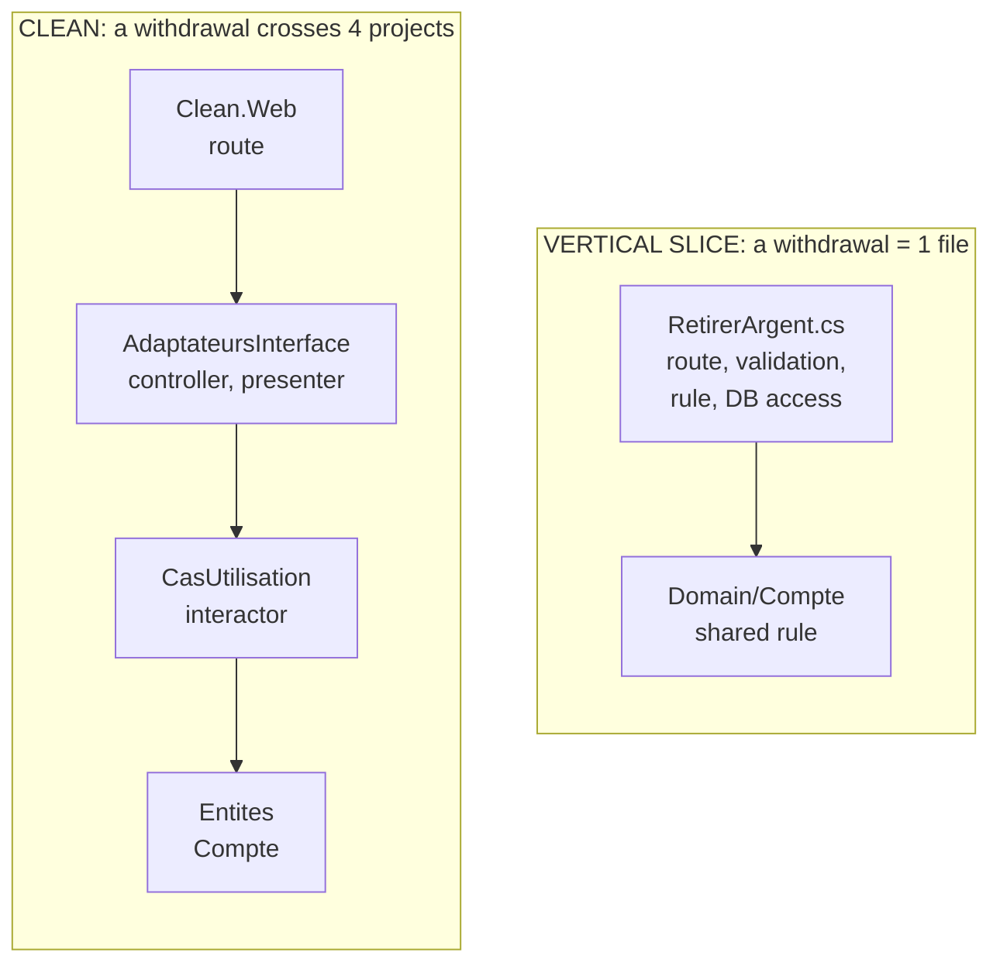

# Clean or Vertical Slice?

> **The difference in one sentence**: Clean splits the code **by technical layer** (a use case crosses four circles),
> Vertical Slice splits it **by feature** (a use case fits in one file).

📁 Demos: [`03-Clean`](../../../03-Clean) · [`05-VerticalSlice`](../../../05-VerticalSlice) ·
📖 Pages: [Clean](../03-clean.md) · [Vertical Slice](../05-vertical-slice.md) · 🗂️ Cheat sheets: [3](../fiches/03-clean.md) · [5](../fiches/05-vertical-slice.md)

⬅️ [Onion or Clean?](03-onion-vs-clean.md) · ➡️ [Hexagonal or Functional Core?](05-hexagonale-vs-coeur-fonctionnel.md) · 🌐 [Français](../../differences/04-clean-vs-vertical-slice.md)

---

## What they share

Both make the **use case** the basic unit of the code: `RetraitInteracteur` on one side, `RetirerArgent` on the other.
You easily find "what happens when you withdraw money". They diverge on everything else.

## The differences point by point

| | Clean | Vertical Slice |
|---|---|---|
| Split axis | **horizontal**: entities, use cases, adapters, web | **vertical**: one slice per query or command |
| Adding "withdraw money" | one file in each circle, 4 projects | **one file** + one line in `Program.cs` |
| Abstractions | one interface per boundary (input, output, gateway) | none "just in case": the `DbContext` already is repository + unit of work |
| Coupling | loose everywhere | **tight within** the slice, **loose between** slices |
| Reading and writing | same path (interactor, gateway) | each slice chooses: entity to write, **LINQ projection** to read |
| Shared rules | in the entities, from the start | **moved up** into `Domain/` when a second slice needs them |
| Changing database | rewrite the gateway | costlier: the `DbContext` is in every slice |
| Risk | ceremony, empty abstractions | duplication, bloated handlers |

## Side by side



## In the demos' code

The code is quoted exactly as it is, French comments included.

**Vertical Slice**: the complete slice, from the route to the database
([RetirerArgent.cs](../../../05-VerticalSlice/Vertical.Api/Features/Comptes/RetirerArgent.cs)):

```csharp
public static void Map(IEndpointRouteBuilder app) => app.MapPost("/accounts/{id:guid}/withdrawal", Execute);

private static async Task<IResult> Execute(Guid id, Request request, BankDbContext db)
{
    // … validation of the amount …
    var account = await db.Accounts.FindAsync(id);
    if (account is null)
        return Results.NotFound();

    if (account.Withdraw(request.Amount) is { } refusal)
        return Results.BadRequest(new { error = refusal });

    db.Operations.Add(new Operation { AccountId = id, Label = "Withdrawal", Amount = -request.Amount });
    await db.SaveChangesAsync();

    return Results.Ok(new Response(id, account.Balance));
}
```

**Clean**: the same withdrawal spread over the route ([Program.cs](../../../03-Clean/Clean.Web/Program.cs)), the
controller, the interactor ([Retrait.cs](../../../03-Clean/Clean.CasUtilisation/Retrait/Retrait.cs)), the presenter
([PresentersHttp.cs](../../../03-Clean/Clean.AdaptateursInterface/Presenters/PresentersHttp.cs)) and the gateway:

```csharp
public class WithdrawalInteractor(IAccountsGateway accounts) : IWithdrawalInput
{
    public async Task Execute(WithdrawalRequest request, IWithdrawalOutput output)
    {
        var account = await accounts.Load(request.AccountId);
        // … Refusal, AccountNotFound or Success, pushed to the presenter …
    }
}
```

**Reading** shows the gap best. Vertical Slice projects straight into the response, read-only, without going through the
domain ([ConsulterCompte.cs](../../../05-VerticalSlice/Vertical.Api/Features/Comptes/ConsulterCompte.cs)):

```csharp
var account = await db.Accounts
    .AsNoTracking()
    .Where(c => c.Id == id)
    .Select(c => new { c.Id, c.Owner, c.Balance })
    .FirstOrDefaultAsync();
```

In Clean, a lookup goes through the same path as a write: interactor, gateway, entity, presenter.

## How to choose

- **Vertical Slice** for a line-of-business API delivered feature by feature, where features evolve independently and
  the database won't change.
- **Clean** (or Onion) when the infrastructure must stay replaceable, the same rules serve several channels, or the
  domain is rich and shared by all features.

## Combining them

Common and effective: **vertical slices inside each module** of a
[modular monolith](09-monolithe-modulaire-vs-microservices.md), a rich domain for the shared rules, and hexagonal ports
**only around external services** (payment, email), where replacement is likely.

## Misconceptions

- *"Vertical Slice = no architecture"*: it is an architecture with rules (one slice per request, tight coupling inside,
  loose between), which requires the discipline to recognize and move up shared code.
- *"Vertical Slice requires MediatR"*: no, the demo does without it; one static method per slice is enough (MediatR has,
  incidentally, required a paid license for companies since 2025).
