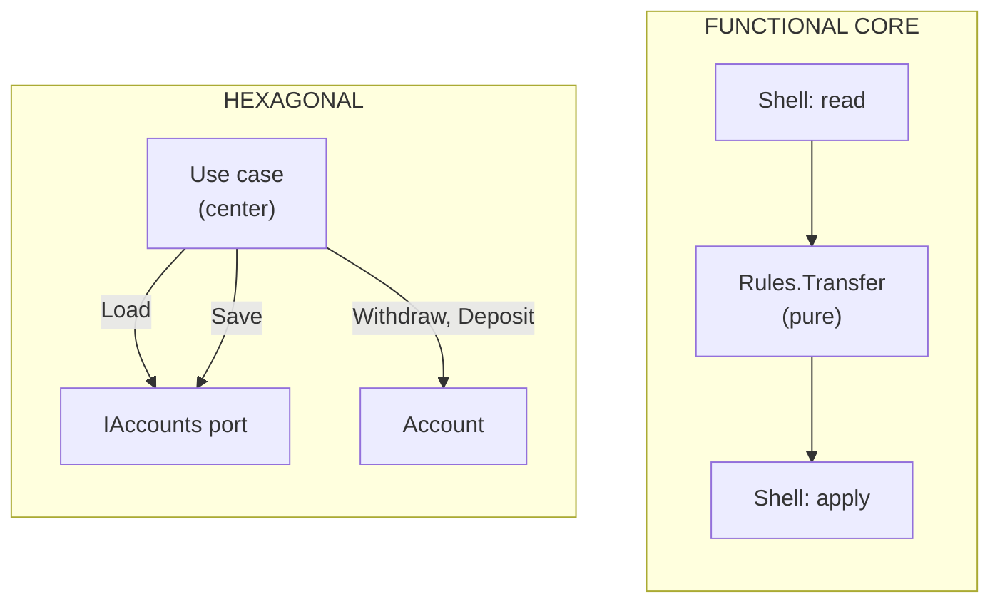

# Hexagonal or Functional Core?

> **The difference in one sentence**: the hexagonal center **still does input/output**, through ports; the functional
> core does **none at all**: it receives values and returns a decision, the shell does everything else.

📁 Demos: [`01-Hexagonal`](../../../01-Hexagonal) · [`04-FunctionalCore`](../../../04-FunctionalCore) ·
📖 Pages: [Hexagonal](../01-hexagonale.md) · [Functional Core](../04-coeur-fonctionnel.md) · 🗂️ Cheat sheets: [1](../fiches/01-hexagonale.md) · [4](../fiches/04-coeur-fonctionnel.md)

⬅️ [Clean or Vertical Slice?](04-clean-vs-vertical-slice.md) · ➡️ [DDD or Hexagonal / Onion?](06-ddd-vs-hexagonale-onion.md) · 🌐 [Français](../../differences/05-hexagonale-vs-coeur-fonctionnel.md)

---

## What they share

The business ignores HTTP, the database and the file system; it is tested without infrastructure. The functional core
is often described as **hexagonal taken to the extreme**.

## The differences point by point

| | Hexagonal | Functional Core |
|---|---|---|
| The center calls… | **outbound ports** (`IAccounts.Load`, `INotifications`) | **nothing** |
| Style | objects, `async`, entities modified in place | **pure** functions, immutable `record`s (`account with { Balance = … }`) |
| Who orchestrates read → decide → write | the use case, **at the center** | the **shell**, outside |
| What the rule returns | nothing (it modifies the entity) or an exception | a **decision**: `Accepted` or `Refused` |
| Time ("today") | read at the center through a port (clock) if needed | **an input** computed by the shell |
| Testing the center | with test adapters (memory, fakes) | values → value, **no test doubles** |
| Limit | interfaces to maintain | load everything **before** deciding |

## Side by side



## In the demos' code

The code is quoted exactly as it is.

**Hexagonal**: the use case, at the center, loads, modifies and saves through its ports
([UseCases.cs](../../../01-Hexagonal/Hexa.Hexagon/Application/UseCases.cs)):

```csharp
var source = await accounts.Load(sourceId) ?? throw new AccountNotFoundException(sourceId);
var target = await accounts.Load(targetId) ?? throw new AccountNotFoundException(targetId);

source.Withdraw(amount);
target.Deposit(amount);

await accounts.Save(source);
await accounts.Save(target);
```

**Functional Core**: the rule receives everything it needs, including the day's total, and returns a decision
([Rules.cs](../../../04-FunctionalCore/Functional.Core/Rules.cs)):

```csharp
public static TransferDecision Transfer(Account source, Account target, decimal amount, decimal alreadyTransferredToday)
{
    if (source.Id == target.Id)
        return new TransferDecision.Refused("Cannot transfer to the same account.");
    // … daily limit, then reuse of the withdrawal rule …
}
```

The shell does the three stages (2. DECIDE, pure; 3. APPLY, I/O)
([Endpoints.cs](../../../04-FunctionalCore/Functional.Shell/Endpoints.cs)):

```csharp
// 2. DECIDE (pure)
var decision = Rules.Transfer(source.ToCore(), target.ToCore(), request.Amount, alreadyTransferred);

// 3. APPLY (I/O)
switch (decision)
{
    case TransferDecision.Accepted ok:
        source.Balance = ok.Source.Balance;
        target.Balance = ok.Target.Balance;
        // … operations, SaveChangesAsync, 200 …
    case TransferDecision.Refused refusal:
        return Results.BadRequest(new { error = refusal.Reason });
}
```

What this changes:

- **Tests**: the daily limit rule is tested with numbers, without a database or a fake clock.
- **Decisions are data**: they can be logged, compared, replayed.
- **The constraint**: the shell must know **in advance** everything the rule will read (here, the day's total
  transfers). If the decision requires cascading reads ("if X, then go fetch Y"), the pure core becomes hard.

## How to choose

They are not two competing architectures at the same level:

- **hexagonal** organizes the whole application and its boundaries;
- the **functional core** suits **complex rules** (pricing, eligibility, limits, calculations) and lives **inside** the
  hexagon, an Onion, or even a vertical slice.

## Combining them

A hexagonal use case can become a small shell: it reads through its ports, calls a pure rule, applies the decision
through its ports. You keep interchangeable adapters **and** rules testable without test doubles. The same principle,
*deciding* separated from *applying*, underpins [Event Sourcing](../10-event-sourcing.md).

## Misconceptions

- *"Functional = F#"*: the demo is in C#: `record`, `with`, `switch` on closed types are enough.
- *"No more mocks at all"*: the shell still has to be tested, with a few integration tests; it is the rules that no
  longer need them.
