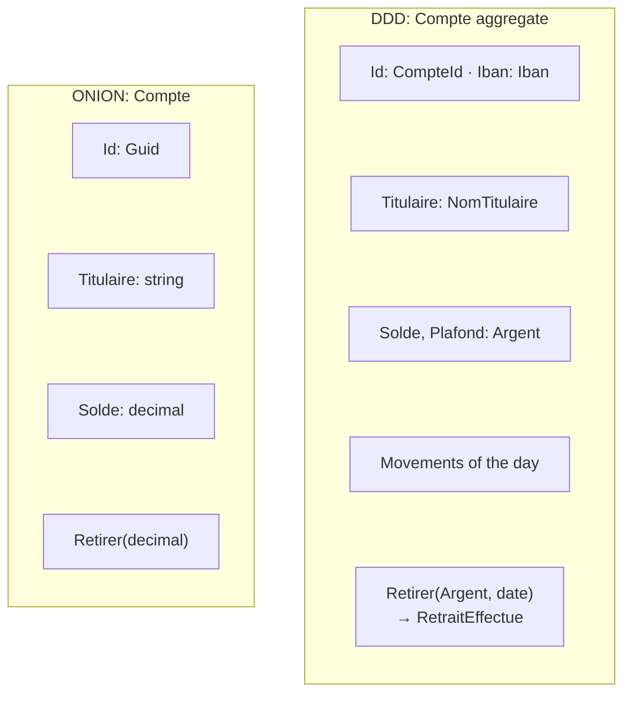

# DDD or Hexagonal / Onion?

> **The difference in one sentence**: hexagonal and Onion say **how to arrange** the code and which way the
> dependencies go; DDD says **what to model** and **where to cut**. They are not competitors: DDD fills the center that
> the other two protect.

📁 Demos: [`02-Onion`](../../../02-Onion) · [`11-DDD`](../../../11-DDD) (on an Onion base) ·
📖 Pages: [Hexagonal](../01-hexagonale.md) · [Onion](../02-onion.md) · [DDD](../11-ddd.md) ·
🗂️ Cheat sheets: [1](../fiches/01-hexagonale.md) · [2](../fiches/02-onion.md) · [11](../fiches/11-ddd.md)

⬅️ [Hexagonal or Functional Core?](05-hexagonale-vs-coeur-fonctionnel.md) · ➡️ [CQRS or Event Sourcing?](07-cqrs-vs-event-sourcing.md) · 🌐 [Français](../../differences/06-ddd-vs-hexagonale-onion.md)

---

## What they share

The business at the center, isolated from the infrastructure; repositories declared inside and implemented outside;
entities that protect their rules. The DDD demo actually reuses the Onion organization (`Domaine`, `Application`,
`Infrastructure`, `Api`).

## The differences point by point

| | Hexagonal / Onion | DDD |
|---|---|---|
| Nature | a **structure**: projects, interfaces, direction of references | a **design approach**: language, model, split |
| Question | where to put this code, who depends on whom? | what is an "account" here, and where does this model stop? |
| The center | empty: "put the domain there" | filled: value objects, aggregates, factories, domain services, events |
| Domain types | `decimal`, `string`, `Guid` | `Argent` (amount + currency), `Iban`, `NomTitulaire`, `CompteId` |
| The names | the developers' | the experts', recorded in a glossary (`LANGAGE.md`) |
| Scale | one application | also **the whole system**: bounded contexts and context map |
| Relationships with the outside | adapters | **anti-corruption layer**, published language, open host service |
| What it requires | technical discipline | **available domain experts** |

## Side by side: the same account



## In the demos' code

The code is quoted exactly as it is, French comments and messages included.

**Onion**: a correct entity, but made of primitive types
([Compte.cs](../../../02-Onion/Onion.Domain/Model/Compte.cs)):

```csharp
public class Account
{
    public Guid Id { get; private set; }
    public string Owner { get; private set; }
    public decimal Balance { get; private set; }
```

Nothing prevents adding euros and dollars, or passing a malformed IBAN in a `string`.

**DDD**: errors become impossible by construction. An `Argent` (money) refuses to mix currencies — a domain rule,
carried by the type itself ([Argent.cs](../../../11-DDD/Ddd.TenueDeCompte.Domaine/ObjetsValeurs/Argent.cs)):

```csharp
// The operations refuse to mix currencies: it is a domain rule, carried by the type itself.
public static Money operator +(Money a, Money b) => new(a.Amount + b.Amount, SameCurrency(a, b));
```

And the **aggregate's boundary** is dictated by an invariant: to check the **daily** limit, the account contains its
movements of the day ([Compte.cs](../../../11-DDD/Ddd.TenueDeCompte.Domaine/Comptes/Compte.cs)):

```csharp
public void Withdraw(Money amount, DateTime date)
{
    CheckDebitPossible(amount);

    var alreadyWithdrawn = WithdrawalsOfTheDay(date);
    if (alreadyWithdrawn + amount > DailyWithdrawalLimit)
        throw new BusinessRuleException(
            $"Daily withdrawal limit of {DailyWithdrawalLimit} exceeded (already withdrawn today: {alreadyWithdrawn}).");

    Balance -= amount;
    _movements.Add(new Movement(date, MovementType.Withdrawal, amount, "Withdrawal"));
    Raise(new WithdrawalMade(Id, amount, date));
}
```

**What neither hexagonal nor Onion says**: that an "account" isn't the same thing for Account Keeping (a balance, a
limit) and for Compliance (a due diligence case, always in euros). DDD makes them **two contexts**, each with its model,
connected by a published event (`VirementEmis`) and an explicit request (`BloquerCompte`). In front of the legacy exchange
system, an **anti-corruption layer**
([CoucheAntiCorruption.cs](../../../11-DDD/Ddd.TenueDeCompte.Infrastructure/CoucheAntiCorruption.cs)) translates its
format into our language. In terms of code, it is a hexagonal adapter; what DDD adds is the reason: not letting someone
else's model pollute ours.

## How to choose

You don't choose one **instead of** the other:

- a structure (Hexagonal, Onion or Clean) is useful as soon as the business has rules;
- **tactical DDD** (value objects, aggregates) is worth the effort when the business is rich and type errors
  (currencies, identifiers, units) are costly;
- **strategic DDD** (bounded contexts) becomes essential when several teams or subdomains share the same system: it says
  where to cut the [modules](../07-monolithe-modulaire.md) and the [services](../08-microservices.md).

## Misconceptions

- *"Doing DDD = having Entities, ValueObjects, Repositories folders"*: that is the tactical toolbox, the least important
  part. Without a shared language or contexts, it isn't DDD.
- *"DDD = microservices"*: bounded contexts give boundaries; they can stay modules of a single deployment.
- *"DDD applies everywhere"*: for CRUD, it is a lot of ceremony for nothing.
