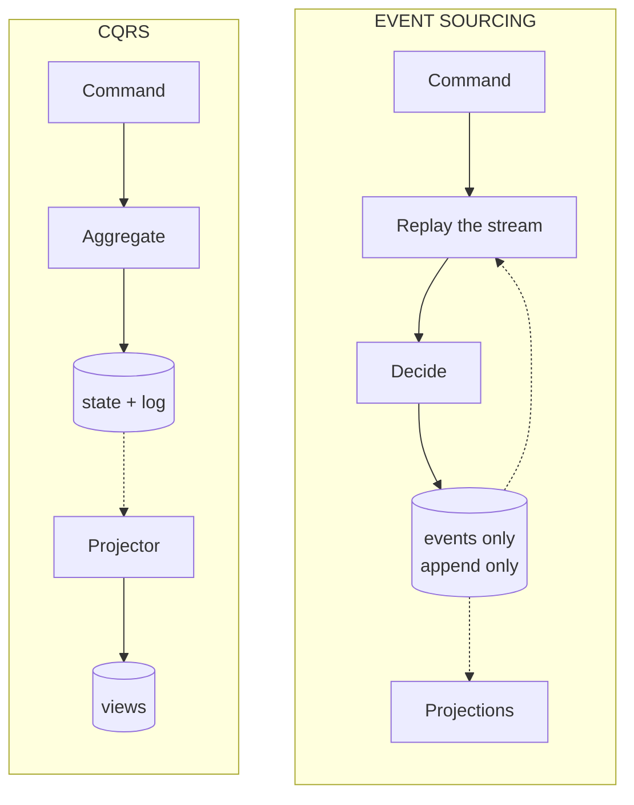

# CQRS or Event Sourcing?

> **The difference in one sentence**: CQRS **separates reading from writing**; Event Sourcing **changes what is stored**
> (the facts, not the state). One doesn't imply the other, even though they often go together.

📁 Demos: [`09-CQRS`](../../../09-CQRS) · [`10-EventSourcing`](../../../10-EventSourcing) ·
📖 Pages: [CQRS](../09-cqrs.md) · [Event Sourcing](../10-event-sourcing.md) · 🗂️ Cheat sheets: [9](../fiches/09-cqrs.md) · [10](../fiches/10-event-sourcing.md)

⬅️ [DDD or Hexagonal / Onion?](06-ddd-vs-hexagonale-onion.md) · ➡️ [Package by Component or Modular Monolith?](08-composants-vs-monolithe-modulaire.md) · 🌐 [Français](../../differences/07-cqrs-vs-event-sourcing.md)

---

## What they share

**Events** (`CompteOuvert`, `ArgentRetire`…), **projections** that build read views, and **eventual consistency**
between what is written and what is read. Hence the confusion.

## The differences point by point

| | CQRS | Event Sourcing |
|---|---|---|
| What it separates / changes | two **models**: write (rules) and read (views) | the **persistence**: an append-only event log |
| What is stored on the write side | the account's **state** (balance) **and** an event log | **only the events**; the balance is recomputed |
| Role of the events | **feed** the read views | **be the truth**: the state only exists by replaying them |
| If the events are lost… | the state remains; the views can no longer be rebuilt | everything is lost |
| Loading an account | read a row | replay its stream (from a snapshot) |
| Correcting a mistake | an update | a **compensating event**; nothing is erased |
| Concurrency | the database's | **version number**: 409 if the stream has moved |
| History, time travel | no (only the final state is reliable) | **yes**, by construction |
| Evolving an event | easy (it only serves the views) | **upcasting** forever: old events stay in the store |
| Two databases? | not required (two models on one database is enough) | a store + the views |

## Side by side



## In the demos' code

The code is quoted exactly as it is, French comments and messages included.

**CQRS**: the write side saves the **state** (the entities tracked by EF Core) **and** appends the events to the log,
in the same transaction ([EcritureDb.cs](../../../09-CQRS/Cqrs.Ecriture/Persistance/EcritureDb.cs)):

```csharp
public async Task Enregistrer(params IEvenementDomaine[] evenementsSupplementaires)
{
    var evenements = ChangeTracker.Entries<Compte>()
        .SelectMany(entree => entree.Entity.ExtraireEvenements())
        .Concat(evenementsSupplementaires)
        .ToList();
    // … chaque événement ajouté à la table Evenements …
    await SaveChangesAsync();
}
```

**Event Sourcing**: there is no "balance" column. The aggregate **decides** (and produces an event), then **applies**
the event to evolve its in-memory state ([Compte.cs](../../../10-EventSourcing/Es.Domaine/Compte.cs)):

```csharp
// ─── Décisions ───
// …
public void Retirer(decimal montant, string motif, DateTime date)
{
    VerifierOuvert();
    VerifierMontant(montant);
    if (montant > Solde)
        throw new RegleMetierException("Solde insuffisant.");
    Enregistrer(new ArgentRetire(Id, montant, motif, date));
}
```

```csharp
public static Compte Reconstituer(IEnumerable<IEvenement> historique) =>
    DepuisInstantane(null, historique);
```

And the store refuses to write if the stream has moved since it was loaded
([MagasinEvenements.cs](../../../10-EventSourcing/Es.Stockage/MagasinEvenements.cs)):

```csharp
var actuelle = _evenements.Count(e => e.Flux == ecriture.Flux);
if (actuelle != ecriture.VersionAttendue)
    throw new ConflitDeConcurrenceException(ecriture.Flux, ecriture.VersionAttendue, actuelle);
```

**What only one side can do**: both demos can throw away their views and rebuild them by replaying their events. But only
Event Sourcing can **recover the write state at a past version** (`GET /comptes/{id}/etat?version=2`): in CQRS, the state
is overwritten with each change, and the log is just a complement, which doesn't guarantee an aggregate can be rebuilt.
In Event Sourcing, the log **is** the aggregate, and a projection added afterwards ("largest withdrawals") immediately
knows the whole past.

## The same withdrawal

| Step | CQRS | Event Sourcing |
|---|---|---|
| Load | read the account's row | read the stream (after the last snapshot), replay |
| Decide | aggregate method | aggregate method (decide / apply) |
| Write | modified state + event in the log, one transaction | **one event appended**, if the version hasn't changed |
| Response | 202: the read side will follow | 200 with the balance and the version; 409 if `If-Match` no longer matches |
| Read | projected view (2 s deliberate lag in the demo) | projected views, or state recomputed on demand |

## How to choose

- **CQRS alone** when reads are far more numerous or very different from writes (dashboards, statements, searches): each
  side is optimized. The simplest variant (two models, one database, synchronous read) is often enough.
- **Event Sourcing** when **history is business data**: banking, accounting, insurance, regulatory audit. And only in
  those modules.
- **Both**: the most common case for Event Sourcing, which needs views to read efficiently.

## Misconceptions

- *"CQRS requires two databases and eventual consistency"*: no, separating the models on one database, with a
  synchronous read, is already CQRS.
- *"Event Sourcing = an event bus"*: the event store is a **database**; publishing messages to other services is another
  subject.
- *"With Event Sourcing, nothing can be erased, so no GDPR"*: personal data is encrypted and the key destroyed.
