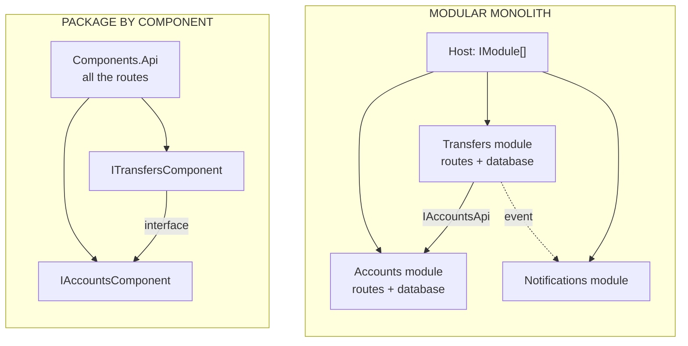

# Package by Component or Modular Monolith?

> **The difference in one sentence**: a component is **business logic and its database behind an interface**; a module
> is **a mini-application**: it also owns its HTTP routes and its event subscriptions, and is plugged in with one line.

📁 Demos: [`06-Components`](../../../06-Components) · [`07-ModularMonolith`](../../../07-ModularMonolith) ·
📖 Pages: [Package by Component](../06-composants.md) · [Modular Monolith](../07-monolithe-modulaire.md) ·
🗂️ Cheat sheets: [6](../fiches/06-composants.md) · [7](../fiches/07-monolithe-modulaire.md)

⬅️ [CQRS or Event Sourcing?](07-cqrs-vs-event-sourcing.md) · ➡️ [Modular Monolith or Microservices?](09-monolithe-modulaire-vs-microservices.md) · 🌐 [Français](../../differences/08-composants-vs-monolithe-modulaire.md)

---

## What they share

A single deployment; **one database per unit** (Transfers never reads the Accounts tables); everything that isn't the
contract is `internal`, so the compiler prevents shortcuts; a transfer between two units is made **without a shared
transaction**, with compensation if the credit fails.

## The differences point by point

| | Package by Component | Modular Monolith |
|---|---|---|
| Public surface | an interface (`IAccountsComponent`) + DTOs + `AddAccountsComponent()` | an `IModule` class; the contract lives in a **separate project** (`Modular.Accounts.Contracts`) |
| HTTP routes | in the **shared web layer** (`Components.Api`), which calls the components | in **each module** (`MapEndpoints`) |
| Communication | interface calls, synchronous | contract calls **and events** published on a bus |
| Adding a reaction (notify…) | modify the caller | add a subscribing module, without touching the others |
| Adding / removing a feature | modify the API and the injection | one line in `IModule[] modules = [...]` |
| Who references whom | Transfers references the Accounts **project** (for the interface) | Transfers only references **Accounts.Contracts** |
| Safeguard | `internal` + a test that freezes the list of public types | `internal` + Contracts project + architecture tests (no module references another's implementation) |
| Next step | group a component with its API and its events | a module becomes a service |

## Side by side



## In the demos' code

The code is quoted exactly as it is, French comments included.

**Package by Component**: the web layer declares the routes and calls the component through its interface
([Program.cs](../../../06-Components/Components.Api/Program.cs)):

```csharp
// Try writing "new AccountsDbContext(...)" or "new Account(...)" here: it does not compile.
app.MapPost("/accounts/{id:guid}/withdrawal", async (Guid id, WithdrawalRequest request, IAccountsComponent accounts) =>
    ToHttp(await accounts.Withdraw(id, request.Amount)));
```

**Modular Monolith**: the host only knows modules, each one brings its routes, its database, its subscriptions
([Program.cs](../../../07-ModularMonolith/Modular.Host/Program.cs)):

```csharp
// The list of modules: removing a line removes a whole feature (routes, database, subscriptions).
IModule[] modules = [new AccountsModule(), new TransfersModule(), new NotificationsModule()];
```

A module's contract also contains **its events**
([Contracts.cs](../../../07-ModularMonolith/Modular.Accounts.Contracts/Contracts.cs)):

```csharp
// ─── Asynchronous communication: the events the module publishes ───
public record WithdrawalMade(Guid AccountId, decimal Amount, decimal NewBalance) : IIntegrationEvent;
```

And a module can be **added without touching the others**: Notifications only subscribes
([NotificationsModule.cs](../../../07-ModularMonolith/Modular.Notifications/NotificationsModule.cs)):

```csharp
// Subscriptions to the other modules' events.
services.AddScoped<IEventHandler<WithdrawalMade>, OnWithdrawalMade>();
services.AddScoped<IEventHandler<TransferMade>, OnTransferMade>();
```

In the Package by Component demo, notifying Bob of a transfer would require modifying `TransfersComponent` (or the web
layer) to call a notifications component.

**The transfer itself is almost identical**: debit, credit, compensate if the credit fails
([TransfersComponent.cs](../../../06-Components/Components.Transfers/Internal/TransfersComponent.cs),
[TransfersEndpoints.cs](../../../07-ModularMonolith/Modular.Transfers/Internal/TransfersEndpoints.cs)). The
difference comes **after**: the module publishes `TransferMade` on the bus.

## How to choose

- **Package by Component** for a medium-sized application you want to protect from shortcuts, with a single team and a
  single API.
- **Modular Monolith** as soon as there are several subdomains, features react to other features, or different teams
  own parts: each module evolves with its routes and its database.

## Moving from components to modules

1. Move the interface and the DTOs out into a `*.Contracts` project.
2. Move the routes from the web layer into the component (`MapEndpoints`), which becomes an `IModule`.
3. Replace "notify" calls with published events.
4. Add the architecture tests: no module references another's implementation.

## Misconceptions

- *"A module = a folder"*: without `internal`, separate contracts and tests, a folder prevents nothing.
- *"One database per unit necessarily means several database servers"*: in the demos, they are distinct logical
  databases; in production, separate schemas on the same server are often enough.
