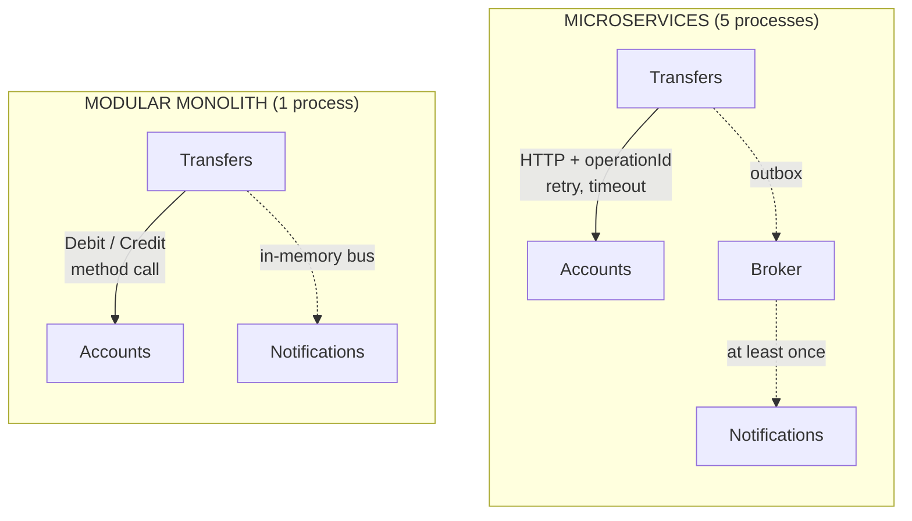

# Modular Monolith or Microservices?

> **The difference in one sentence**: between two parts of the system, a **method call** or **the network**. Everything
> that was free in the monolith (a call that succeeds, an event that isn't lost) becomes code in microservices.

📁 Demos: [`07-ModularMonolith`](../../../07-ModularMonolith) · [`08-Microservices`](../../../08-Microservices) ·
📖 Pages: [Modular Monolith](../07-monolithe-modulaire.md) · [Microservices](../08-microservices.md) ·
🗂️ Cheat sheets: [7](../fiches/07-monolithe-modulaire.md) · [8](../fiches/08-microservices.md)

⬅️ [Package by Component or Modular Monolith?](08-composants-vs-monolithe-modulaire.md) · ➡️ [Microservices or Serverless?](10-microservices-vs-serverless.md) · 🌐 [Français](../../differences/09-monolithe-modulaire-vs-microservices.md)

---

## What they share

The **same split**: Accounts, Transfers, Notifications. Demo 8 is literally demo 7 cut into processes. One database per
part, contracts between parts, events to notify, compensation if the credit fails.

## The differences point by point

| | Modular Monolith | Microservices |
|---|---|---|
| Deployments | **1** process | **5** (gateway, 3 services, broker) |
| The contract | a C# project (`Modular.Accounts.Contracts`) | **the exchanged JSON**: no shared code, each client has its copy of the remote model |
| Call between parts | `IAccountsApi.Debit(...)`: succeeds or throws an exception | HTTP: **retry, timeout, circuit breaker** |
| A replayed call | impossible | common (lost response) → **idempotency** through `operationId` |
| Events | **in-memory** bus: lost if the process goes down | **outbox** (same transaction) + "at least once" broker |
| A message received twice | impossible | common → the subscriber ignores **duplicates** (`Message-Id`) |
| State of a transfer | succeeded or compensated, within the request | a **saga with a status**: `InProgress`, `Done`, `Cancelled`, `ToResume` |
| One part down | the whole process is down | the others carry on; **eventual consistency** |
| Scaling | the whole | **per service** |
| Safeguard | `internal` + architecture tests | **the network**: impossible to cheat |
| Operations | one log, one debugger | distributed tracing, monitoring, multiple deployments |

## Side by side: the same transfer



## In the demos' code

The code is quoted exactly as it is, French comments included.

**The call.** Monolith: a method of the contract
([TransfersEndpoints.cs](../../../07-ModularMonolith/Modular.Transfers/Internal/TransfersEndpoints.cs)):

```csharp
// Synchronous call to another module, only through its public contract.
var debit = await accounts.Debit(source.Id, request.Amount);
```

Microservices: an HTTP client armed against failures
([Micro.Transfers/Program.cs](../../../08-Microservices/Micro.Transfers/Program.cs)):

```csharp
// Calls to the Accounts service: the network can fail, so we protect ourselves.
// Retry (including on POST: safe, because the calls carry an idempotent operationId),
// timeout per attempt and circuit breaker so as not to insist on a service that is down.
builder.Services.AddHttpClient("accounts", (sp, client) =>
        client.BaseAddress = new Uri(sp.GetRequiredService<IConfiguration>()["Services:Accounts"]!))
    .AddStandardResilienceHandler(options =>
    {
        options.Retry.MaxRetryAttempts = 3;
        options.Retry.Delay = TimeSpan.FromMilliseconds(200);
    });
```

**The retry requires idempotency** on the Accounts side ([Micro.Accounts/Endpoints.cs](../../../08-Microservices/Micro.Accounts/Endpoints.cs)):

```csharp
if (await db.ProcessedOperations.FindAsync(request.OperationId) is { } alreadyProcessed)
    return Respond(alreadyProcessed);
```

**The event.** Monolith: published on the bus after saving; if the process goes down between the two, the event is
lost. Microservices: written **in the same transaction** as the data, then relayed:

```csharp
// Change AND event saved together: either both, or neither.
db.Outbox.Add(OutboxMessage.Create("withdrawal-made",
    new { accountId = id, amount = request.Amount, newBalance = account.Balance }));
await db.SaveChangesAsync();
```

**The compensation.** Monolith: if the credit fails, the source is credited back, and that call necessarily succeeds.
Microservices: the compensation itself can fail (Accounts unreachable); the transfer then goes to `ToResume` (to
resume), a state that doesn't exist in the monolith.

Result: with equal features, most of demo 8's extra code is there to **handle network failures**.

## How to choose

- **Modular monolith first**: it brings most of the benefits (clear boundaries, teams per module) at a fraction of the
  cost.
- **Microservices** when at least one of these needs is real: deploying one part without the others, sizing it
  separately, writing it in another technology, letting teams move without coordinating. **And** when the organization
  knows how to operate a distributed system.

## Moving from one to the other

Thanks to the modular monolith's boundaries, you extract **one module at a time**:

1. its C# contract becomes an HTTP API (and its client, a copy of the JSON);
2. its in-memory bus becomes a broker, with an outbox on the publisher's side and deduplication on the subscriber's;
3. its callers gain retry, timeout, idempotency;
4. a gateway hides the split from the clients.

That is exactly the move from demo 7 to demo 8. To do it **in production, without downtime**, see the
[Strangler Fig](../22-strangler-fig.md).

## Misconceptions

- *"Microservices are for performance"*: a network call is thousands of times slower than a method call; you gain
  independence, not speed.
- *"A monolith is necessarily a plate of spaghetti"*: it is the **non-modular** monolith that is.
- *"Sharing a model library between services saves time"*: it recreates the monolith's coupling, without its advantages.
