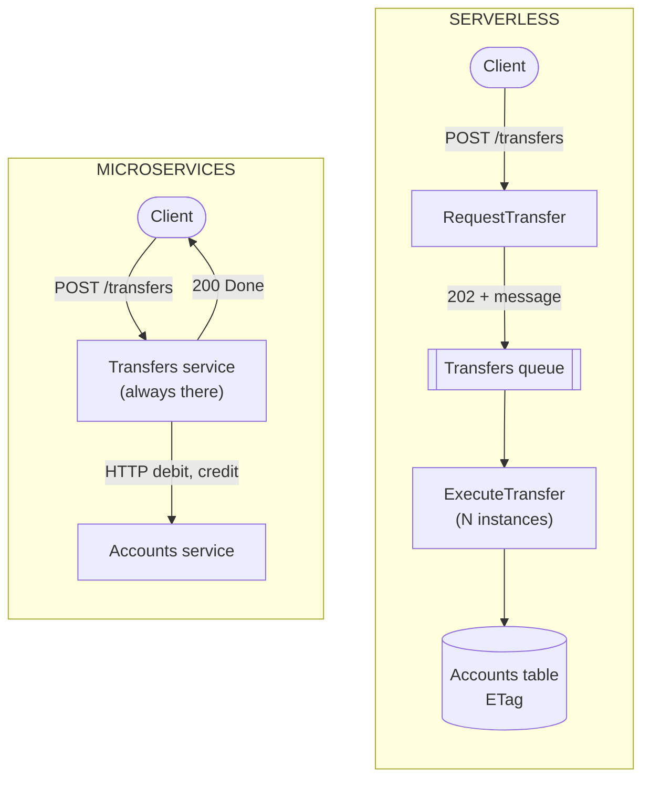

# Microservices or Serverless?

> **The difference in one sentence**: a microservice is a **process that runs continuously**, which you operate; a
> serverless function **only exists for the duration of an event**, on servers managed by the provider.

📁 Demos: [`08-Microservices`](../../../08-Microservices) · [`12-Serverless`](../../../12-Serverless) (simulated platform) ·
📖 Pages: [Microservices](../08-microservices.md) · [Serverless](../12-serverless.md) ·
🗂️ Cheat sheets: [8](../fiches/08-microservices.md) · [12](../fiches/12-serverless.md)

⬅️ [Modular Monolith or Microservices?](09-monolithe-modulaire-vs-microservices.md) · ➡️ [Microkernel or Microservices?](11-microkernel-vs-microservices.md) · 🌐 [Français](../../differences/10-microservices-vs-serverless.md)

---

## What they share

Units deployed separately, communicating over HTTP and messages; hence the same obligations: **multiple deliveries →
idempotency**, eventual consistency, retries, failed messages set aside (dead letters on one side, *poison* queue on the
other).

## The differences point by point

| | Microservices | Serverless |
|---|---|---|
| Unit | a **service** (several routes, one process) | a **function** (a static method, a trigger) |
| Lifetime | continuous | the duration of a call; the instance is recycled after 20 s of inactivity (demo) |
| In-memory state | possible (caches, connections) | **misleading**: specific to one instance, lost on a cold start |
| Data | the **service's** database | **managed services** (ETag tables, queues, object storage) |
| Concurrency | the database's | **conditional** writes (ETag), reread and retry |
| Triggers | HTTP, broker subscriptions | HTTP, **queue**, **uploaded file**, **timer**, declared in a manifest |
| Scaling | you add instances | automatic, **one instance per simultaneous call** (at most 10 per function in the demo), down to zero |
| Latency | stable | **cold start** (≈ 600 ms in the demo) |
| Cost | the servers, even when idle | **per use**; expensive under heavy constant load |
| Operations | yours (containers, orchestrator) | the provider's; **lock-in**, duration and memory limits |

## Side by side: the same transfer



## In the demos' code

The code is quoted exactly as it is, French comments included.

**Microservices**: the Transfers service makes the transfer **within the request**, calling Accounts over HTTP, and
answers with the final status ([Micro.Transfers/Endpoints.cs](../../../08-Microservices/Micro.Transfers/Endpoints.cs)).

**Serverless**: the HTTP function **doesn't** make the transfer; it accepts it and hands it to a queue
([Functions.cs](../../../12-Serverless/Sls.Functions/Functions.cs)):

```csharp
/// <summary>HTTP: the transfer is NOT made here. It is accepted (202) and handed to a queue: immediate response.</summary>
public static async Task<HttpResponseData> Request(HttpRequestData request, FunctionContext context)
```

There is no controller and no service `Program.cs`: a **manifest** declares who reacts to what
([Deployment.cs](../../../12-Serverless/Sls.Functions/Deployment.cs)):

```csharp
.Http("RequestTransfer", "POST", "/transfers", TransfersFunctions.Request)
// …
.Queue("ExecuteTransfer", Queues.Transfers, TransfersFunctions.Execute, memoryMb: 256)
.Storage("ProcessImport", "imports/", ImportsFunctions.Process, memoryMb: 512)
.Timer("ProduceReport", TimeSpan.FromSeconds(30), ReportsFunctions.Produce);
```

**State**: a microservice can keep whatever it wants in memory while it runs. A function can't, and the demo shows it
side by side (✗ instance memory, reset on every cold start; ✓ managed service, shared and durable)
([Functions.cs](../../../12-Serverless/Sls.Functions/Functions.cs)):

```csharp
// ✗ Instance memory: specific to THIS instance, reset at each cold start.
var instanceCounter = (context.InstanceMemory.TryGetValue("visits", out var v) ? (long)v : 0) + 1;
context.InstanceMemory["visits"] = instanceCounter;

// ✓ Managed service: shared by all the instances, durable.
var global = await Concurrency.ModifyOrCreate(context.Table(Tables.Counters), "visits",
    new Counter(0), c => c with { Value = c.Value + 1 });
```

**Concurrency**: in microservices, each service has its database and its transactions. In serverless, dozens of
instances write to the same managed table: you write **only if nobody wrote in the meantime** (ETag), otherwise you
reread and retry ([Model.cs](../../../12-Serverless/Sls.Functions/Model.cs)).

**Scale**: an 8-line import produces 8 messages, hence **8 instances** of `ExecuteTransfer` at the same time (measured:
`peakInstances = 8`), without configuring anything. On the microservices side, you would have to start more instances of
the Transfers service yourself.

## How to choose

- **Serverless** for **event-driven**, **irregular** processing: uploaded files, webhooks, queues, scheduled jobs,
  "glue" between cloud services. The complete demo costs $0.000054.
- **Microservices** for sustained traffic, stable latencies, long-running processing, in-memory state (caches,
  connections), or independence from a provider.
- **Both together**, very often: services for the core, functions for peripheral processing.

## Misconceptions

- *"Serverless = without servers"*: without servers **to manage**.
- *"Serverless = always cheaper"*: under constant, high load, a dedicated server costs less.
- *"A function = a microservice"*: a function has no state, no database of its own, no lifetime; a microservice often
  groups several functions and their data.
