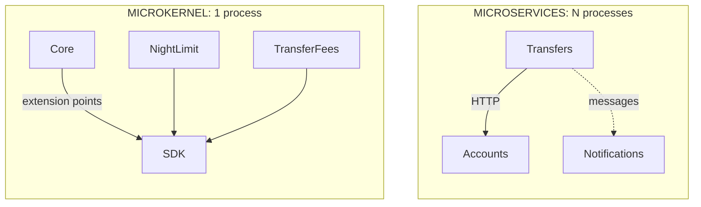

# Microkernel or Microservices?

> **The difference in one sentence**: despite the shared prefix, the microkernel **extends** an application (plug-ins
> loaded into its process), microservices **split** it (separate processes). One answers "how to add variants?", the
> other "how to deploy parts separately?".

📁 Demos: [`13-Microkernel`](../../../13-Microkernel) · [`08-Microservices`](../../../08-Microservices) ·
📖 Pages: [Microkernel](../13-microkernel.md) · [Microservices](../08-microservices.md) ·
🗂️ Cheat sheets: [13](../fiches/13-microkernel.md) · [8](../fiches/08-microservices.md)

⬅️ [Microservices or Serverless?](10-microservices-vs-serverless.md) · ➡️ [Orchestrated Saga or Choreography?](12-saga-orchestree-vs-choregraphie.md) · 🌐 [Français](../../differences/11-microkernel-vs-microservices.md)

---

## What they share

Pieces that **don't reference each other** and only meet at runtime, through a contract; the ability to add, remove or
update a piece **without recompiling the others**.

## The differences point by point

| | Microkernel | Microservices |
|---|---|---|
| Question | adding **variants** (per customer, country, offer) without touching the core | **deploying and sizing** parts independently |
| Processes | **one**: the plug-ins run in the core's | one per service |
| The contract | an **SDK**: .NET interfaces (`IOperationCheck`, `IFeeRule`…) | **JSON** over the network |
| Who calls whom | the **core** calls the plug-ins, at the extension points it planned | each service calls whoever it wants, over HTTP or messages |
| Cost of a call | a method call | a network round trip, which can fail |
| Updating a piece | drop in a DLL: reloaded **at runtime** | redeploy a service |
| A faulty piece | the plug-in is set aside ("in error"); the operation is refused for safety | the service is unreachable; the others retry, compensate |
| Isolation | **no security isolation**: a plug-in can do anything | strong: separate process, network, database |
| Data | the core's; plug-ins receive **values** | one database per service |
| Main trap | changing an extension point breaks every plug-in; SDK to version | partial failures, idempotency, operations |

## Side by side



## In the demos' code

The code is quoted exactly as it is.

**Microkernel**: it is the core that decides where the extensions come in, and in which order (1. "check" extension
point: a single refusal is enough) ([BankingKernel.cs](../../../13-Microkernel/Mk.Kernel/BankingKernel.cs)):

```csharp
// 1. "Check" extension point: a single refusal is enough.
foreach (var check in plugins.Active<IOperationCheck>())
{
    string? refusal = null;
    if (!Protect(check, () => refusal = check.Check(operation)))
        return Result.Refused($"The plugin {check.Name} is faulted: operation refused for safety.");
    if (refusal is not null)
        return Result.Refused($"[{check.Name}] {refusal}");
}
```

A plug-in is a class loaded from a DLL, in its own context, but **in the same process**
([PluginLoader.cs](../../../13-Microkernel/Mk.Kernel/PluginLoader.cs)):

```csharp
internal sealed class PluginLoadContext(string dllPath)
    : AssemblyLoadContext(Path.GetFileNameWithoutExtension(dllPath), isCollectible: true)
```

**Microservices**: Transfers calls Accounts **across the network**, with everything needed to survive its failures
([Micro.Transfers/Program.cs](../../../08-Microservices/Micro.Transfers/Program.cs)):

```csharp
builder.Services.AddHttpClient("accounts", (sp, client) =>
        client.BaseAddress = new Uri(sp.GetRequiredService<IConfiguration>()["Services:Accounts"]!))
    .AddStandardResilienceHandler(options =>
    {
        options.Retry.MaxRetryAttempts = 3;
        options.Retry.Delay = TimeSpan.FromMilliseconds(200);
    });
```

What follows from this:

- a `TransferFees` plug-in runs **inside** the core's operation; no network, no idempotency to plan for;
- a plug-in that loops or reads the disk can harm the whole process; a faulty service only harms itself;
- adding a fee rule to a microservice requires **redeploying** it; with the microkernel, **dropping in** a DLL.

## How to choose

- **Microkernel** for a product with a stable core and many variants: software configurable per customer, rule engine,
  tool extensible by third parties (VS Code, browsers, payroll).
- **Microservices** for independent teams, different scaling needs, separate release cycles.
- **Untrusted plug-ins** (written by strangers): neither as is; one separate process per plug-in is needed, which brings
  the microkernel closer… to microservices.

## Combining them

A microservice can very well be organized as a microkernel: the "Fees" service has a stable core and loads each
customer's price lists as plug-ins.

## Misconceptions

- *"Microkernel = small services"*: it is a single application, whose core is small.
- *"Plug-ins are isolated"*: their **loading** is isolated (separate, unloadable contexts), not their execution.
