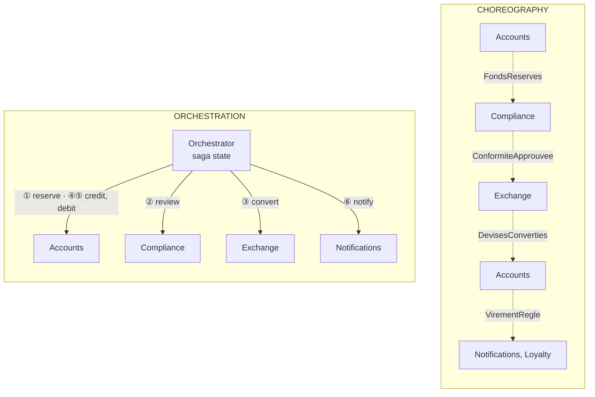

# Orchestrated Saga or Choreography?

> **The difference in one sentence**: the **same multi-step transfer**, written **in a single place** (an orchestrator
> that calls each service) or **nowhere** (each service reacts to the others' events).

📁 Demos: [`14-SagaOrchestree`](../../../14-SagaOrchestree) · [`21-Choregraphie`](../../../21-Choregraphie) (same data,
same rules, for a side-by-side comparison) · 📖 Pages: [Orchestrated Saga](../14-saga-orchestree.md) ·
[Choreography](../21-choregraphie.md) · 🗂️ Cheat sheets: [14](../fiches/14-saga-orchestree.md) · [21](../fiches/21-choregraphie.md)

⬅️ [Microkernel or Microservices?](11-microkernel-vs-microservices.md) · ➡️ [Pipeline or Choreography?](13-pipeline-vs-choregraphie.md) · 🌐 [Français](../../differences/12-saga-orchestree-vs-choregraphie.md)

---

## What they share

A process spread over several services, hence **no single transaction**: local steps, **compensations** on failure. In
both demos: the funds are first **reserved**, a human analyst decides above €10,000, the exchange service converts, the
**final debit is the point of no return** (after it, you retry, you no longer undo), the participants are idempotent.

## The differences point by point

| | Orchestrated Saga | Choreography |
|---|---|---|
| The process is written… | **in a single file** (`DefinitionVirement.cs`) | **nowhere**: it emerges from the subscriptions |
| A service knows… | the orchestrator knows **every** participant | **nobody**: only event contracts (architecture test) |
| "Where is transfer 42?" | the **saga's state**, saved after every step | a **projection** to build (the Tracking service, which listens to the 13 event types) |
| Compensation | **reverse order**, by the engine, retried until it succeeds | **scattered**: Accounts releases the funds on `ConformiteRefusee` **and** on `ChangeEchoue` |
| A participant down | the engine retries (4 times), then compensates or goes "to handle manually" | **silence**: the broker retries, puts it in the dead letters; the reservation **expires** after 30 s |
| Human waiting | a "waiting" step, with a **deadline** handled by the engine | Compliance waits; it must also listen to `ReservationExpiree` |
| Adding a reaction (loyalty…) | change the definition | **subscribe**, without touching the others |
| Single point of failure | the orchestrator | the broker |
| The system's map | the definition | the list of subscriptions, **at runtime** (`GET /bus`) |

## Side by side



## In the demos' code

The code is quoted exactly as it is, French comments included.

**Orchestration**: the process reads from top to bottom, with its compensations next to each step
([DefinitionVirement.cs](../../../14-SagaOrchestree/Saga.Orchestrateur/DefinitionVirement.cs)):

```csharp
new("ReserveFunds",
    async s => { await accounts.Reserve(s.Id, s.Source, s.Amount); return Outcome.Success; },
    Compensate: s => accounts.Release(s.Id, s.Source)),
// …
new("CaptureFunds",
    async s => { await accounts.Capture(s.Id, s.Source); return Outcome.Success; },
    PointOfNoReturn: true),
```

And it is the engine that decides what to do with a failure — after the point of no return, nothing can be undone
anymore ([MoteurSaga.cs](../../../14-SagaOrchestree/Saga.Orchestrateur/MoteurSaga.cs)):

```csharp
else if (PointOfNoReturnPassed(saga))
{
    // Nothing can be undone any more: the money has already been debited for good.
    RequireManualIntervention(saga, $"{step.Name} impossible after {options.MaxAttempts} attempts: {message}");
}
else
{
    StartCompensation(saga, $"{step.Name} impossible after {options.MaxAttempts} attempts: {message}");
}
```

**Choreography**: no file describes the process. The only thread is the **correlation** and the **cause** carried by
each event, which make it possible to tell the story afterwards
([Bus.cs](../../../21-Choregraphie/Choreo.Bus/Bus.cs)):

```csharp
/// <summary>A new event, in reaction to this one: same correlation, and this one as cause.</summary>
public T Next<T>(T next, string emitter) where T : Event =>
    next with { Correlation = Correlation, Cause = Id, Emitter = emitter };
```

When the exchange service goes down, nobody is waiting for its answer. The safety net is **local**: Accounts gives its
reservations a lifetime and emits `ReservationExpiree`. Each late case (an analyst deciding too late, a settlement
arriving after the expiry) required a line of code in **a different service**.

On the other hand, adding the Loyalty service required **no** change elsewhere: it subscribes to `VirementRegle`, and the
test `Ajouter_un_abonne_ne_change_rien_pour_les_autres` proves it. On the orchestration side, a step would have had to be
added to the definition.

## The same incident: the exchange service is down

| | Orchestrated Saga | Choreography |
|---|---|---|
| Who notices | the engine (exception at step ③) | the broker (failed delivery) |
| What happens | retries, then compensation: funds released, saga "Annulée" (cancelled) | 4 attempts, dead letters; the transfer stays "EnCours" (in progress), €200 reserved |
| How it ends | immediately, by the engine | 30 s later, by the reservation's expiry: "Abandonné" (abandoned) |
| Where to see it | `GET /sagas/{id}`: the full history | `GET /bus/lettres-mortes`, `GET /virements/bloques` |

## How to choose

- **Orchestration** to **drive** a multi-step business process, with waits, timeouts and precise failure rules (order,
  international transfer, subscription). In production: Temporal, Durable Functions, Step Functions, MassTransit /
  NServiceBus sagas.
- **Choreography** for **reactions** to a fact (notify, bill, archive, feed a dashboard) and short, stable processes with
  few participants.

## Combining them

The most common: an orchestrator drives the process, then publishes `VirementEffectue`; notifications, loyalty,
accounting **choreograph** around it, without the orchestrator knowing them.

## Misconceptions

- *"Choreography is more decoupled, therefore better"*: the coupling hasn't disappeared, it has become **implicit** (who
  must listen to what for the process to finish).
- *"The orchestrator is a single point of failure"*: the broker is just as much one in choreography; and the saga's
  state, saved at every step, allows recovery after a crash.
