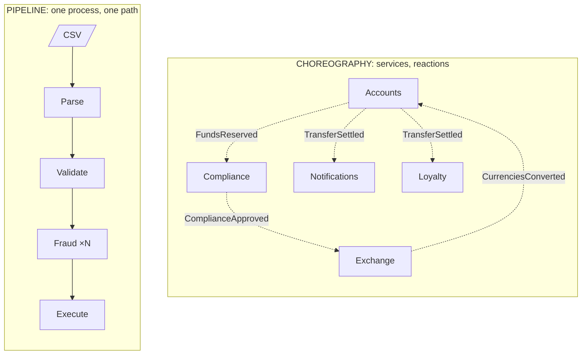

# Pipeline or Choreography?

> **The difference in one sentence**: in a pipeline, **data** goes through a sequence of steps **fixed at assembly**,
> within one process; in a choreography, **facts** travel between services, and the path **emerges** from the
> subscriptions.

📁 Demos: [`20-Pipeline`](../../../20-Pipeline) · [`21-Choreography`](../../../21-Choreography) ·
📖 Pages: [Pipeline](../20-pipeline.md) · [Choreography](../21-choregraphie.md) ·
🗂️ Cheat sheets: [20](../fiches/20-pipeline.md) · [21](../fiches/21-choregraphie.md)

⬅️ [Orchestrated Saga or Choreography?](12-saga-orchestree-vs-choregraphie.md) · ➡️ [Multi-tenant or Cells?](14-multi-tenant-vs-cellules.md) · 🌐 [Français](../../differences/13-pipeline-vs-choregraphie.md)

---

## What they share

**Independent** steps that don't know each other, connected by an intermediary (pipe or broker); a step that sets an item
aside without stopping the rest; **idempotent recovery**; a logical order between steps that nobody calls explicitly.

## The differences point by point

| | Pipeline | Choreography |
|---|---|---|
| What travels | **data to transform**: the lines of a CSV file | **facts**: "funds reserved", "currencies converted" |
| The path | **linear, fixed at assembly**: Parse → Validate → … → Execute | **emerges** from the subscriptions; one fact can trigger several reactions |
| Scope | **one processing job**, within a process | **one business process**, between services |
| The intermediary | a **bounded** pipe (64 items): when full, it makes the previous stage wait | a broker that **stores**: no back-pressure |
| Throughput | that of the slowest stage; you **parallelize the bottleneck** (8 copies of the fraud check) | each service at its own pace |
| Order | **preserved** (the parallel stage reorders): line 2 can depend on line 1 | no guarantee between different transfers |
| A refused item | **rejected with a reason**, counted in the report | a refusal event (`ComplianceRefused`), to which others react |
| A failure | an exception **stops** the whole pipeline; you replay the file | **silence**: dead letters, then expiry |
| Adding a step | reassemble the pipeline | subscribe |
| Overview | the assembly code | the subscriptions, at runtime |

## Side by side



## In the demos' code

The code is quoted exactly as it is.

**Pipeline**: a full pipe **blocks** the stage that writes; that is what bounds memory, whatever the file size
([Stage.cs](../../../20-Pipeline/Pipeline.Core/Stage.cs)):

```csharp
/// <summary>Writing into a full pipe BLOCKS: the stage waits for the next one to have room. That is the back-pressure.</summary>
private async Task Write(ChannelWriter<Element<TOutput>> output, Element<TOutput> element, RunContext context)
```

And the first failing stage stops all the others
([Pipeline.cs](../../../20-Pipeline/Pipeline.Core/Pipeline.cs)):

```csharp
// The first stage that fails stops all the others.
foreach (var task in tasks)
    _ = task.ContinueWith(_ => stopping.Cancel(), TaskContinuationOptions.OnlyOnFaulted);
```

**Choreography**: each service keeps the identifiers already handled, and reacts by publishing the follow-up; nothing
slows it down if the next one is slow, nothing stops it if the next one goes down
([Others.cs](../../../21-Choreography/Choreo.Services/Others.cs)):

```csharp
lock (Lock)
{
    if (_handled.Contains(received.Id))
        return;
    if (react() is { } next)
        Bus.Publish(next);
    _handled.Add(received.Id);
}
```

## How to choose

- **Pipeline** when data goes through a sequence of independent steps **inside a processing job**: imports, exports,
  ETL, batches (payroll, invoicing), log or media streams, compilers.
- **Choreography** when **services** must react to what happens elsewhere, without knowing each other.

## Combining them

An import of transfers can be a pipeline **inside** the Accounts service, and each executed transfer can publish an event
that other services choreograph. The two demos don't compete: they live at two different scales.

## Misconceptions

- *"A pipeline is sequential"*: all the stages work **at the same time**, each on a different item.
- *"Putting a queue between each step makes a pipeline"*: without bounded pipes, you lose back-pressure, and therefore
  bounded memory.
