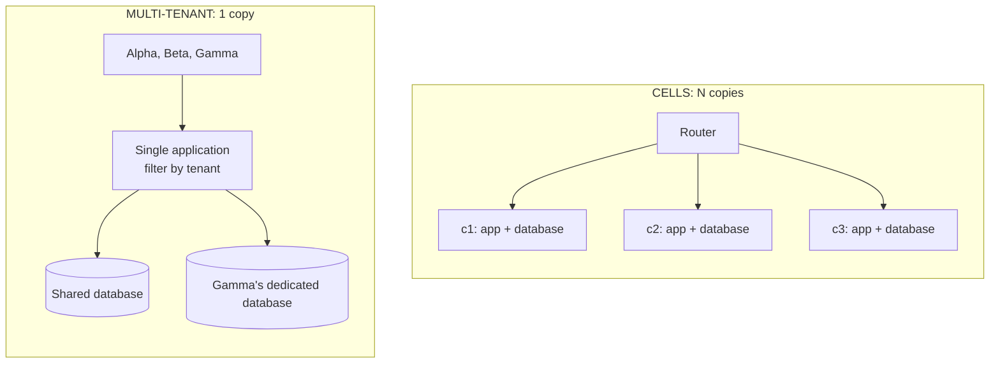

# Multi-tenant or Cells?

> **The difference in one sentence**: multi-tenant runs **a single copy** of the system for all customers, in order to
> **pool**; cells run **several complete copies**, each for a group of customers, in order to **bound the blast radius**.

📁 Demos: [`15-MultiTenant`](../../../15-MultiTenant) · [`17-CellBased`](../../../17-CellBased) ·
📖 Pages: [Multi-tenant](../15-multi-tenant.md) · [Cells](../17-cell-based.md) ·
🗂️ Cheat sheets: [15](../fiches/15-multi-tenant.md) · [17](../fiches/17-cell-based.md)

⬅️ [Pipeline or Choreography?](13-pipeline-vs-choregraphie.md) · ➡️ [Cells or Microservices?](15-cellules-vs-microservices.md) · 🌐 [Français](../../differences/14-multi-tenant-vs-cellules.md)

---

## What they share

Both spread **customers** over an infrastructure: each request carries the customer's identity, which decides where (and
with which rules) it is processed. Both can place a customer in a separate database (dedicated database on one side, a
cell on the other) and run into the same troublesome neighbor: the customer who consumes too much.

## The differences point by point

| | Multi-tenant | Cells |
|---|---|---|
| Goal | **pool**: one deployment, one version, shared costs | **partition**: a failure, a bug, a greedy customer stay in one cell |
| Copies of the application | **one** | **N** complete cells (API, rules, data), + a router |
| Who "the customer" is | an **organization** (a bank, customer of the SaaS) | an **end customer** (alice, bob…) or a group |
| Data | shared database (filter by tenant) **or** dedicated database | one database **per cell**, with several customers inside |
| Isolation | **logical**, built into the code: global filter, stamping, composite key | **physical**: separate processes and data |
| A failure hits… | potentially **all** customers | the customers **of one cell** (2 out of 5 in the demo) |
| A bad deployment | everyone at the same time | a **canary** cell, then in waves |
| The noisy neighbor | per-tenant **quotas** (60 or 600 requests/min) | it stays in its cell; if needed, it is **migrated** |
| Growing | add servers to the single instance | **add cells** of known, tested size |
| Main risk | **data leak** between customers at the slightest slip | **cross-cell** operations (slow, compensated); N times the infrastructure |

## Side by side



## In the demos' code

The code is quoted exactly as it is, French comments included.

**Multi-tenant**: isolation is a matter of **code**, concentrated in the `DbContext`
([BanqueDbContext.cs](../../../15-MultiTenant/Mt.Banque/BanqueDbContext.cs)):

```csharp
private void Isolate<T>(ModelBuilder model) where T : class, IBelongsToTenant
{
    // Composite key: two tenants can have an account with the same identifier (here, Alice and Bob exist everywhere)
    // without conflict in the shared database.
    model.Entity<T>().HasKey(nameof(IBelongsToTenant.TenantId), "Id");
    model.Entity<T>().HasQueryFilter(e => e.TenantId == CurrentTenant);
}
```

Forgetting this filter means exposing one bank to another. Cells don't have this risk: a cell only contains its own
customers, and has no way to read another's.

**Cells**: isolation is a matter of **topology**. When a cell goes down, the router only returns the error to its
customers — blast radius ([Relais.cs](../../../17-CellBased/Cell.Routeur/Relais.cs)):

```csharp
catch (HttpRequestException)
{
    // Blast radius: only the customers of THIS cell get this error.
```

**The greedy customer**: multi-tenant **throttles** it with a quota specific to its plan
([Installation.cs](../../../15-MultiTenant/Mt.Locataires/Installation.cs)); cells **move** it to another cell (copy,
routing switch, cleanup) without the other customers noticing.

**Growing**: multi-tenant adds a customer in a few seconds (one line in the catalog). Cells too, as long as there is room
left; when all are full, you don't enlarge a cell, you add one
([PlanDeControle.cs](../../../17-CellBased/Cell.Routeur/PlanDeControle.cs)):

```csharp
/// <summary>The least loaded open cell that still has room.</summary>
public CellInfo? ChooseCell() => registry.All()
    .Where(c => c.Open && placement.Count(c.Id) < c.Capacity)
    .OrderBy(c => placement.Count(c.Id)).ThenBy(c => c.Id)
    .FirstOrDefault();
```

## How to choose

- **Multi-tenant** as soon as you sell **the same software to several organizations**: it is SaaS's business model.
  Start with the shared database and a global filter, offer the dedicated database to those who pay for it.
- **Cells** at **very large scale**, when a global outage costs more than N copies of the infrastructure, and a natural
  partition key (the customer) keeps almost all operations within a cell.

## Combining them

It is the most frequent case at large SaaS companies: **cells, each multi-tenant inside**. A customer is first routed to
their cell, then isolated from the other tenants of the same cell by the filter. Multi-tenant's dedicated database
becomes, at the extreme, a dedicated cell.

## Misconceptions

- *"One dedicated database per customer = cells"*: the database is separate, but the application, its deployment and its
  bugs remain shared.
- *"Cells replace tenant isolation"*: a cell contains several customers; they still have to be isolated from each other.
