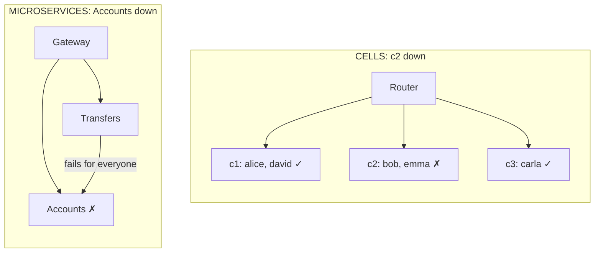

# Cells or Microservices?

> **The difference in one sentence**: both split the system into pieces that run separately, but **not along the same
> axis**: microservices split **by function** (accounts, transfers), cells **by group of customers** (each cell has all
> the functions).

📁 Demos: [`08-Microservices`](../../../08-Microservices) · [`17-CellBased`](../../../17-CellBased) ·
📖 Pages: [Microservices](../08-microservices.md) · [Cells](../17-cell-based.md) ·
🗂️ Cheat sheets: [8](../fiches/08-microservices.md) · [17](../fiches/17-cell-based.md)

⬅️ [Multi-tenant or Cells?](14-multi-tenant-vs-cellules.md) · ➡️ [Actors or Space-based?](16-acteurs-vs-spatiale.md) · 🌐 [Français](../../differences/15-cellules-vs-microservices.md)

---

## What they share

Several processes, an entry point that routes (gateway or router), one database per piece, and for everything that
crosses two pieces: **idempotency** (operation identifier) and **compensation** if the second one doesn't answer.

## The differences point by point

| | Microservices | Cells |
|---|---|---|
| Split axis | **functional**: one service per subdomain | **by customers**: one complete copy per group |
| Different pieces? | **yes**: each service has its own code | **no**: all cells run the same code |
| An Alice → Bob transfer | **always** crosses several services (Transfers → Accounts) | stays **local** if Alice and Bob are in the same cell |
| Exchanges between pieces | constant, at the heart of how it works | **rare**: avoided through the choice of partition key |
| The entry point | gateway: routes **by path** (`/comptes`, `/virements`) | router: routes **by customer** (alice → c1) |
| A failure hits… | **one function, for all** customers | **all functions, for one group** of customers |
| Deploying | **service by service**, each at its own pace | the same version, **cell by cell** (canary, waves) |
| Growing | add instances of the busiest service | add cells of known size |
| Teams | one team per service | one team for the product, one for the cell platform |

## Side by side: where a failure lands



## In the demos' code

**Microservices**: Transfers **always** calls Accounts over the network, with retry and idempotency, for any transfer
([Micro.Virements/Program.cs](../../../08-Microservices/Micro.Virements/Program.cs),
[Micro.Comptes/Endpoints.cs](../../../08-Microservices/Micro.Comptes/Endpoints.cs)).

**Cells**: a transfer between two customers of the same cell is a **local transaction**. Only a transfer between cells
goes through the router, with an operation identifier and a compensation, exactly as in microservices (test
`Un_virement_dans_une_meme_cellule_reste_local`, and `Si_la_cellule_du_beneficiaire_est_en_panne_le_virement_est_compense`).

**The actual result after stopping a cell**: alice, carla and david answer 200; bob and emma receive "Cellule c2
injoignable : seuls ses clients sont touchés" (cell c2 unreachable: only its customers are affected)
([Relais.cs](../../../17-CellBased/Cell.Routeur/Relais.cs)). Stopping the Accounts service, on the other hand, prevents
**all** customers from looking up their account and making transfers.

**Deploying**: in cells, a faulty version stops at the canary cell; its health probe replays a control withdrawal
([Version.cs](../../../17-CellBased/Cell.Cellule/Version.cs)) (the code is quoted exactly as it is):

```csharp
public (bool Sain, string Detail) Sonde()
{
    var resultat = Retirer(100m, 10m);
    return resultat == 90m
        ? (true, "retrait de contrôle correct")
        : (false, $"retrait de contrôle incorrect : 100 - 10 = {resultat}");
}
```

In microservices, a faulty version of Accounts immediately hits all customers, unless you add a progressive deployment
yourself.

## How to choose

- **Microservices** for the **independence of teams and deployments** per subdomain.
- **Cells** for **resilience** at very large scale, when a global outage is unacceptable.

## Combining them

They are orthogonal: **a cell can contain microservices**. The router first routes the customer to their cell, then the
cell's gateway routes the path to the right service. You then add up both costs: N cells × M services to operate.

## Misconceptions

- *"Several instances of a microservice = cells"*: the instances share the same database and the same version; a cell
  has its own data and can have its own version.
- *"Cells avoid the problems of distributed systems"*: only if the partition key keeps almost all operations within a
  cell; otherwise, you get the drawbacks of both.
