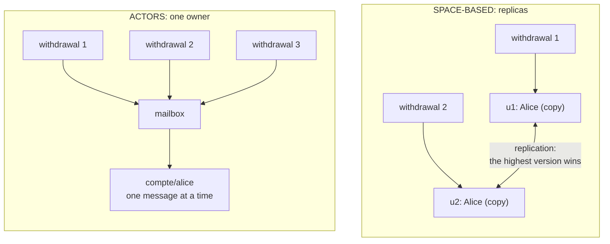

# Actors or Space-based?

> **The difference in one sentence**: both keep the state **in memory**, but actors give each piece of data **a single
> owner** (no write is ever lost), while the space-based architecture **replicates** it in every unit (simultaneous
> writes can be lost).

📁 Demos: [`18-ActorModel`](../../../18-ActorModel) · [`19-SpaceBased`](../../../19-SpaceBased) ·
📖 Pages: [Actors](../18-modele-acteurs.md) · [Space-based](../19-space-based.md) ·
🗂️ Cheat sheets: [18](../fiches/18-modele-acteurs.md) · [19](../fiches/19-space-based.md)

⬅️ [Cells or Microservices?](15-cellules-vs-microservices.md) · ➡️ [What you put in front of the services](17-passerelle-bff-graphql-strangler.md) · 🌐 [Français](../../differences/16-acteurs-vs-spatiale.md)

---

## What they share

The state is in memory, the database is used to **reload** after a failure; a request doesn't wait for a round trip to
the database to read; you scale by adding compute units. And in both demos, the same experiment (hundreds of
simultaneous withdrawals on Alice's account) reveals everything.

## The differences point by point

| | Actors | Space-based |
|---|---|---|
| Problem targeted | **concurrency**: several requests on the same data | **the database saturating**: too many requests for it |
| A piece of data lives… | in **a single** actor (`account/alice`) | **replicated** in every processing unit |
| Simultaneous writes | **queued** in the mailbox, handled one at a time | applied **in parallel** in several replicas |
| Lost write? | **never** | **possible** (collision: the highest version wins) |
| Countermeasure | structural: one owner, one message at a time | **affinity routing** (same key → same unit), imperfect |
| The database | durable state written by the actor; reread by a new incarnation | **deferred** backup (pump); can go down without stopping the service |
| Scaling | millions of actors, **activated on demand**, spread out | 2 to 6 units, added with the load, each with **all** the data |
| A failure | the faulty actor is **replaced** (supervision); the others notice nothing | one unit goes down: its requests go elsewhere; all go down: cold start from the database |
| An operation on two pieces of data | a conversation (a `transfer/…` actor), with compensation | no transaction; collision risk on each key |
| Limit | cross-cutting reads, request cycles (deadlocks) | everything in memory, database lagging, collisions |

## Side by side: 3 requests on Alice's account



## In the demos' code

The code is quoted exactly as it is, French comments and messages included.

**Actors**: a single reader per mailbox, which waits for the end of each message before the next one
([ActorSystem.cs](../../../18-ActorModel/Actors.Runtime/ActorSystem.cs)):

```csharp
// THE key point of the model: only one message at a time, each handled to the end before the next one.
response = await activation.Instance!.Receive(envelope.Message);
```

The account can therefore write the most naive code: read, check, modify, without a lock
([AccountActor.cs](../../../18-ActorModel/Actors.Bank/AccountActor.cs)):

```csharp
if (debit && amount > state.Balance)
    return new Refusal($"Insufficient balance ({state.Balance:0.00} €).");
```

**Space-based**: the write is applied in the local replica, then **published** to the other replicas and the pump,
without waiting for them — the database is not on the request path
([DataGrid.cs](../../../19-SpaceBased/Space.Grid/DataGrid.cs)):

```csharp
// The database is not on the request path: the write goes into the pump, we do not wait.
_toThePump(modification);
```

On receipt, a replica detects that a modification doesn't start from the version it knows: that is a collision, and the
highest version wins ([Replica.cs](../../../19-SpaceBased/Space.Grid/Replica.cs)):

```csharp
var concurrent = local != m.Previous && local.Unit != "" && local.Unit != m.Version.Unit;
```

The countermeasure is to always route the same key to the same unit
([MessagingGrid.cs](../../../19-SpaceBased/Space.Grid/MessagingGrid.cs)):

```csharp
: _units.MaxBy(u => Hash($"{key}/{u.Id}"))!;
```

## The same experiment, two results

| Real run | Actors | Space-based |
|---|---|---|
| Requests | 1,000 simultaneous €3 withdrawals (Alice: €1,000) | 200 simultaneous €1 withdrawals (Alice: €1,000) |
| Result | 333 accepted, final balance €1: **exact** | **affinity**: 200 accepted, €800: exact |
| | | **round robin**: 200 accepted, €700: **€100 lost**, 199 updates overwritten |

In space-based, even affinity isn't a guarantee: while a unit arrives or leaves, a key can change owner and a write can
be lost (test `With_affinity_a_change_of_units_opens_a_collision_window`). Actors don't have this problem,
because **the owner is the data itself**.

## How to choose

- **Actors** for many independent entities, with **highly contended** state that changes often: accounts, carts,
  players, connected objects, sessions.
- **Space-based** for **huge load peaks** the database can't keep up with, on data that fits in memory and is **read
  often, written rarely** or well partitioned: ticketing, auctions, bookings. A poor choice for real balances, and the
  demo uses them precisely to **show** the collisions.

## Combining them

The two meet when you move from a **replicated** cache to a **distributed** cache: each piece of data then has a single
master copy, on a single unit. That is already almost an actor (Orleans is the example: distributed actors, whose
directory says which server hosts which).

## Misconceptions

- *"In memory = no more database"*: both demos write the durable state; only the database's place on the request path
  changes.
- *"Actors remove the problems of distributed systems"*: no transactions between actors, and a request cycle (A waits
  for B which waits for A) blocks them until the timeout.
