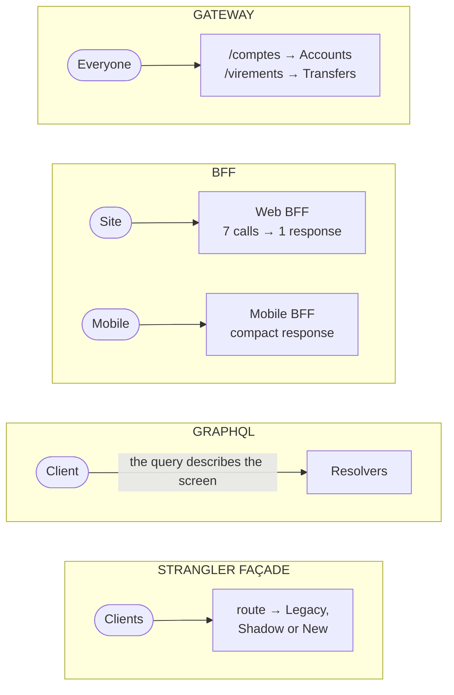

# Gateway, BFF, GraphQL or Strangler façade?

> **The difference in one sentence**: four components placed **in front of** the services, confused because they all
> forward requests; but the gateway **routes** (for everyone), the BFF **adapts** (for one application), GraphQL **lets
> the client describe** its response, and the Strangler Fig façade **migrates** (for the time it takes to replace a
> system).

📁 Demos: [`08-Microservices`](../../../08-Microservices) (gateway) · [`16-BFF`](../../../16-BFF) ·
[`23-RestGrpcGraphQL`](../../../23-RestGrpcGraphQL) · [`22-StranglerFig`](../../../22-StranglerFig) ·
📖 Pages: [Microservices](../08-microservices.md) · [BFF](../16-bff.md) · [REST, gRPC, GraphQL](../23-rest-grpc-graphql.md) ·
[Strangler Fig](../22-strangler-fig.md)

⬅️ [Actors or Space-based?](16-acteurs-vs-spatiale.md) · ➡️ [Contents](README.md) · 🌐 [Français](../../differences/17-passerelle-bff-graphql-strangler.md)

---

## What they share

A single entry point for the client, who doesn't see what lies behind; internal routes never exposed; no business rules
(they stay in the services). And they combine: they are often found **stacked**.

## The differences point by point

| | API gateway | BFF | GraphQL | Strangler Fig façade |
|---|---|---|---|---|
| Role | **route** a path to a service | **adapt** the services to **one** application | let **the client** describe the response's shape | **migrate** a route from the legacy system to the new one |
| How many? | one, for all clients | **one per type of application** (web, mobile) | one schema for all | one, in front of the legacy system |
| Who writes it | the platform team | the application's team | the API team (schema), the client (queries) | the migration team |
| Contains | a routing table, aggregated health | aggregation, formatting, session, app versions | per-field resolvers | a routing table **with modes** (Legacy, Shadow, New) |
| Downstream requests | one per request received | **several, in parallel** (7 for the dashboard) | as many as fields requested (watch out for N+1) | one (two in shadow mode) |
| Response shape | the service's | **tailored to the screen** | **the requested one** | **identical** to the legacy contract |
| Security | authentication, quotas | **the token stays on the server** (HttpOnly cookie) | to be bounded: depth, cost | the legacy's |
| Lifetime | permanent | permanent | permanent | **temporary**: becomes a simple gateway |

## Side by side



## In the demos' code

The code is quoted exactly as it is, French comments included.

**Gateway**: a "prefix → service" table; what isn't in it stays invisible
([Micro.Passerelle/Program.cs](../../../08-Microservices/Micro.Passerelle/Program.cs)):

```csharp
// Table de routage : préfixe public → service. Tout ce qui n'y figure pas (ex. /interne/…) reste invisible.
var routes = app.Configuration.GetSection("Routes").Get<Dictionary<string, string>>() ?? [];
```

**BFF**: one screen, one browser request, and behind it, calls in parallel — the total duration is that of the slowest
call, not the sum ([TableauDeBord.cs](../../../16-BFF/Bff.Web/TableauDeBord.cs)):

```csharp
// ② Puis tout le reste EN PARALLÈLE : la durée totale est celle de l'appel le plus lent, pas la somme.
var conseiller = services.Conseiller(profil.ConseillerId, jeton);
var offres = Facultatif(annulation => services.Offres(profil.Segment, jeton, annulation), BudgetOffres);
var comptes = profil.Comptes.Select(id => CompteAvecOperations(id, jeton)).ToList();
Task[] appels = [conseiller, offres, .. comptes];
await Task.WhenAll(appels);
```

Measured: 7 calls to the services, ≈ 300 ms instead of ≈ 900 ms if they were chained.

**GraphQL**: no route per screen; the client sends the description of what it displays, and the response has exactly
that shape ([demo 23](../23-rest-grpc-graphql.md)):

```graphql
query EcranAccueil($id: ID!, $n: Int) {
  client(id: $id) {
    nom
    comptes { numero libelle solde operations(derniers: $n) { date libelle montant } }
  }
}
```

Measured result for the mobile home screen: **1 request** with GraphQL, versus 5 with REST. The BFF gets the same gain,
but with **a route written for that screen**; GraphQL gets it without a dedicated route.

**Strangler façade**: the same mechanism as a gateway, plus a **mode** per route, changeable live; anything undeclared
stays on the legacy ([Relais.cs](../../../22-StranglerFig/Fig.Facade/Relais.cs)):

```csharp
var route = table.Trouver(http.Request.Method, chemin);
var mode = route?.Mode ?? Mode.Ancien;   // ce que personne n'a repris reste à l'ancien : c'est le point de départ
```

## How to choose

- A **gateway** as soon as there are several services behind a public entry point.
- A **BFF** when several client applications with different needs use the same services, or a web application must not
  handle tokens.
- **GraphQL** when screens are numerous, rich and changing, and writing a BFF (or a route) per screen becomes the
  bottleneck.
- A **Strangler façade** for the time it takes to replace a system in production.

## Combining them

The most common stack: a **gateway** at the entrance (security, quotas), a **BFF** behind it for each application, and a
BFF can expose **GraphQL** to its application. During a migration, the Strangler façade **is** the gateway; at the end,
it stays one, with all its routes in `Nouveau`.

## Misconceptions

- *"GraphQL replaces the BFF"*: it replaces per-screen aggregation, not session management or security specific to an
  application.
- *"The gateway can do everything"*: putting per-screen aggregation in it turns it into a shared BFF, which every team has
  to modify.
