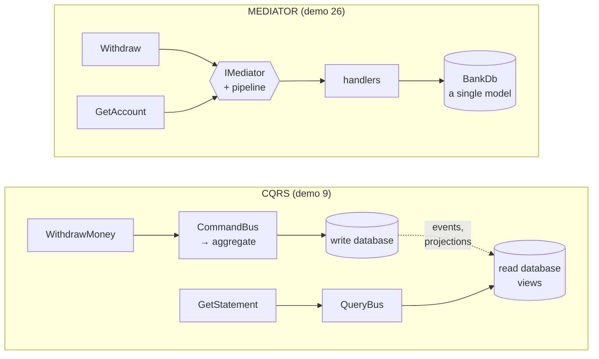

# Mediator or CQRS?

> **The difference in one sentence**: the mediator separates **the caller from the called code** (a message, a
> handler, a pipeline); CQRS separates **the model that writes from the model that reads**. They get mixed up because
> MediatR made the words "command" and "query" popular; but a mediator doesn't make CQRS, and CQRS does very well
> without a mediator.

📁 Demos: [`09-CQRS`](../../../09-CQRS) · [`26-Mediator`](../../../26-Mediator) ·
📖 Pages: [CQRS](../09-cqrs.md) · [Mediator](../26-mediator.md) · 🗂️ Cheat sheets: [9](../fiches/09-cqrs.md) · [26](../fiches/26-mediator.md)

⬅️ [Gateway, BFF, GraphQL or Strangler façade?](17-passerelle-bff-graphql-strangler.md) · ➡️ [Contents](README.md) · 🌐 [Français](../../differences/18-mediator-vs-cqrs.md)

---

## What they share

Messages named in the imperative (`Withdraw`, `MakeTransfer`), **one handler per message**, a single entry point that
runs every message through common steps (validation, journal). Both demos even have a validator called before the
handler. Hence the confusion, kept alive by thousands of "CQRS with MediatR" tutorials that separate nothing but
classes.

## The differences point by point

| | Mediator | CQRS |
|---|---|---|
| What it separates | the **caller** and the **called code** | the **write model** and the **read model** |
| The question it answers | how to call, and what to do around each call? | how to represent the data for writing, and for reading? |
| Entry point | **one** mediator for everything (`IMediator.Send`) | often **two**: `CommandBus` and `QueryBus` in demo 9; or plain services |
| Data model | **only one**: the read queries the commands' tables | **two**: aggregates to write, denormalized views to read |
| Databases | one | one or two; two in demo 9, linked by events |
| Consistency | immediate (same database, same transaction) | often eventual: the read follows the write with a delay |
| Events | **in-process** notifications, in the sender's transaction | events that **feed** the read views (projections) |
| A command's answer | anything (here, the new balance) | nothing, or an id; the view is read afterwards (202 in demo 9) |
| What it costs | indirection: the compiler no longer sees the path | two models to maintain, duplicated data, read delay |
| Without the other? | yes: demo 26 is a mediator **without** CQRS | yes: nothing requires going through a mediator |

## Side by side



## In the demos' code

**Mediator**: reads and writes go through the same mediator, and the read queries **the same tables** as the commands
([GetAccount.cs](../../../26-Mediator/Med.Bank/Features/Accounts/GetAccount.cs)):

```csharp
/// <summary>A query reads the same tables as the commands: the mediator does not separate the models.</summary>
internal class GetAccountHandler(BankDb db) : IRequestHandler<GetAccount, AccountView>
```

`ICommand` and `IQuery` are only labels there, which the pipeline uses to know when to save
([Behaviors.cs](../../../26-Mediator/Med.Bank/Pipeline/Behaviors.cs)):

```csharp
if (request is not ICommand<TResponse>)
    return await next();
```

**CQRS**: a bus for the commands, which validates before the handler, exactly the role of a mediator, written in a few
lines, and which demo 9 always had ([CommandBus.cs](../../../09-CQRS/Cqrs.Write/Commands/CommandBus.cs)):

```csharp
/// <summary>
/// Single entry point for the commands: a shared "pipeline" (validation, logging)
/// before the handler. It is the role MediatR often plays, written here in a few lines.
/// </summary>
public class CommandBus(IServiceProvider services, ILogger<CommandBus> logger)
```

What makes demo 9 CQRS is not this bus: it is that its commands and its queries live in **two projects that don't know
each other** (`Cqrs.Write`, `Cqrs.Read`), on **two databases**, linked by events that projections turn into views.
Replacing both buses by MediatR would change nothing to the CQRS; removing them neither.

## The same withdrawal

| Step | Mediator (demo 26) | CQRS (demo 9) |
|---|---|---|
| Entry | `mediator.Send(new Withdraw(…))` | `commandBus.Send(new WithdrawMoney(…))` |
| Before the handler | journal, validation (pipeline behaviors) | validation, logging (in the bus) |
| Write | entity changed, `SaveChanges` by the pipeline | aggregate changed + event in the journal, one transaction |
| Answer | 200 with the new balance | 202: the read will follow |
| Next read | the same tables, up to date at once | the projected view, once the projection has run |

## How to choose

- **A mediator** when many use cases share the same concerns (validation, transaction, audit, permissions) and you
  want to write them once; it goes well with [vertical slices](../05-vertical-slice.md).
- **CQRS** when reads are far more numerous, or of another shape, than writes (dashboards, statements, search): each
  side is optimized separately.
- **Both**: common, and legitimate; but CQRS starts when the **models** separate, not when classes are called
  `…Command` and `…Query`.

## Misconceptions

- *"We do CQRS: we have MediatR commands and queries"*: if the queries read the same entities as the commands, it is a
  mediator, not CQRS (that is exactly demo 26).
- *"CQRS requires a mediator"*: no; demo 9 has two buses of a few lines, and plain services would do as well.
- *"The mediator's notifications are events, like in CQRS"*: they run in the same process and the same transaction;
  CQRS events feed another model, often elsewhere and later.
