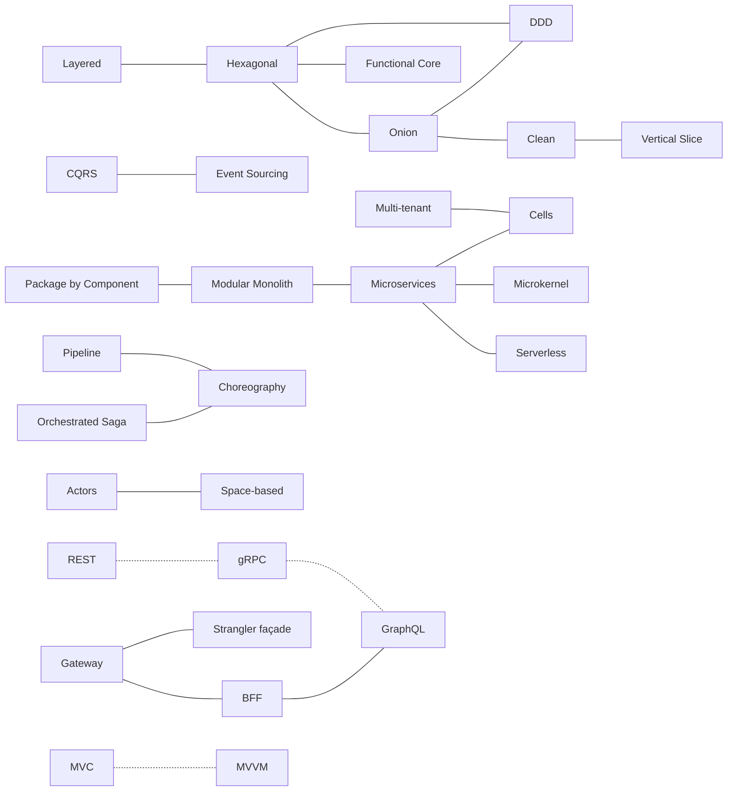

# The differences between architectures

🌐 [Français](../../differences/README.md)

Hexagonal or Onion? CQRS or Event Sourcing? Saga or choreography? These pages compare, **two by two**, the architectures
most often confused, and only on what **sets them apart**. Each one relies on the demos' code: the same banking
business, the same transfer, written in both architectures.

📖 Full documentation: [Docs](../README.md) · 🗂️ [Cheat sheets](../fiches/README.md) ·
📗 [No-code version](../pour-tous/README.md) · ★ [Cross-cutting concepts](../concepts-transverses.md)

## How to read a page

| Section | What you'll find |
|---|---|
| **The difference in one sentence** | what to remember if you read nothing else |
| **What they share** | why they get confused |
| **The differences point by point** | a table, criterion by criterion |
| **Side by side** | a diagram of both |
| **In the demos' code** | real excerpts, with the link to each file |
| **How to choose · Combining them · Misconceptions** | decision signals, common combinations, misunderstandings |

---

## ① Code organization

| # | Comparison | The difference in a word |
|---|---|---|
| 1 | [Layered or Hexagonal?](01-couches-vs-hexagonale.md) | the **direction** of the dependency between business and database |
| 2 | [Hexagonal or Onion?](02-hexagonale-vs-onion.md) | the same rule; one draws the **perimeter**, the other the **center** |
| 3 | [Onion or Clean?](03-onion-vs-clean.md) | Clean **formalizes** the use case and **inverts the output** (presenter) |
| 4 | [Clean or Vertical Slice?](04-clean-vs-vertical-slice.md) | splitting **by layer** or **by feature** |
| 5 | [Hexagonal or Functional Core?](05-hexagonale-vs-coeur-fonctionnel.md) | the center **still** does input/output, or **none at all** |

## ② Modeling

| # | Comparison | The difference in a word |
|---|---|---|
| 6 | [DDD or Hexagonal / Onion?](06-ddd-vs-hexagonale-onion.md) | **what** to model and where to cut, versus **how** to arrange |
| 7 | [CQRS or Event Sourcing?](07-cqrs-vs-event-sourcing.md) | separating **reads and writes**, versus changing **what is stored** |

## ③ System decomposition

| # | Comparison | The difference in a word |
|---|---|---|
| 8 | [Package by Component or Modular Monolith?](08-composants-vs-monolithe-modulaire.md) | a module **also** owns its routes and its events |
| 9 | [Modular Monolith or Microservices?](09-monolithe-modulaire-vs-microservices.md) | a **method call** or **the network** |
| 10 | [Microservices or Serverless?](10-microservices-vs-serverless.md) | a **permanent** process or a function **for the duration of an event** |
| 11 | [Microkernel or Microservices?](11-microkernel-vs-microservices.md) | **extending** an application or **splitting** it |
| 12 | [Orchestrated Saga or Choreography?](12-saga-orchestree-vs-choregraphie.md) | the process written **in one place** or **nowhere** |
| 13 | [Pipeline or Choreography?](13-pipeline-vs-choregraphie.md) | **data** on a fixed path, or **facts** between services |
| 14 | [Multi-tenant or Cells?](14-multi-tenant-vs-cellules.md) | **one** copy to pool, **N** copies to partition |
| 15 | [Cells or Microservices?](15-cellules-vs-microservices.md) | splitting **by customers** or **by function** |
| 16 | [Actors or Space-based?](16-acteurs-vs-spatiale.md) | in memory, with **an owner** or **replicas** |
| 17 | [Gateway, BFF, GraphQL or Strangler façade?](17-passerelle-bff-graphql-strangler.md) | **routing**, **adapting**, **letting the client describe** or **migrating** |

## ④ Already comparisons

Two demos are, by construction, detailed comparisons: the same business is exposed or presented in several ways, with
measurements.

| Comparison | Where |
|---|---|
| **REST, gRPC or GraphQL?** Who chooses the response shape, what travels, errors, streams, contract evolution | [demo 23](../23-rest-grpc-graphql.md) |
| **MVC or MVVM?** Who receives the user's action, how long the screen lives, what you test without a screen | [demo 24](../24-mvc-mvvm.md) |

---

## The map of confusions

Each line is a page of this section; the dotted arrows, a comparison demo.

