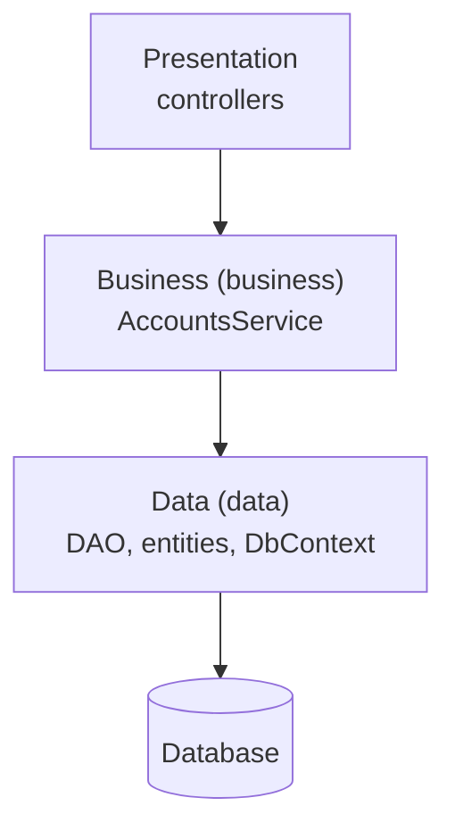

# Cheat sheet 0 · Layered (N-tier)

**French name**: *Architecture en couches (N-tiers)*

> **In one sentence**: Presentation → Business → Data; each layer only calls the one below it.

**Family**: code organization · **Origin**: common practice since the 1990s ·
**Demo**: [`00-Layered`](../../../00-Layered) (port 5100) · 📖 [Full page](../00-couches.md) ·
🌐 [Français](../../fiches/00-couches.md)

## Key points

- Responsibilities are split along **technical** lines and stacked.
- **Dependencies flow down to the database**: the business layer depends on the data layer (its interface, its entities).
- Entities are **anemic**: the rules live in the services.
- Safeguard: **non-transitive** project references (the presentation cannot see the data layer).

| ✅ When to use it | ❌ Signs it's time to move on |
|---|---|
| CRUD with thin business logic, prototype, junior team | Rules multiply and need testing without a database |
| Starting fast, with a structure everyone knows | A change of storage is on the table |

**Pitfall**: one feature = changes in every layer; the business logic is coupled to persistence.

**Next steps**: invert the dependencies → [Hexagonal](01-hexagonale.md), [Onion](02-onion.md); organize by
feature → [Vertical Slice](05-vertical-slice.md).

---
[Cheat sheet index](README.md) · ➡️ [Hexagonal](01-hexagonale.md)
