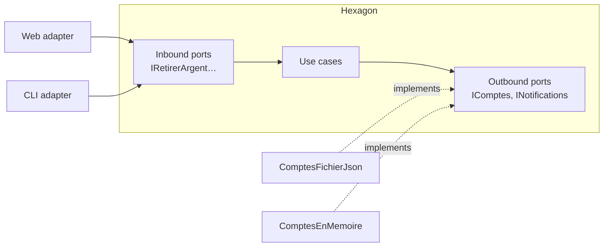

# Cheat sheet 1 · Hexagonal (Ports & Adapters)

**French name**: *Architecture hexagonale*

> **In one sentence**: the business core depends on nothing; the outside world plugs into it through **ports**
> (interfaces) and interchangeable **adapters** (implementations).

**Family**: code organization · **Origin**: Alistair Cockburn, 2005 ·
**Demo**: [`01-Hexagonale`](../../../01-Hexagonale) (port 5101, + a CLI) · 📖 [Full page](../01-hexagonale.md) ·
🌐 [Français](../../fiches/01-hexagonale.md)

## Key points

- Inside / outside rather than top / bottom. **Every dependency points toward the hexagon**.
- **Inbound** port = what the application offers; **outbound** port = what it needs.
- The *composition root* (`Program.cs`) is the only place that knows both the hexagon and the adapters.
- **Contract tests**: the same suite runs against every adapter of a port.

| ✅ When to use it | ❌ Less useful if |
|---|---|
| Rich business logic, infrastructure likely to change | Simple CRUD with no rules |
| Several input channels (API, CLI, messages) | One adapter per port, forever |

**Pitfall**: pass-through ports that add nothing; the core itself is left unstructured.

**Neighbors**: same dependency rule as [Onion](02-onion.md) and [Clean](03-clean.md).

---
⬅️ [Layered](00-couches.md) · [Cheat sheet index](README.md) · ➡️ [Onion](02-onion.md)
