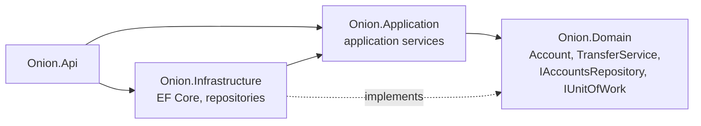

# Cheat sheet 2 · Onion

> **In one sentence**: concentric layers; the domain at the center, **every dependency points toward it**.

**Family**: code organization · **Origin**: Jeffrey Palermo, 2008 ·
**Demo**: [`02-Onion`](../../../02-Onion) (port 5102) · 📖 [Full page](../02-onion.md) ·
🌐 [Français](../../fiches/02-onion.md)

## Key points

- Same rule as hexagonal, but the **center is split**: domain model → domain services → application services.
- The data-access interfaces (`IAccountsRepository`, `IUnitOfWork`) live **in the domain**; the infrastructure implements them.
- The application service orchestrates: load, delegate to the domain, save (unit of work, all or nothing).

| ✅ When to use it | ❌ Less useful if |
|---|---|
| Rich business logic, with rules spanning several entities | Small application: lots of projects and interfaces |
| Need for a structured core and an explicit unit of work | Team that doesn't distinguish domain from application services |

**Pitfall**: the rules drift into the services → anemic model.

**Hexagonal or Onion?** Same rule; one stresses the ports around the core, the other the layers inside it.
Many ".NET Clean" projects are actually Onion.

---
⬅️ [Hexagonal](01-hexagonale.md) · [Cheat sheet index](README.md) · ➡️ [Clean](03-clean.md)
