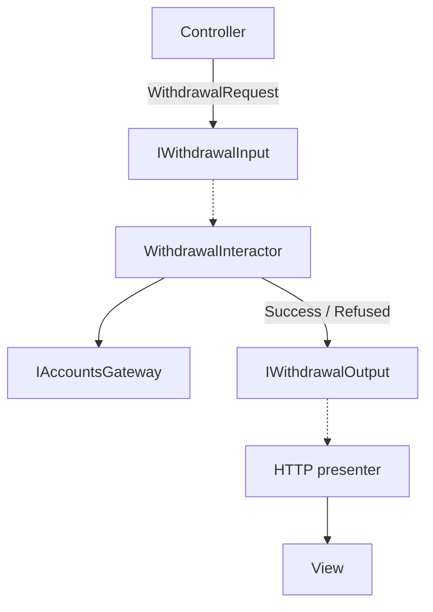

# Cheat sheet 3 · Clean Architecture

> **In one sentence**: one *interactor* per use case, explicit boundaries; it returns nothing and pushes its result
> to a *presenter*.

**Family**: code organization · **Origin**: Robert C. Martin, 2012 ·
**Demo**: [`03-Clean`](../../../03-Clean) (port 5103) · 📖 [Full page](../03-clean.md) ·
🌐 [Français](../../fiches/03-clean.md)

## Key points

- Four circles: **Entities → Use Cases → Interface Adapters → Frameworks & Drivers**.
- **Dependency rule**: a circle only knows the circles further in.
- Vocabulary: request / response model, input / output boundary, interactor, presenter, gateway.
- Dependency inversion also applies to the **output**: the interactor calls the presenter through an interface it defines.

| ✅ When to use it | ❌ Less useful if |
|---|---|
| Several presentations of the same use case | Simple web API: a stateful presenter feels unnatural in ASP.NET Core |
| Many use cases worth making explicit | Team that would apply it dogmatically |

**Pitfall**: the **ceremony** (6 types for one withdrawal). In practice, the .NET templates (Jason Taylor, Ardalis) keep
the circles and replace the presenter with a `Result<T>`.

**Compare**: the same withdrawal fits in one file with [Vertical Slice](05-vertical-slice.md).

---
⬅️ [Onion](02-onion.md) · [Cheat sheet index](README.md) · ➡️ [Functional Core](04-coeur-fonctionnel.md)
