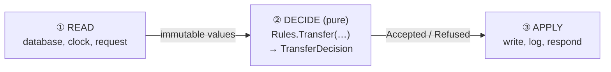

# Cheat sheet 4 · Functional Core, Imperative Shell

> **In one sentence**: **pure** rules that return a decision; a thin **shell** around them does all the input/output.

**Family**: code organization · **Origin**: Gary Bernhardt, "Boundaries", 2012 ·
**Demo**: [`04-FunctionalCore`](../../../04-FunctionalCore) (port 5104) · 📖 [Full page](../04-coeur-fonctionnel.md) ·
🌐 [Français](../../fiches/04-coeur-fonctionnel.md)

## Key points

- The core: no `async`, no interfaces, no database, no clock. **Values in, a decision out.**
- The shell: imperative, thin, **makes no decisions**.
- Decisions are **data**: they can be logged and replayed.
- Core tests: values → value, **without a single mock**, in milliseconds.

| ✅ When to use it | ❌ Hard if |
|---|---|
| Complex rules: pricing, eligibility, limits, calculations | The decision requires cascading reads |
| Inside any other architecture | The team isn't used to the functional style |

**Pitfall**: you have to **load everything before** deciding.

**Neighbors**: hexagonal taken to the extreme; the same "decide / apply" split is at the heart of
[Event Sourcing](10-event-sourcing.md).

---
⬅️ [Clean](03-clean.md) · [Cheat sheet index](README.md) · ➡️ [Vertical Slice](05-vertical-slice.md)
