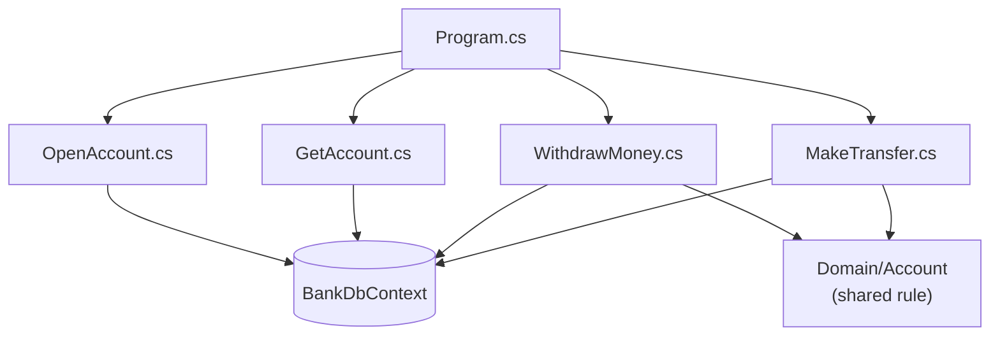

# Cheat sheet 5 · Vertical Slice

> **In one sentence**: code organized **by feature**; each slice contains everything, from the HTTP route down to the database.

**Family**: code organization · **Origin**: Jimmy Bogard, around 2018 ·
**Demo**: [`05-VerticalSlice`](../../../05-VerticalSlice) (port 5105) · 📖 [Full page](../05-vertical-slice.md) ·
🌐 [Français](../../fiches/05-vertical-slice.md)

## Key points

- One slice = one query or one command, in **one file**.
- **Tight coupling within** a slice, **loose coupling between** slices.
- Each slice picks its own technique (LINQ projection, entity, SQL…).
- No "just in case" abstractions: the `DbContext` already is a repository + unit of work. Only **shared** rules move up into `Domain/`.

| ✅ When to use it | ❌ Less suited if |
|---|---|
| Line-of-business APIs, delivered feature by feature | A database change is likely (the `DbContext` is everywhere) |
| Inside each module of a modular monolith | Team with little discipline about shared code |

**Pitfall**: duplication and bloated handlers if nothing is ever moved up. (MediatR has required a paid license for companies since 2025.)

**Neighbors**: the vertical axis continues with [Package by Component](06-composants.md) then [Modular Monolith](07-monolithe-modulaire.md).

---
⬅️ [Functional Core](04-coeur-fonctionnel.md) · [Cheat sheet index](README.md) · ➡️ [Package by Component](06-composants.md)
