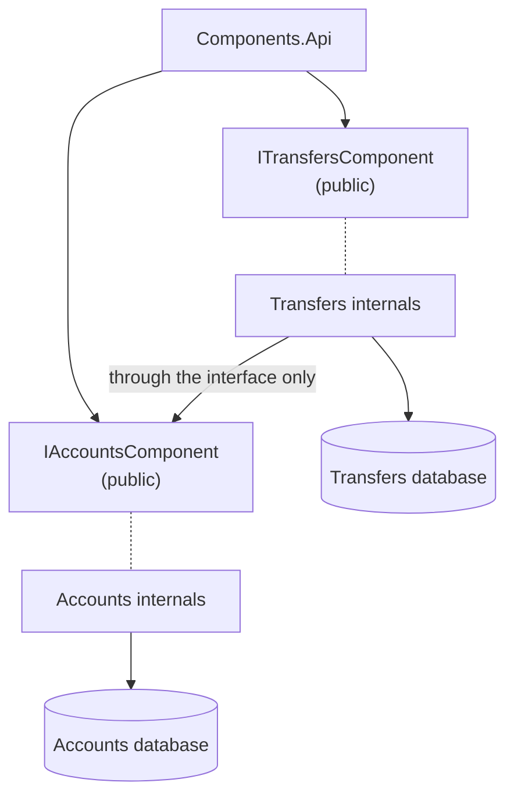

# Cheat sheet 6 · Package by Component

> **In one sentence**: a **single public interface** per component, everything else `internal`; the compiler enforces
> the architecture.

**Family**: system decomposition · **Origin**: Simon Brown, "The Missing Chapter" (*Clean Architecture*) ·
**Demo**: [`06-Components`](../../../06-Components) (port 5106) · 📖 [Full page](../06-composants.md) ·
🌐 [Français](../../fiches/06-composants.md)

## Key points

- Observation: if everything is `public`, nothing stops a controller from calling the repository directly.
- A component = business logic + data behind an interface; a shortcut **does not compile**.
- **One database per component**: Transfers never reads the Accounts tables.

| ✅ When to use it | ❌ Cost |
|---|---|
| Enforcing boundaries without tests or reviews | Designing good public interfaces takes care |
| Preparing a future modular monolith | No more shared transaction: compensation is needed |

**Takeaway**: an architecture protected by neither `internal` nor an architecture test (NetArchTest, ArchUnitNET)
always ends up bypassed.

**Next step**: components that also own their API and their events → [Modular Monolith](07-monolithe-modulaire.md).

---
⬅️ [Vertical Slice](05-vertical-slice.md) · [Cheat sheet index](README.md) · ➡️ [Modular Monolith](07-monolithe-modulaire.md)
