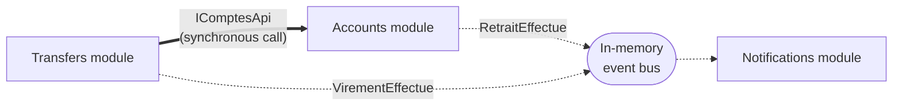

# Cheat sheet 7 · Modular Monolith

**French name**: *Monolithe modulaire*

> **In one sentence**: autonomous modules (API, database, events) connected by **contracts**, deployed together in
> a single process.

**Family**: system decomposition · **Origin**: popularized notably by Shopify ·
**Demo**: [`07-MonolitheModulaire`](../../../07-MonolitheModulaire) (port 5107) · 📖 [Full page](../07-monolithe-modulaire.md) ·
🌐 [Français](../../fiches/07-monolithe-modulaire.md)

## Key points

- A module = a mini-application (routes, database, subscriptions) plugged in with one line: `IModule[] modules = [...]`.
- Rules, checked by architecture tests:
  1. you only reference another module's **Contracts**, never its implementation;
  2. only the `IModule` class is public;
  3. contracts depend on no module;
  4. **one database per module**.

| ✅ When to use it | ❌ Limits |
|---|---|
| **Recommended starting point** for a growing system | Modules can't be scaled independently |
| Several subdomains, a single operations team | No transactions or joins across modules |

**Pitfall**: the in-memory bus loses events on a crash → [outbox](../concepts-transverses.md#outbox).
A bad split is expensive: find the boundaries with [DDD](11-ddd.md).

**Next step**: a module that must be deployed separately → its contracts become a network API → [Microservices](08-microservices.md).

---
⬅️ [Package by Component](06-composants.md) · [Cheat sheet index](README.md) · ➡️ [Microservices](08-microservices.md)
