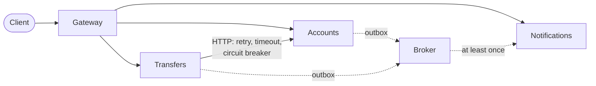

# Cheat sheet 8 · Microservices

> **In one sentence**: **one process per service**, one database each, deployable on its own; communication over the
> **network** (HTTP + messages), no shared code.

**Family**: system decomposition · **Demo**: [`08-Microservices`](../../../08-Microservices) (gateway 5200,
services 5201–5203, broker 5209; start everything with `Micro.Lanceur`) · 📖 [Full page](../08-microservices.md) ·
🌐 [Français](../../fiches/08-microservices.md)

## Key points

- Demo 7 cut into processes: method calls, transactions and in-memory events now go through **a network that can fail**.
- The contract is the **exchanged JSON**: no references between services.
- Mandatory mechanisms: **idempotency** (`operationId`, `Message-Id`), **outbox**, resilient client,
  **saga + compensation**, a gateway that hides the `/interne/…` routes.

| ✅ When to use it | ❌ Avoid if |
|---|---|
| Several teams, independent release cycles | A single team: the modular monolith is enough |
| Very different scaling needs | No operations tooling (tracing, monitoring) |

**Pitfall**: partial failures and eventual consistency everywhere; most of the code handles failures.

**In production**: RabbitMQ / Azure Service Bus, YARP, .NET Aspire or Kubernetes, OpenTelemetry.
Mechanisms: [cross-cutting concepts](../concepts-transverses.md).

---
⬅️ [Modular Monolith](07-monolithe-modulaire.md) · [Cheat sheet index](README.md) · ➡️ [CQRS](09-cqrs.md)
