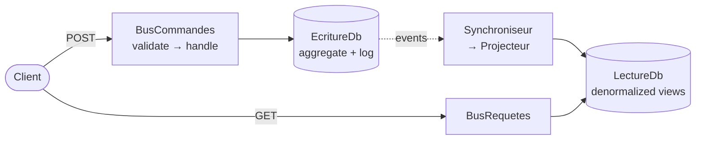

# Cheat sheet 9 · CQRS

> **In one sentence**: one model to **write** (the rules), another to **read** (views ready to display), connected
> by events.

**Family**: modeling · **Origin**: Greg Young, around 2010, after Bertrand Meyer's CQS ·
**Demo**: [`09-CQRS`](../../../09-CQRS) (port 5108) · 📖 [Full page](../09-cqrs.md) ·
🌐 [Français](../../fiches/09-cqrs.md)

## Key points

- Writing and reading have different needs: consistency and invariants on one side, speed and varied shapes on the other.
- A command returns nothing (or an identifier); a query changes nothing.
- The two sides **don't reference each other**: their only link is the events project.
- The views can be **rebuilt** from the events.

| ✅ When to use it | ❌ Overkill if |
|---|---|
| Reads far more numerous than, or very different from, writes | Simple CRUD |
| Screens that want precomputed views | Immediate consistency is required everywhere |

**Vocabulary traps**: CQRS **does not require two databases** (separating the models over one database is often enough);
CQRS **is not** Event Sourcing (here, the state is stored normally).

**Cost**: duplicated data, projections to maintain, eventual consistency to explain.

---
⬅️ [Microservices](08-microservices.md) · [Cheat sheet index](README.md) · ➡️ [Event Sourcing](10-event-sourcing.md)
