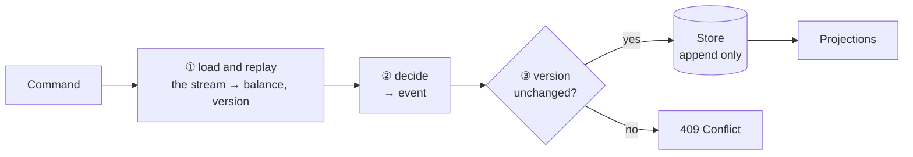

# Cheat sheet 10 · Event Sourcing

> **In one sentence**: you store the **sequence of events**, not the state; the state is recomputed by replaying them,
> and nothing is ever deleted.

**Family**: modeling · **Demo**: [`10-EventSourcing`](../../../10-EventSourcing) (port 5109; human-readable store:
`Es.Api\evenements.jsonl`) · 📖 [Full page (French)](../../10-event-sourcing.md) ·
🌐 [Français](../../fiches/10-event-sourcing.md)

## Key points

- The balance is only a **calculation** over the facts (opened, withdrawn, transferred…), as in accounting.
- Two-step aggregate: **decide** (rules → event) then **apply** (event → state).
- **Optimistic concurrency** by version number; **snapshots** to avoid replaying everything.
- **Upcasting** of old event versions; **Given / When / Then** tests.

| ✅ When to use it | ❌ Overkill if |
|---|---|
| History is business data: banking, accounting, insurance, audit | CRUD, or a module with no need for history |
| Time travel, new retroactive views | Team in a hurry: the learning curve is real |

**Pitfalls**: you correct with a **compensating** event; events are **versioned forever**;
**GDPR**: encrypt personal data and destroy the key.

**Neighbors**: almost always paired with [CQRS](09-cqrs.md) for reads. In production: EventStoreDB, Marten, Axon.

---
⬅️ [CQRS](09-cqrs.md) · [Cheat sheet index](README.md) · ➡️ [DDD](11-ddd.md)
