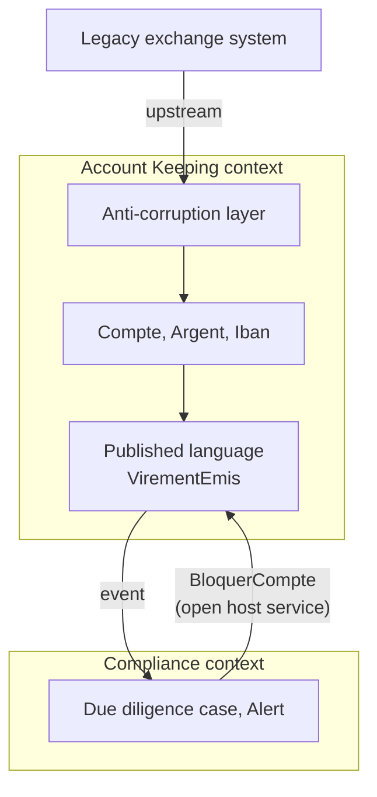

# Cheat sheet 11 · Domain-Driven Design (DDD)

> **In one sentence**: start from the business, speak **its** language, and let the model drive the code, both within a
> context (tactical) and between contexts (strategic).

**Family**: modeling · **Origin**: Eric Evans, *Domain-Driven Design*, 2003 ·
**Demo**: [`11-DDD`](../../../11-DDD) (port 5110, Onion base) · 📖 [Full page (French)](../../11-ddd.md) ·
🌐 [Français](../../fiches/11-ddd.md)

## Key points

- **Strategic**: bounded contexts (an "account" is not the same thing in Account Keeping and in Compliance),
  context map, published language, anti-corruption layer.
- **Tactical**: ubiquitous language (glossary `LANGAGE.md` = names in the code), **always-valid value objects**
  (`Iban`, `Argent`), aggregates, factories, domain services, repositories, domain events.
- It is **not a folder layout** but an approach, usable with Hexagonal, Onion or Clean.

| ✅ When to use it | ❌ Overkill if |
|---|---|
| Complex business, experts available | CRUD: a lot of ceremony |
| Finding **where to cut** modules and services | No access to domain experts |

**Pitfall**: reducing it to its tactical toolbox; splitting contexts is hard and expensive to fix.

**Links**: contexts → modules ([7](07-monolithe-modulaire.md)) or services ([8](08-microservices.md)); aggregates →
event streams ([10](10-event-sourcing.md)).

---
⬅️ [Event Sourcing](10-event-sourcing.md) · [Cheat sheet index](README.md) · ➡️ [Serverless](12-serverless.md)
