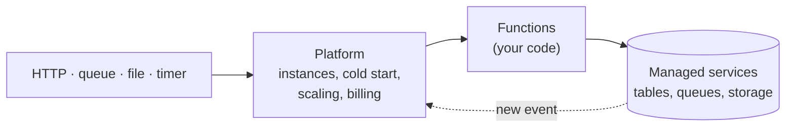

# Cheat sheet 12 · Serverless (FaaS)

> **In one sentence**: **stateless functions** run on demand when an **event** occurs, on servers managed by the
> provider, billed per use.

**Family**: system decomposition · **Origin**: AWS Lambda, 2014 ·
**Demo**: [`12-Serverless`](../../../12-Serverless) (port 5111, **simulated** platform) · 📖 [Full page](../12-serverless.md) ·
🌐 [Français](../../fiches/12-serverless.md)

## Key points

- "Serverless" = **no servers to manage**. You write short functions and a **manifest** (which function, which trigger).
- **Event-driven** loop: a function writes to a queue or to storage, which triggers another one.
- State lives only in **managed services** (concurrency via ETag); queues with a *poison* queue.
- In the demo, `Sls.Plateforme` plays the provider; only `Sls.Fonctions` would be written for real.

| ✅ When to use it | ❌ Avoid if |
|---|---|
| Files, messages, webhooks, scheduled jobs | Heavy constant load (high cost) |
| APIs with irregular traffic, "glue" between cloud services | Strict latency (cold starts), long-running work |

**Pitfalls**: **idempotency** is mandatory (multiple deliveries), provider lock-in, duration and memory limits.

**Going real**: Azure Functions (isolated worker) or AWS Lambda, Azurite / LocalStack, Durable Functions /
Step Functions to orchestrate.

---
⬅️ [DDD](11-ddd.md) · [Cheat sheet index](README.md) · ➡️ [Microkernel](13-microkernel.md)
