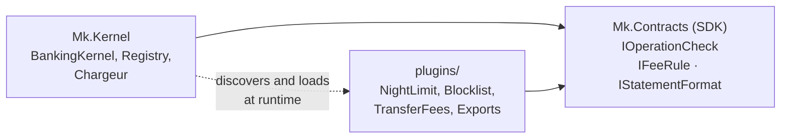

# Cheat sheet 13 · Microkernel (plug-ins)

> **In one sentence**: a **minimal core** that defines extension points; the variable features are **plug-ins**
> loaded, unloaded and updated at runtime.

**Family**: code organization · **Examples**: VS Code, Eclipse, web browsers, payroll software ·
**Demo**: [`13-Microkernel`](../../../13-Microkernel) (port 5112; build the solution first, `plugins/` is a build
output) · 📖 [Full page](../13-microkernel.md) · 🌐 [Français](../../fiches/13-microkernel.md)

## Key points

- The core references **no** plug-in; plug-ins only see the **SDK**.
- Three extension points: **reject** an operation, **add fees**, **produce a statement** (one DLL can contain several).
- One load context per plug-in: unloading is possible, settings come from `plugin.json`, the folder is watched.
- A faulty plug-in is set aside.

| ✅ When to use it | ❌ Be careful if |
|---|---|
| Product configurable per customer, country, offer | Unstable extension points: changing them breaks every plug-in |
| Rule engines, third-party extensions | Untrusted plug-ins: they run **in-process** |

**Pitfalls**: copying the SDK into the plug-in folder (incompatible types); holding a reference to a plug-in
(unloading becomes impossible); the SDK is a public contract to **version**.

**In .NET**: *McMaster.NETCore.Plugins* wraps this mechanism.

---
⬅️ [Serverless](12-serverless.md) · [Cheat sheet index](README.md) · ➡️ [Orchestrated Saga](14-saga-orchestree.md)
