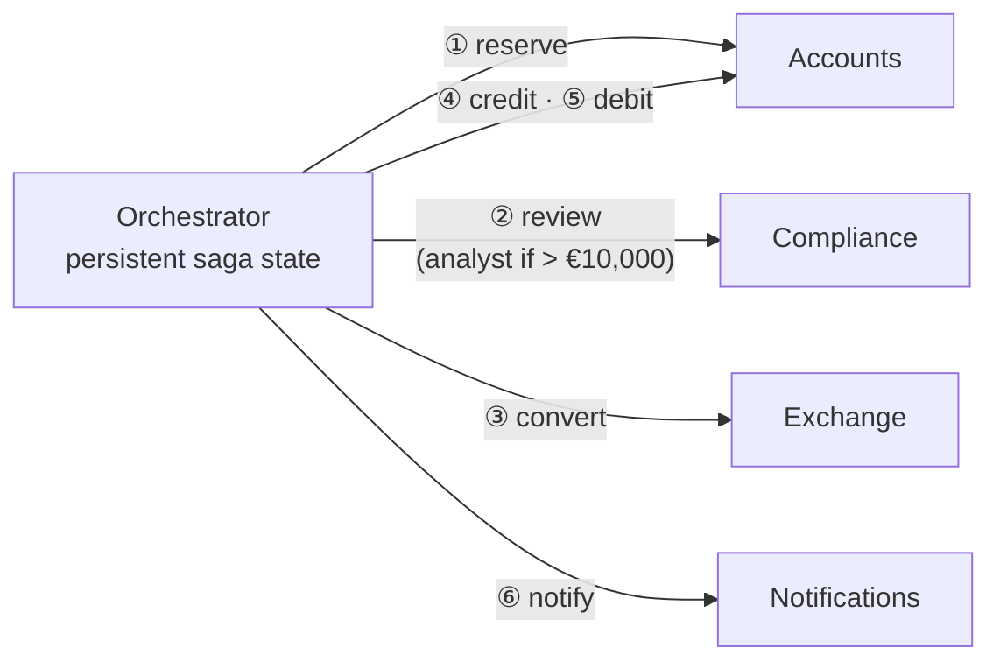

# Cheat sheet 14 · Orchestrated Saga

**French name**: *Saga orchestrée*

> **In one sentence**: an **orchestrator** drives a process spread over several services, remembers where it stands,
> retries, waits, and **compensates** in reverse order when needed.

**Family**: system decomposition · **Origin**: sagas, Garcia-Molina and Salem, 1987 ·
**Demo**: [`14-OrchestratedSaga`](../../../14-OrchestratedSaga) (port 5113) · 📖 [Full page](../14-saga-orchestree.md) ·
🌐 [Français](../../fiches/14-saga-orchestree.md)

## Key points

- Several services = no single transaction: local steps + **compensations**.
- The process is **written in one place**; the state and history of each saga can be inspected.
- The engine handles **retries, (human) waits, deadlines, compensation** and recovery after a crash.
- Rule of thumb: choreography to **notify**, orchestration to **drive**.

| ✅ When to use it | ❌ Watch out for |
|---|---|
| Long multi-step processes: order, international transfer, subscription | The orchestrator knows every participant (coupling) |
| Human waits, timeouts, precise failure rules | One more component to make highly available |

**Pitfalls**: participants **must be idempotent**; the "bloated conductor" that absorbs the participants' business logic.

**In production**: don't write your own engine → Temporal, Durable Functions, Step Functions, MassTransit / NServiceBus sagas.
Compare with [Choreography](21-choregraphie.md) (same transfer).

---
⬅️ [Microkernel](13-microkernel.md) · [Cheat sheet index](README.md) · ➡️ [Multi-tenant](15-multi-tenant.md)
