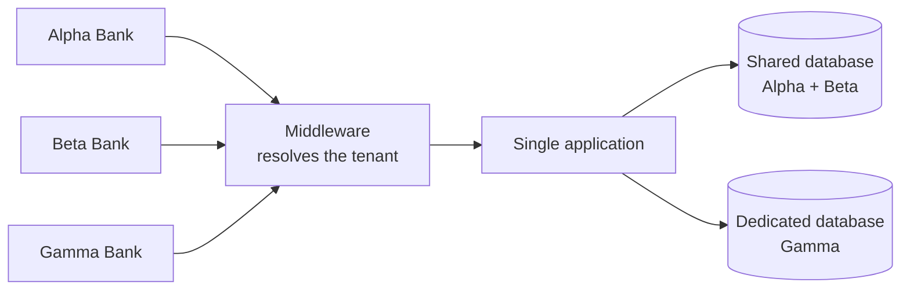

# Cheat sheet 15 · Multi-tenant (SaaS)

> **In one sentence**: **one** application, **one** deployment, for **several customers** (tenants), each with its own
> data, rules and quotas, never seeing anyone else's.

**Family**: system decomposition · **Demo**: [`15-MultiTenant`](../../../15-MultiTenant) (port 5114; tenant from
the subdomain `beta.localhost:5114` or the `X-Locataire` header) · 📖 [Full page](../15-multi-tenant.md) ·
🌐 [Français](../../fiches/15-multi-tenant.md)

## Key points

- The tenant is resolved **once** (middleware) and then **ambient** (`ContexteLocataire`).
- Safeguards: EF Core **global filter**, automatic **stamping** on write, **composite key** (tenant + id).
- Plans: shared database by default, **dedicated database** for those who pay for it; quotas against the **noisy neighbor**.
- `Mt.Locataires` contains no banking logic: the business code is written as if for a single bank.

| ✅ When to use it | ❌ Cost |
|---|---|
| The same software sold to several organizations (B2B SaaS) | One isolation bug exposes **every** customer |
| A new customer in seconds, a single version | Migrations and backups across N dedicated databases |

**Pitfall**: every request, background job, cache and log must **carry the tenant**.

**In production**: tenant taken from authentication, Finbuckle.MultiTenant, *Row-Level Security* as a second barrier.

---
⬅️ [Orchestrated Saga](14-saga-orchestree.md) · [Cheat sheet index](README.md) · ➡️ [BFF](16-bff.md)
