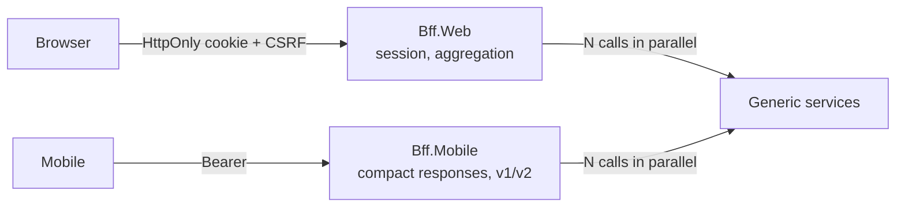

# Cheat sheet 16 · Backend for Frontend (BFF)

> **In one sentence**: **one backend per client application**, written by its team, that assembles the generic services
> into responses tailored to its screens and handles security its own way.

**Family**: system decomposition · **Origin**: SoundCloud, popularized by Sam Newman ·
**Demo**: [`16-BFF`](../../../16-BFF) (web BFF 5115, mobile BFF 5116, services 5210; `alice / demo`) · 📖 [Full page](../16-bff.md) ·
🌐 [Français](../../fiches/16-bff.md)

## Key points

- Without a BFF: the client chains calls (slow on mobile) or the services add per-screen routes.
- One call per screen; the BFF calls the services **in parallel** and degrades gracefully if one is down.
- On the web, the **token stays on the server** (session + HttpOnly cookie).
- BFFs don't reference each other: contracts are **copied**, only the useful fields (tolerant reader).

| ✅ When to use it | ❌ Pointless if |
|---|---|
| Several client applications with different needs | A single application, a single backend (it **is** its BFF) |
| Single-page application that must not handle tokens | |

**Pitfalls**: sneaking **business rules** into it (they stay in the services, which also check permissions);
sessions to share between instances; intended duplication, to be accepted.

**In production**: Duende BFF, YARP, OpenID Connect. Alternative: [GraphQL](23-rest-grpc-graphql.md) in front of the applications.

---
⬅️ [Multi-tenant](15-multi-tenant.md) · [Cheat sheet index](README.md) · ➡️ [Cells](17-cell-based.md)
