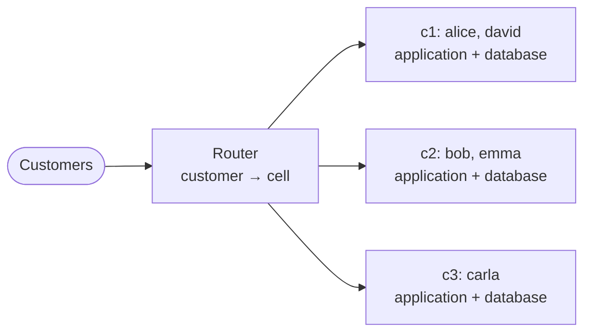

# Cheat sheet 17 · Cell-Based Architecture

**French name**: *Architecture cellulaire*

> **In one sentence**: several **complete, independent copies** of the system, each serving part of the customers;
> a failure stays **locked inside its cell**.

**Family**: system decomposition · **Demo**: [`17-CellBased`](../../../17-CellBased) (router 5117, cells 5231–5234;
start everything with `Cell.Launcher`) · 📖 [Full page](../17-cell-based.md) ·
🌐 [Français](../../fiches/17-cell-based.md)

## Key points

- Goal: **bound the blast radius** (failure, bad deployment, greedy customer). 50 cells → an incident hits 2% of customers.
- Each cell contains **everything** and doesn't depend on the others.
- The router only **routes** (partition key → cell); a control plane places and moves customers.
- Deployment **in waves**: the first cell acts as the canary.

| | Splits… | A failure hits… |
|---|---|---|
| Microservices | by function | one function, for everyone |
| **Cells** | by group of customers | everything, for one group |

| ✅ When to use it | ❌ Overkill if |
|---|---|
| Very large scale: a global outage costs more than N copies | Most systems: availability zones + progressive rollouts are enough |
| Natural partition key (the customer) | Lots of exchanges between customers |

**Pitfalls**: **cross-cell** operations are slow and need compensation; a partition key commits you for a long time;
customer migrations; a router that must be highly available.

---
⬅️ [BFF](16-bff.md) · [Cheat sheet index](README.md) · ➡️ [Actors](18-modele-acteurs.md)
