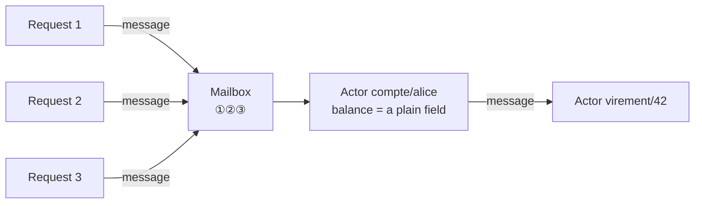

# Cheat sheet 18 · Actor Model

**French name**: *Modèle d'acteurs*

> **In one sentence**: thousands of actors with **private state**, communicating only **through messages** handled **one
> at a time**; no locks, and an actor that crashes is **replaced**.

**Family**: system decomposition · **Origin**: Carl Hewitt, 1973; popularized by Erlang ·
**Demo**: [`18-ActorModel`](../../../18-ActorModel) (port 5118; `/system` to observe and trigger failures) ·
📖 [Full page](../18-modele-acteurs.md) · 🌐 [Français](../../fiches/18-modele-acteurs.md)

## Key points

- **Every piece of data has a single owner**; safety is structural, not a matter of discipline.
- An actor can: change **its own** state, **send** messages, **create** actors (here *virtual* ones: you address them, the runtime creates them).
- **Different** actors work in parallel on all cores.
- On a failure, the **supervisor** replaces the actor, which reloads its durable state.

| ✅ When to use it | ❌ Less suited if |
|---|---|
| Many independent entities whose state is often modified concurrently: games, IoT, sessions, accounts | Cross-cutting queries over relational data |
| Scaling across several machines | Transactions between entities are needed |

**Pitfalls**: no transactions between actors (steps, idempotency, compensation); **request cycles =
deadlocks**; a heavily solicited actor becomes a bottleneck; cross-cutting reads → a separate view.

**In .NET**: Orleans (virtual actors), Akka.NET or Proto.Actor (fine-grained supervision).

---
⬅️ [Cells](17-cell-based.md) · [Cheat sheet index](README.md) · ➡️ [Space-based](19-space-based.md)
