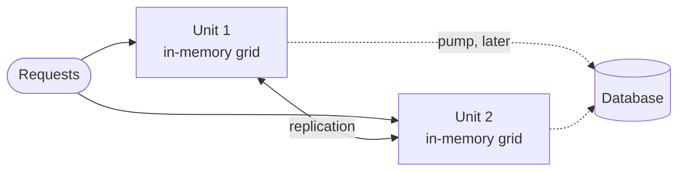

# Cheat sheet 19 · Space-Based Architecture

**French name**: *Architecture spatiale*

> **In one sentence**: the database leaves the request path; each **processing unit** keeps **all the data in
> memory**, replicated between units, and the database is updated in the background.

**Family**: system decomposition · **Origin**: *tuple spaces*; described notably by Mark Richards ·
**Demo**: [`19-SpaceBased`](../../../19-SpaceBased) (port 5119; `/grid` to observe and trigger failures) ·
📖 [Full page](../19-space-based.md) · 🌐 [Français](../../fiches/19-space-based.md)

## Key points

- A request only touches **memory**; the database is now just a **deferred backup**.
- **Elasticity**: a unit starts by copying another unit's grid; units are added and removed with the load.
- Safeguards: **versions** on every item and **affinity routing** (same key → same unit) to limit collisions.
- The database can go down without interrupting the service.

| ✅ When to use it | ❌ Avoid if |
|---|---|
| Huge, unpredictable peaks: ticketing, auctions, bookings, games | Large data volumes (everything must fit in memory) |
| Data written mostly by key | A database that must be up to date at all times (accounting, real-time reports) |

**Pitfalls**: **collisions**: accepted writes can be lost; the database lags behind for other systems;
complex to test and operate. A poor choice for real balances: the demo uses them to **show** the collisions.

---
⬅️ [Actors](18-modele-acteurs.md) · [Cheat sheet index](README.md) · ➡️ [Pipeline](20-pipeline.md)
