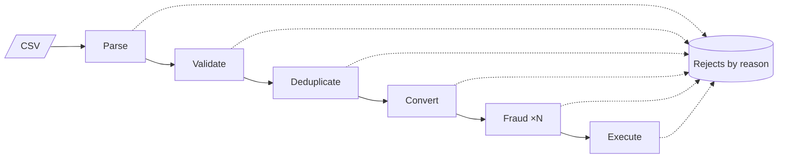

# Cheat sheet 20 · Pipeline (pipes & filters)

> **In one sentence**: independent **filters** connected by **bounded pipes**, all working **at the same time** on a
> stream of data, like an assembly line.

**Family**: code organization · **Examples**: Unix shell, compilers, ETL ·
**Demo**: [`20-Pipeline`](../../../20-Pipeline) (port 5120; `POST /imports` of a CSV file of transfers) ·
📖 [Full page](../20-pipeline.md) · 🌐 [Français](../../fiches/20-pipeline.md)

## Key points

- A filter knows neither its source nor its destination: it receives, produces or **rejects** (with a reason).
- A pipe is **bounded**: when full, it makes the previous stage wait (**back-pressure**) → bounded memory, whatever the file size.
- All stages work in parallel; to go faster, find the **bottleneck** and parallelize **that** stage only.
- Types checked at assembly; metrics per stage.

| ✅ When to use it | ❌ Not for |
|---|---|
| Imports / exports, ETL, batches (payroll, invoicing), event streams, media | A whole interactive application |
| Any sequence of independent steps over data | Steps that need the whole data set |

**Pitfalls**: throughput is that of the slowest stage; **stateful** filters (deduplication, execution) stay single and
keep the order; a failure halfway leaves partial work → **idempotent** recovery.

**Takeaway**: a pipeline lives **inside** a service or a module, itself organized according to another cheat sheet.

---
⬅️ [Space-based](19-space-based.md) · [Cheat sheet index](README.md) · ➡️ [Choreography](21-choregraphie.md)
