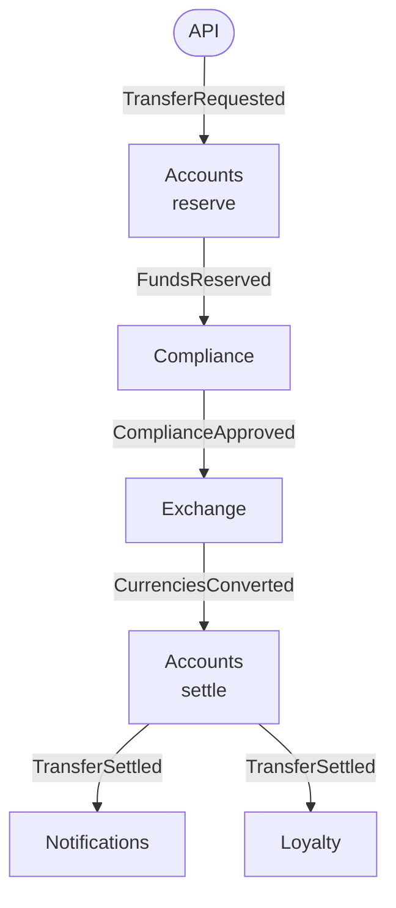

# Cheat sheet 21 · Event-Driven Choreography

**French name**: *Chorégraphie (événementiel pur)*

> **In one sentence**: no service drives the process; each one **reacts to the events** of the others and publishes its
> own.

**Family**: system decomposition · **Demo**: [`21-Choreography`](../../../21-Choreography) (port 5121; `/bus` and
`/chaos` to observe and break things) · 📖 [Full page](../21-choregraphie.md) ·
🌐 [Français](../../fiches/21-choregraphie.md)

## Key points

- The same transfer as the [orchestrated saga](14-saga-orchestree.md), but the process is **written nowhere**: it emerges from the subscriptions.
- A service only knows **event contracts** (architecture test: no service references another).
- Adding a reaction = **subscribing**, without touching the others.
- "Where is transfer 42?" → a **projection** to build (the Tracking).

| ✅ When to use it | ❌ Prefer orchestration if |
|---|---|
| **Reactions** to a fact: notify, bill, archive, synchronize | Many steps, waits, timeouts, failure rules |
| Short, stable processes with few participants | The process must be easy to read and change |

**Pitfalls**: compensations and timeouts are **scattered**; a failure shows up as **silence** (monitor dead letters
and stuck transfers); single point of failure: the broker.

**Common combination**: an orchestrator drives, and publishes events that others choreograph.

---
⬅️ [Pipeline](20-pipeline.md) · [Cheat sheet index](README.md) · ➡️ [Strangler Fig](22-strangler-fig.md)
