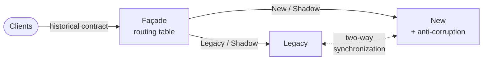

# Cheat sheet 22 · Strangler Fig (progressive migration)

> **In one sentence**: a **façade** in front of the legacy system takes its features away **one route at a time** in
> favor of the new one, until the legacy can be switched off.

**Family**: migration · **Origin**: Martin Fowler, 2004 ·
**Demo**: [`22-StranglerFig`](../../../22-StranglerFig) (façade 5122, legacy 5240, new 5241) · 📖 [Full page](../22-strangler-fig.md) ·
🌐 [Français](../../fiches/22-strangler-fig.md)

## Key points

- Each route has a mode: **Legacy**, **Shadow** (the legacy answers, the new one is called and compared), **New**.
- The routing table can be changed **live**: every step can be undone **with one request**; anything undeclared stays on the legacy.
- The new system has its own model and database, behind an **anti-corruption layer**, and reproduces the historical contract exactly.
- No project references the legacy: when the day comes, you delete its project and the anti-corruption layer.

| ✅ When to use it | ❌ Less useful if |
|---|---|
| A production system that can be neither stopped nor frozen | Small system rewritten in a few weeks |
| Features that can be split into routes, screens or messages | No entry point to intercept |

**Pitfalls**: synchronization (loops, failures, lag); switch data over **in consistent blocks**;
the legacy contract must be reproduced, quirks included; a migration stopped at 80% = the worst of both worlds.

**In production**: YARP, Debezium, Scientist / Diffy for shadowing, feature flags.

---
⬅️ [Choreography](21-choregraphie.md) · [Cheat sheet index](README.md) · ➡️ [REST, gRPC, GraphQL](23-rest-grpc-graphql.md)
